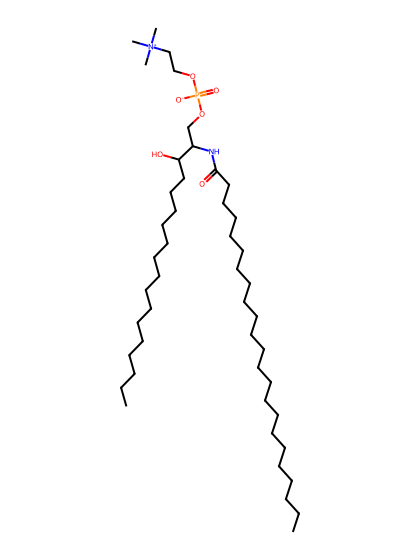
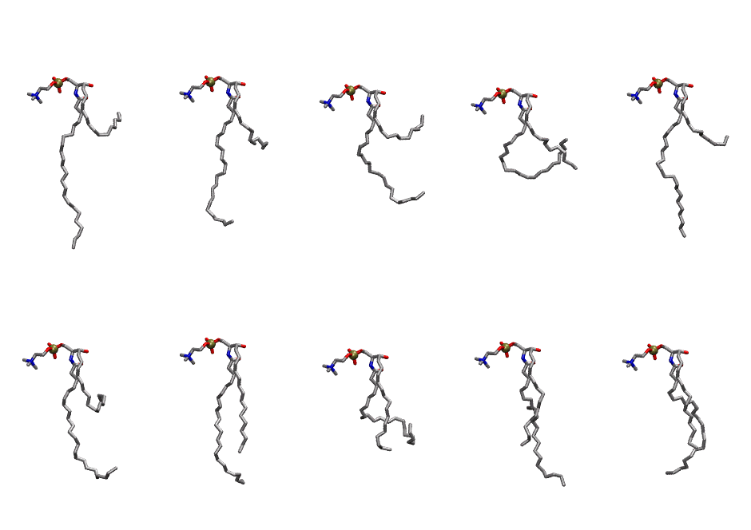
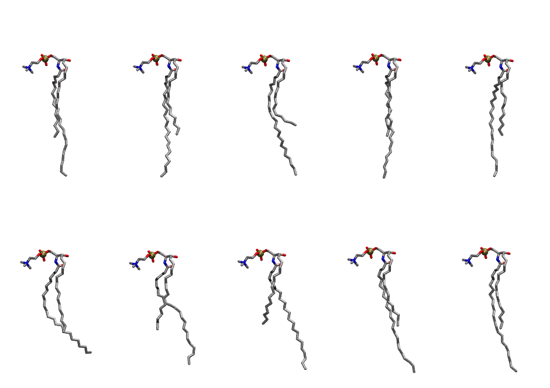

.. _lipid_gallery 23sm:

23SM
====

**sphingomyelin d18:1/23:0**

==============  ==========================================
CHARMM resname  ``23SM``
Net charge      0.00
Atoms           148
Topology file   ``toppar_all36_lipid_sphingo.str``
Conformers      10 fluid, 10 liquid-ordered (``23SM__Lo``)
==============  ==========================================

Structure
---------

Conformers
----------

The grid packer draws a conformer per lipid from an ensemble, so what the ensemble contains is what a built bilayer is made of. 23SM ships two: a fluid one, used by default, and a liquid-ordered one, used for a leaflet declared ``phase: Lo``. All conformers on this page are rendered at one shared scale.

Fluid (``23SM``)
~~~~~~~~~~~~~~~~

===========  =============  ================
Conformer    Head-tail (Å)  Max internal (Å)
===========  =============  ================
``23SM-00``  2.94           29.95
``23SM-01``  8.64           26.68
``23SM-02``  1.75           25.20
``23SM-03``  5.21           22.41
``23SM-04``  6.48           29.34
``23SM-05``  6.21           26.19
``23SM-06``  15.66          27.38
``23SM-07``  9.24           22.11
``23SM-08``  13.87          28.73
``23SM-09``  13.94          25.31
===========  =============  ================

Liquid-ordered (``23SM__Lo``)
~~~~~~~~~~~~~~~~~~~~~~~~~~~~~

===========  =============  ================
Conformer    Head-tail (Å)  Max internal (Å)
===========  =============  ================
``23SM-00``  15.45          29.54
``23SM-01``  14.93          29.80
``23SM-02``  12.70          31.20
``23SM-03``  15.35          29.65
``23SM-04``  14.93          29.77
``23SM-05``  15.40          29.23
``23SM-06``  14.54          28.89
``23SM-07``  13.64          30.98
``23SM-08``  14.58          31.73
``23SM-09``  15.09          30.31
===========  =============  ================

Provenance
----------

How each ensemble was generated, read from the entry's own ``info.yaml``:

===================  ============  ============
Setting              ``23SM``      ``23SM__Lo``
===================  ============  ============
Sampler              ``mc``        ``mc``
Phase                none (fluid)  Lo
Trans bias           0.0           7.5
Chain order          0.157         0.306
MC seed              0             0
Chains               2             2
Cylinder APL         60.0 Ų       60.0 Ų
Cylinder inflation   1.9           1.9
Equilibration steps  20000         20000
Decorrelation steps  3000          3000
Max MC angle         30°           30°
Radius scale         0.8           0.8
Axial bias           1.0           1.0
===================  ============  ============
