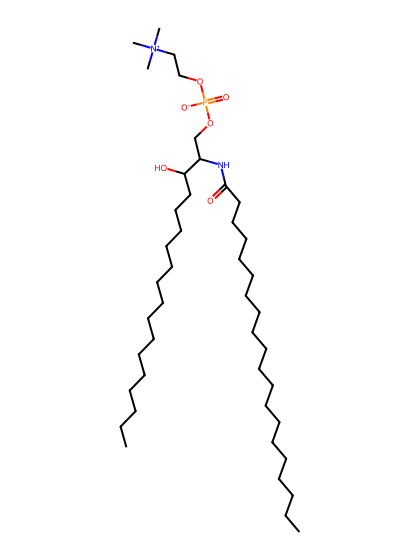
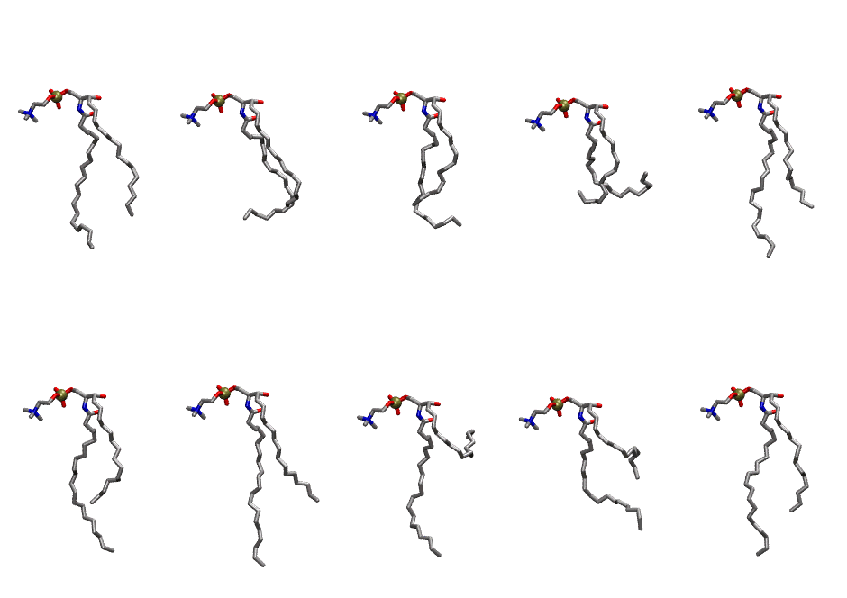
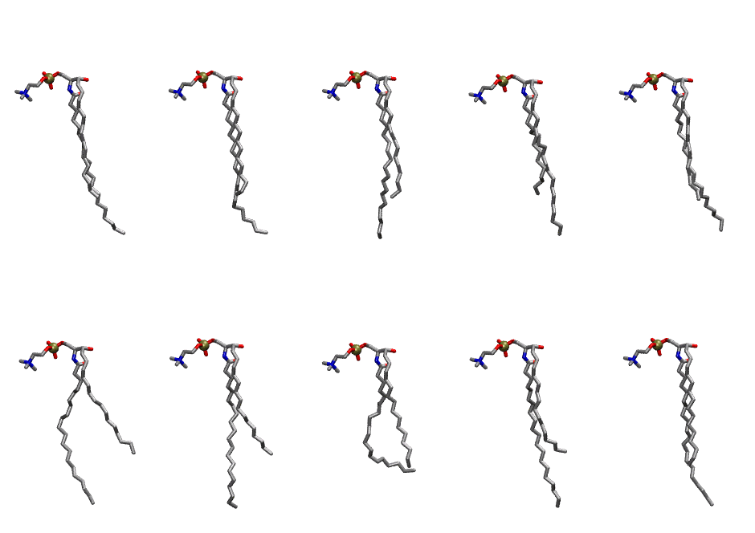

.. _lipid_gallery asm:

ASM
===

**sphingomyelin d18:1/20:0**

==============  =========================================
CHARMM resname  ``ASM``
Net charge      0.00
Atoms           139
Topology file   ``toppar_all36_lipid_sphingo.str``
Conformers      10 fluid, 10 liquid-ordered (``ASM__Lo``)
==============  =========================================

Structure
---------

Conformers
----------

The grid packer draws a conformer per lipid from an ensemble, so what the ensemble contains is what a built bilayer is made of. ASM ships two: a fluid one, used by default, and a liquid-ordered one, used for a leaflet declared ``phase: Lo``. All conformers on this page are rendered at one shared scale.

Fluid (``ASM``)
~~~~~~~~~~~~~~~

==========  =============  ================
Conformer   Head-tail (Å)  Max internal (Å)
==========  =============  ================
``ASM-00``  13.54          23.20
``ASM-01``  11.73          22.24
``ASM-02``  11.90          22.02
``ASM-03``  6.85           21.60
``ASM-04``  12.63          24.35
``ASM-05``  12.12          25.61
``ASM-06``  12.09          26.08
``ASM-07``  2.34           23.72
``ASM-08``  7.52           23.38
``ASM-09``  13.26          24.35
==========  =============  ================

Liquid-ordered (``ASM__Lo``)
~~~~~~~~~~~~~~~~~~~~~~~~~~~~

==========  =============  ================
Conformer   Head-tail (Å)  Max internal (Å)
==========  =============  ================
``ASM-00``  15.55          29.41
``ASM-01``  15.30          28.34
``ASM-02``  15.66          28.55
``ASM-03``  14.63          28.27
``ASM-04``  15.75          28.72
``ASM-05``  13.52          26.50
``ASM-06``  14.06          27.51
``ASM-07``  15.23          24.73
``ASM-08``  13.57          28.72
``ASM-09``  15.71          28.23
==========  =============  ================

Provenance
----------

How each ensemble was generated, read from the entry's own ``info.yaml``:

===================  ============  ===========
Setting              ``ASM``       ``ASM__Lo``
===================  ============  ===========
Sampler              ``mc``        ``mc``
Phase                none (fluid)  Lo
Trans bias           0.0           5.0
Chain order          0.152         0.300
MC seed              0             0
Chains               2             2
Cylinder APL         60.0 Ų       60.0 Ų
Cylinder inflation   1.9           1.9
Equilibration steps  20000         20000
Decorrelation steps  3000          3000
Max MC angle         30°           30°
Radius scale         0.8           0.8
Axial bias           1.0           1.0
===================  ============  ===========
