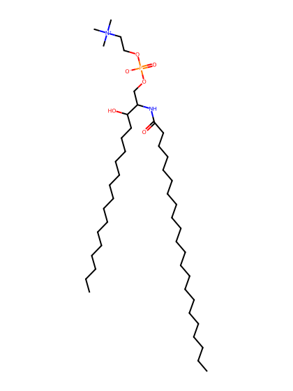
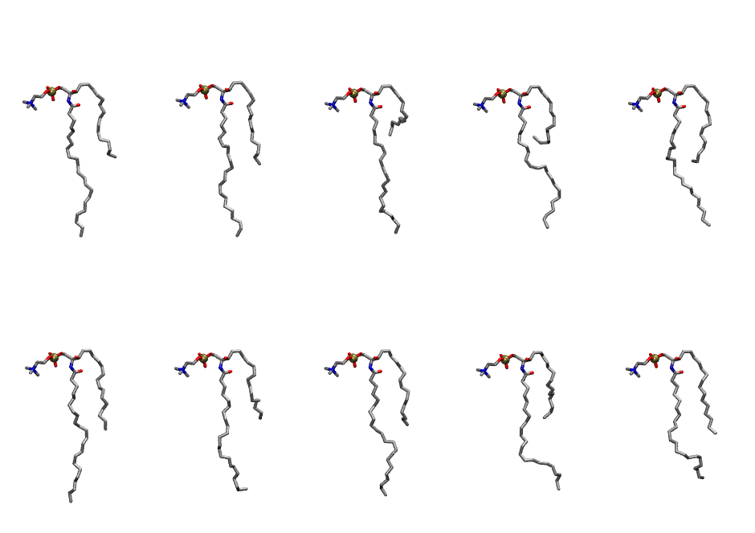
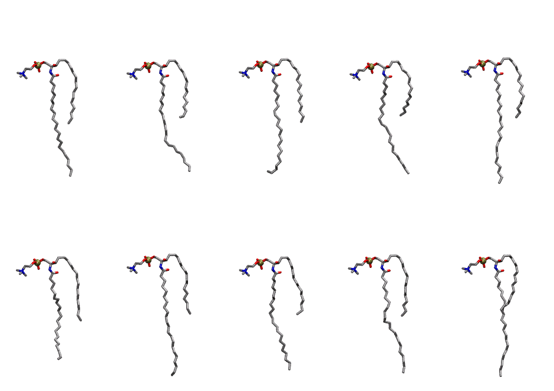

.. _lipid_gallery bsm:

BSM
===

**sphingomyelin d18:1/22:0**

==============  =========================================
CHARMM resname  ``BSM``
Net charge      0.00
Atoms           145
Topology file   ``toppar_all36_lipid_sphingo.str``
Conformers      10 fluid, 10 liquid-ordered (``BSM__Lo``)
==============  =========================================

Structure
---------

Conformers
----------

The grid packer draws a conformer per lipid from an ensemble, so what the ensemble contains is what a built bilayer is made of. BSM ships two: a fluid one, used by default, and a liquid-ordered one, used for a leaflet declared ``phase: Lo``. All conformers on this page are rendered at one shared scale.

Fluid (``BSM``)
~~~~~~~~~~~~~~~

==========  =============  ================
Conformer   Head-tail (Å)  Max internal (Å)
==========  =============  ================
``BSM-00``  9.27           28.91
``BSM-01``  10.83          29.39
``BSM-02``  5.02           29.13
``BSM-03``  5.33           27.26
``BSM-04``  9.74           28.16
``BSM-05``  10.36          29.59
``BSM-06``  8.32           28.05
``BSM-07``  9.49           27.76
``BSM-08``  8.00           27.45
``BSM-09``  10.92          26.25
==========  =============  ================

Liquid-ordered (``BSM__Lo``)
~~~~~~~~~~~~~~~~~~~~~~~~~~~~

==========  =============  ================
Conformer   Head-tail (Å)  Max internal (Å)
==========  =============  ================
``BSM-00``  11.68          31.10
``BSM-01``  10.09          30.02
``BSM-02``  11.51          29.83
``BSM-03``  9.42           29.90
``BSM-04``  10.63          31.98
``BSM-05``  11.64          26.59
``BSM-06``  10.65          31.77
``BSM-07``  10.14          30.26
``BSM-08``  10.94          30.71
``BSM-09``  9.91           31.08
==========  =============  ================

Provenance
----------

How each ensemble was generated, read from the entry's own ``info.yaml``:

===================  ============  ===========
Setting              ``BSM``       ``BSM__Lo``
===================  ============  ===========
Sampler              ``mc``        ``mc``
Phase                none (fluid)  Lo
Trans bias           0.0           5.0
Chain order          0.200         0.298
MC seed              0             0
Chains               2             2
Cylinder APL         60.0 Ų       60.0 Ų
Cylinder inflation   1.9           1.9
Equilibration steps  20000         20000
Decorrelation steps  3000          3000
Max MC angle         30°           30°
Radius scale         0.8           0.8
Axial bias           1.0           1.0
===================  ============  ===========
