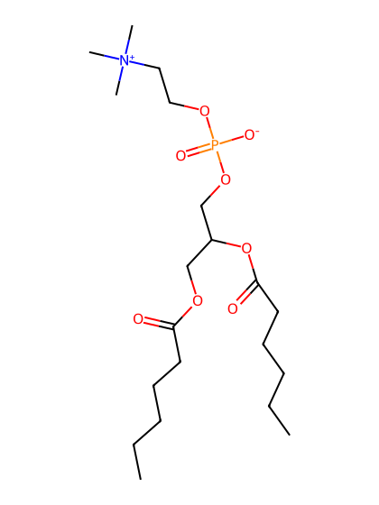
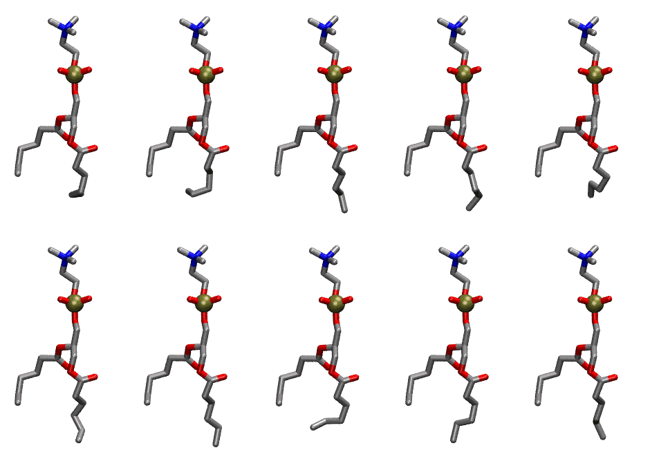

.. _lipid_gallery c6dhpc:

C6DHPC
======

**1,2-dihexanoyl-sn-glycero-3-phosphocholine**

==============  ====================================
CHARMM resname  ``C6DHPC``
Net charge      0.00
Atoms           70
Topology file   ``toppar_all36_lipid_detergent.str``
Conformers      10 fluid
==============  ====================================

Structure
---------

Conformers
----------

The grid packer draws a conformer per lipid from this ensemble, so what the ensemble contains is what a built bilayer is made of. A leaflet declared ``phase: Lo`` generates an ordered ensemble when a build first needs it. All conformers are rendered at one shared scale.

=============  =============  ================
Conformer      Head-tail (Å)  Max internal (Å)
=============  =============  ================
``C6DHPC-00``  8.86           17.67
``C6DHPC-01``  8.86           17.68
``C6DHPC-02``  8.86           18.68
``C6DHPC-03``  8.86           18.73
``C6DHPC-04``  8.86           17.66
``C6DHPC-05``  8.86           19.10
``C6DHPC-06``  8.86           19.24
``C6DHPC-07``  8.86           18.08
``C6DHPC-08``  8.86           18.63
``C6DHPC-09``  8.86           18.64
=============  =============  ================

Provenance
----------

How the ensemble was generated, read from the entry's own ``info.yaml``:

===================  ============
Setting              ``C6DHPC``
===================  ============
Sampler              ``mc``
Phase                none (fluid)
Trans bias           0.0
Chain order          0.140
MC seed              0
Chains               0
Cylinder APL         30.0 Ų
Cylinder inflation   1.9
Equilibration steps  20000
Decorrelation steps  3000
Max MC angle         30°
Radius scale         0.8
Axial bias           1.0
===================  ============
