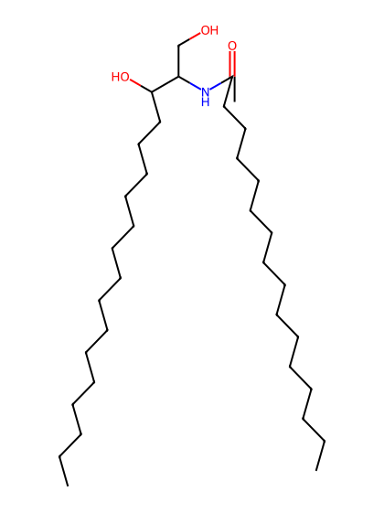
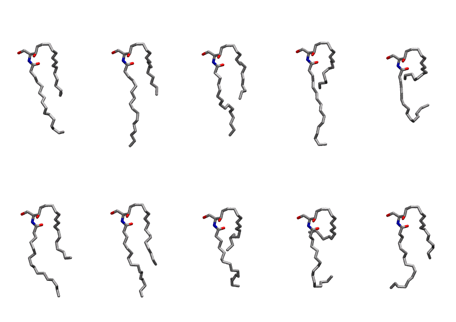
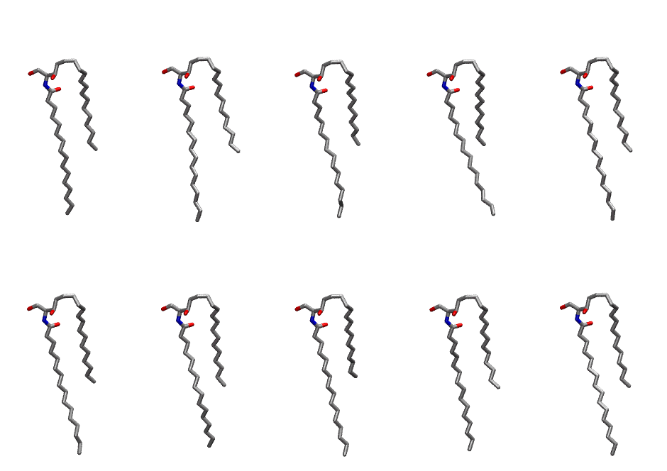

.. _lipid_gallery cer160:

CER160
======

**CERAMIDE d18:1/16:0**

==============  ============================================
CHARMM resname  ``CER160``
Net charge      0.00
Atoms           105
Topology file   ``toppar_all36_lipid_sphingo.str``
Conformers      10 fluid, 10 liquid-ordered (``CER160__Lo``)
==============  ============================================

Structure
---------

Conformers
----------

The grid packer draws a conformer per lipid from an ensemble, so what the ensemble contains is what a built bilayer is made of. CER160 ships two: a fluid one, used by default, and a liquid-ordered one, used for a leaflet declared ``phase: Lo``. All conformers on this page are rendered at one shared scale.

Fluid (``CER160``)
~~~~~~~~~~~~~~~~~~

=============  =============  ================
Conformer      Head-tail (Å)  Max internal (Å)
=============  =============  ================
``CER160-00``  6.19           21.16
``CER160-01``  6.50           23.86
``CER160-02``  7.06           23.04
``CER160-03``  5.38           23.30
``CER160-04``  2.16           17.27
``CER160-05``  6.91           21.44
``CER160-06``  8.47           22.00
``CER160-07``  4.59           20.64
``CER160-08``  0.77           20.01
``CER160-09``  6.71           20.51
=============  =============  ================

Liquid-ordered (``CER160__Lo``)
~~~~~~~~~~~~~~~~~~~~~~~~~~~~~~~

=============  =============  ================
Conformer      Head-tail (Å)  Max internal (Å)
=============  =============  ================
``CER160-00``  8.59           25.56
``CER160-01``  9.14           25.11
``CER160-02``  7.70           25.11
``CER160-03``  7.79           23.98
``CER160-04``  9.02           24.93
``CER160-05``  8.21           25.02
``CER160-06``  8.66           24.95
``CER160-07``  7.40           25.17
``CER160-08``  8.91           25.47
``CER160-09``  9.02           24.64
=============  =============  ================

Provenance
----------

How each ensemble was generated, read from the entry's own ``info.yaml``:

===================  ============  ==============
Setting              ``CER160``    ``CER160__Lo``
===================  ============  ==============
Sampler              ``mc``        ``mc``
Phase                none (fluid)  Lo
Trans bias           0.0           40.0
Chain order          0.126         0.277
MC seed              0             0
Chains               2             2
Cylinder APL         60.0 Ų       60.0 Ų
Cylinder inflation   1.9           1.9
Equilibration steps  20000         20000
Decorrelation steps  3000          3000
Max MC angle         30°           30°
Radius scale         0.8           0.8
Axial bias           1.0           1.0
===================  ============  ==============
