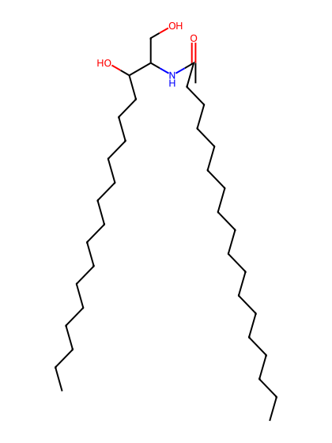
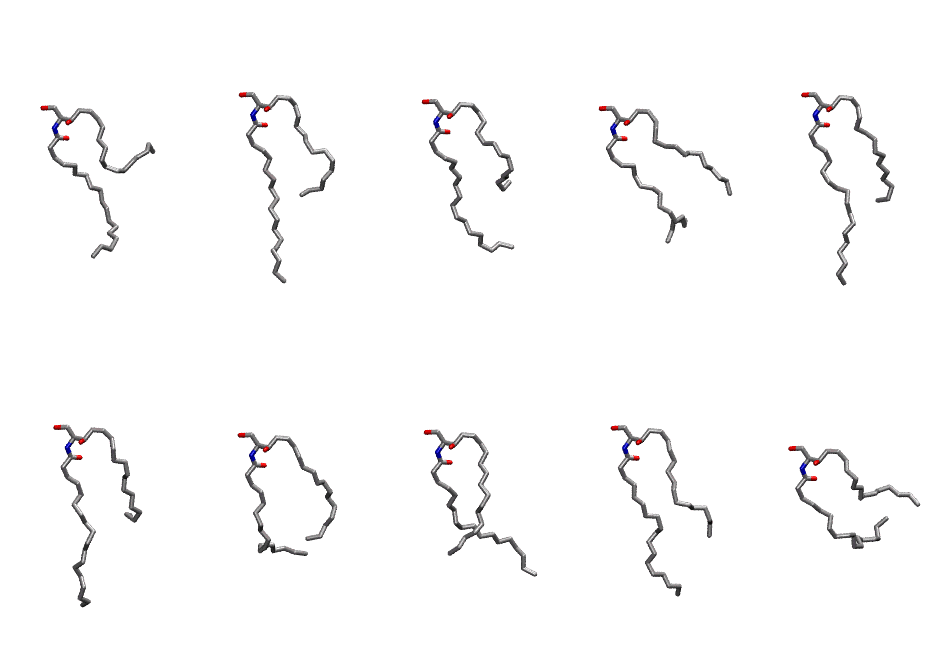
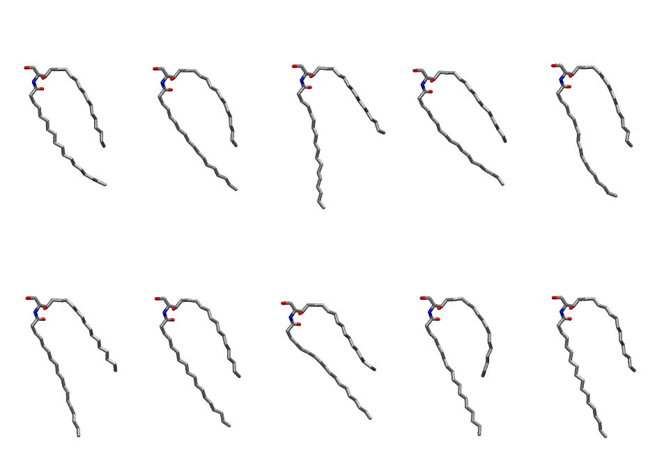

.. _lipid_gallery cer180:

CER180
======

**CERAMIDE d18:1/18:0**

==============  ============================================
CHARMM resname  ``CER180``
Net charge      0.00
Atoms           111
Topology file   ``toppar_all36_lipid_sphingo.str``
Conformers      10 fluid, 10 liquid-ordered (``CER180__Lo``)
==============  ============================================

Structure
---------

Conformers
----------

The grid packer draws a conformer per lipid from an ensemble, so what the ensemble contains is what a built bilayer is made of. CER180 ships two: a fluid one, used by default, and a liquid-ordered one, used for a leaflet declared ``phase: Lo``. All conformers on this page are rendered at one shared scale.

Fluid (``CER180``)
~~~~~~~~~~~~~~~~~~

=============  =============  ================
Conformer      Head-tail (Å)  Max internal (Å)
=============  =============  ================
``CER180-00``  1.57           19.97
``CER180-01``  8.23           24.17
``CER180-02``  5.93           23.14
``CER180-03``  6.45           19.62
``CER180-04``  8.89           24.32
``CER180-05``  6.84           23.91
``CER180-06``  8.64           20.59
``CER180-07``  10.72          23.20
``CER180-08``  9.12           23.46
``CER180-09``  3.02           18.47
=============  =============  ================

Liquid-ordered (``CER180__Lo``)
~~~~~~~~~~~~~~~~~~~~~~~~~~~~~~~

=============  =============  ================
Conformer      Head-tail (Å)  Max internal (Å)
=============  =============  ================
``CER180-00``  9.70           24.93
``CER180-01``  9.42           25.62
``CER180-02``  7.71           26.19
``CER180-03``  8.40           25.29
``CER180-04``  10.01          25.59
``CER180-05``  8.67           26.20
``CER180-06``  9.57           25.86
``CER180-07``  7.68           25.46
``CER180-08``  9.58           26.20
``CER180-09``  8.75           26.37
=============  =============  ================

Provenance
----------

How each ensemble was generated, read from the entry's own ``info.yaml``:

===================  ============  ==============
Setting              ``CER180``    ``CER180__Lo``
===================  ============  ==============
Sampler              ``mc``        ``mc``
Phase                none (fluid)  Lo
Trans bias           0.0           40.0
Chain order          0.097         0.192
MC seed              0             0
Chains               2             2
Cylinder APL         60.0 Ų       60.0 Ų
Cylinder inflation   1.9           1.9
Equilibration steps  20000         20000
Decorrelation steps  3000          3000
Max MC angle         30°           30°
Radius scale         0.8           0.8
Axial bias           1.0           1.0
===================  ============  ==============
