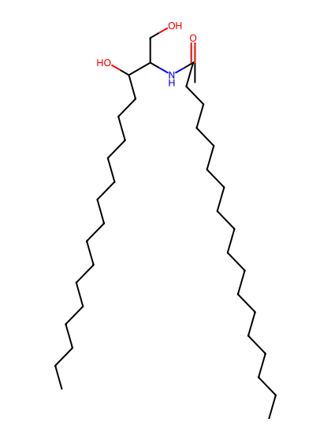
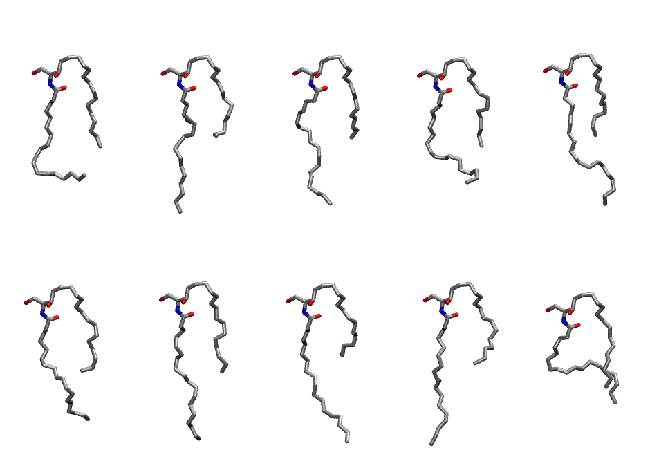

.. _lipid_gallery cer181:

CER181
======

**CERAMIDE d18:1/18:1 (w/oleic acid)**

==============  ==================================
CHARMM resname  ``CER181``
Net charge      0.00
Atoms           109
Topology file   ``toppar_all36_lipid_sphingo.str``
Conformers      10 fluid
==============  ==================================

Structure
---------

Conformers
----------

The grid packer draws a conformer per lipid from this ensemble, so what the ensemble contains is what a built bilayer is made of. A leaflet declared ``phase: Lo`` generates an ordered ensemble when a build first needs it. All conformers are rendered at one shared scale.

=============  =============  ================
Conformer      Head-tail (Å)  Max internal (Å)
=============  =============  ================
``CER181-00``  8.15           19.94
``CER181-01``  6.59           25.47
``CER181-02``  6.86           22.62
``CER181-03``  7.71           18.64
``CER181-04``  6.87           22.81
``CER181-05``  7.41           21.88
``CER181-06``  7.96           25.47
``CER181-07``  5.33           23.65
``CER181-08``  6.74           25.10
``CER181-09``  8.62           19.20
=============  =============  ================

Provenance
----------

How the ensemble was generated, read from the entry's own ``info.yaml``:

===================  ============
Setting              ``CER181``
===================  ============
Sampler              ``mc``
Phase                none (fluid)
Trans bias           0.0
Chain order          0.142
MC seed              0
Chains               2
Cylinder APL         60.0 Ų
Cylinder inflation   1.9
Equilibration steps  20000
Decorrelation steps  3000
Max MC angle         30°
Radius scale         0.8
Axial bias           1.0
===================  ============
