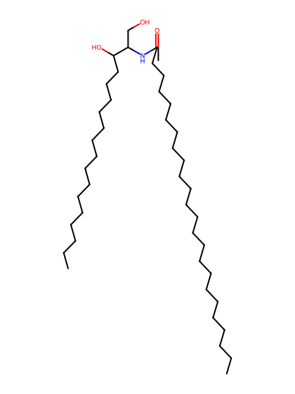
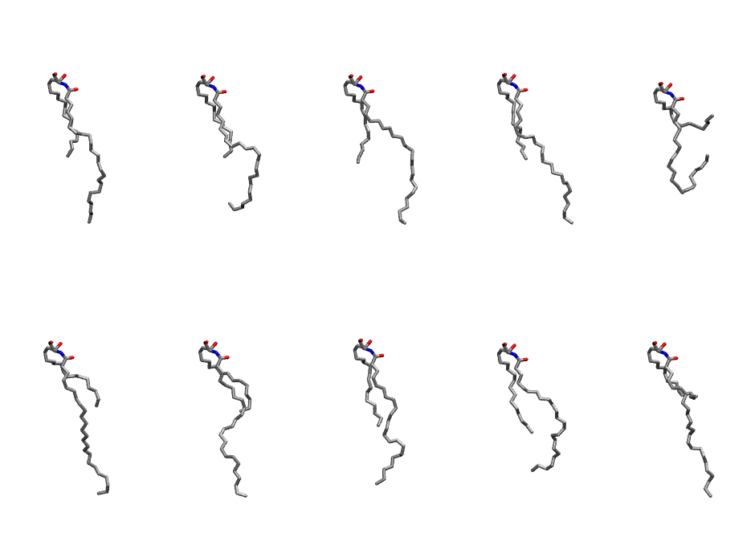
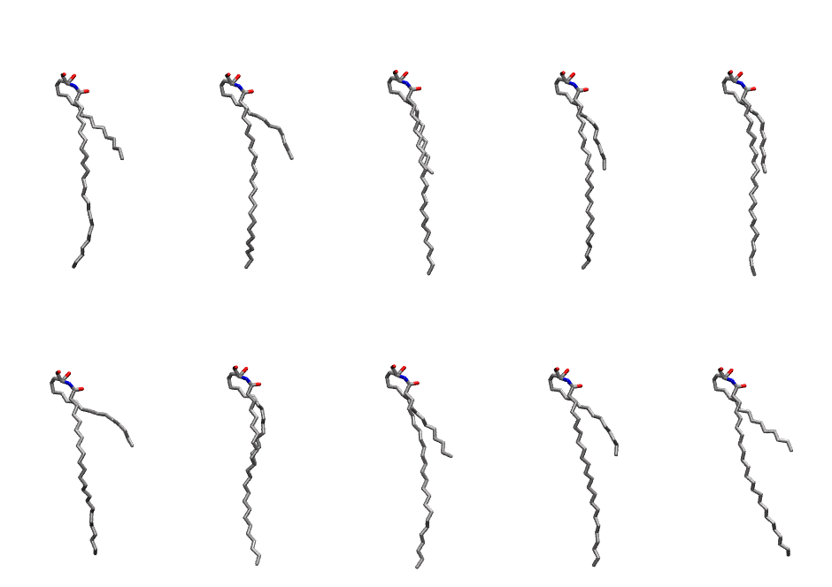

.. _lipid_gallery cer2:

CER2
====

**CERAMIDE by by Sam Tonddast-Navaei (U. Cin/Russel Lab)**

==============  ==========================================
CHARMM resname  ``CER2``
Net charge      0.00
Atoms           129
Topology file   ``toppar_all36_lipid_sphingo.str``
Conformers      10 fluid, 10 liquid-ordered (``CER2__Lo``)
==============  ==========================================

Structure
---------

Conformers
----------

The grid packer draws a conformer per lipid from an ensemble, so what the ensemble contains is what a built bilayer is made of. CER2 ships two: a fluid one, used by default, and a liquid-ordered one, used for a leaflet declared ``phase: Lo``. All conformers on this page are rendered at one shared scale.

Fluid (``CER2``)
~~~~~~~~~~~~~~~~

===========  =============  ================
Conformer    Head-tail (Å)  Max internal (Å)
===========  =============  ================
``CER2-00``  11.40          28.48
``CER2-01``  11.09          25.41
``CER2-02``  12.15          28.61
``CER2-03``  11.76          29.39
``CER2-04``  2.92           21.07
``CER2-05``  8.24           29.70
``CER2-06``  9.21           28.94
``CER2-07``  11.95          26.51
``CER2-08``  12.43          24.89
``CER2-09``  6.53           29.52
===========  =============  ================

Liquid-ordered (``CER2__Lo``)
~~~~~~~~~~~~~~~~~~~~~~~~~~~~~

===========  =============  ================
Conformer    Head-tail (Å)  Max internal (Å)
===========  =============  ================
``CER2-00``  10.43          31.80
``CER2-01``  10.36          32.18
``CER2-02``  13.08          33.41
``CER2-03``  12.28          32.41
``CER2-04``  12.89          33.29
``CER2-05``  8.79           31.79
``CER2-06``  12.21          32.34
``CER2-07``  11.37          33.13
``CER2-08``  10.67          33.59
``CER2-09``  10.00          32.68
===========  =============  ================

Provenance
----------

How each ensemble was generated, read from the entry's own ``info.yaml``:

===================  ============  ============
Setting              ``CER2``      ``CER2__Lo``
===================  ============  ============
Sampler              ``mc``        ``mc``
Phase                none (fluid)  Lo
Trans bias           0.0           10.0
Chain order          0.146         0.281
MC seed              0             0
Chains               2             2
Cylinder APL         60.0 Ų       60.0 Ų
Cylinder inflation   1.9           1.9
Equilibration steps  20000         20000
Decorrelation steps  3000          3000
Max MC angle         30°           30°
Radius scale         0.8           0.8
Axial bias           1.0           1.0
===================  ============  ============
