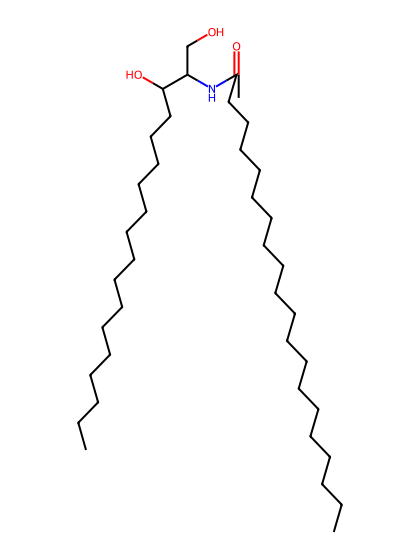
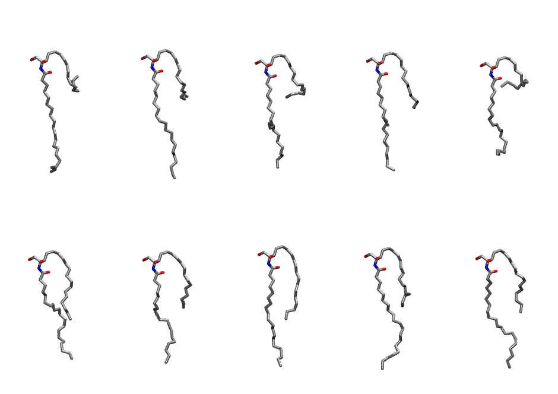
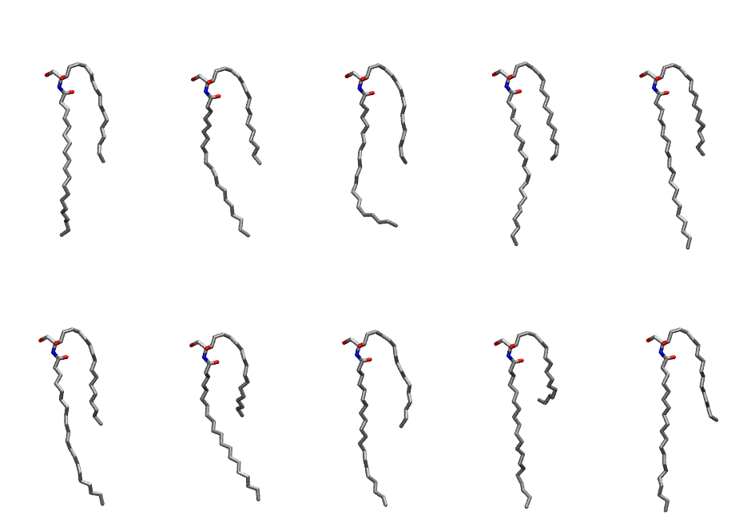

.. _lipid_gallery cer200:

CER200
======

**CERAMIDE d18:1/20:0**

==============  ============================================
CHARMM resname  ``CER200``
Net charge      0.00
Atoms           117
Topology file   ``toppar_all36_lipid_sphingo.str``
Conformers      10 fluid, 10 liquid-ordered (``CER200__Lo``)
==============  ============================================

Structure
---------

Conformers
----------

The grid packer draws a conformer per lipid from an ensemble, so what the ensemble contains is what a built bilayer is made of. CER200 ships two: a fluid one, used by default, and a liquid-ordered one, used for a leaflet declared ``phase: Lo``. All conformers on this page are rendered at one shared scale.

Fluid (``CER200``)
~~~~~~~~~~~~~~~~~~

=============  =============  ================
Conformer      Head-tail (Å)  Max internal (Å)
=============  =============  ================
``CER200-00``  0.84           26.80
``CER200-01``  5.17           27.95
``CER200-02``  4.33           26.11
``CER200-03``  6.92           26.71
``CER200-04``  1.61           22.20
``CER200-05``  9.52           24.25
``CER200-06``  7.07           24.42
``CER200-07``  10.44          26.05
``CER200-08``  7.51           25.81
``CER200-09``  8.26           26.72
=============  =============  ================

Liquid-ordered (``CER200__Lo``)
~~~~~~~~~~~~~~~~~~~~~~~~~~~~~~~

=============  =============  ================
Conformer      Head-tail (Å)  Max internal (Å)
=============  =============  ================
``CER200-00``  10.47          28.89
``CER200-01``  10.10          28.31
``CER200-02``  10.45          26.30
``CER200-03``  10.17          29.13
``CER200-04``  9.29           29.49
``CER200-05``  10.05          28.36
``CER200-06``  8.03           27.27
``CER200-07``  10.04          28.82
``CER200-08``  5.94           28.91
``CER200-09``  9.47           29.54
=============  =============  ================

Provenance
----------

How each ensemble was generated, read from the entry's own ``info.yaml``:

===================  ============  ==============
Setting              ``CER200``    ``CER200__Lo``
===================  ============  ==============
Sampler              ``mc``        ``mc``
Phase                none (fluid)  Lo
Trans bias           0.0           5.0
Chain order          0.178         0.283
MC seed              0             0
Chains               2             2
Cylinder APL         60.0 Ų       60.0 Ų
Cylinder inflation   1.9           1.9
Equilibration steps  20000         20000
Decorrelation steps  3000          3000
Max MC angle         30°           30°
Radius scale         0.8           0.8
Axial bias           1.0           1.0
===================  ============  ==============
