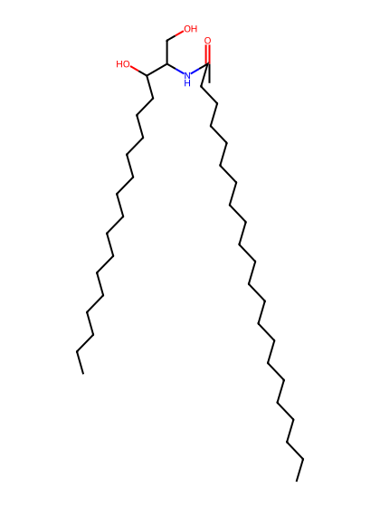
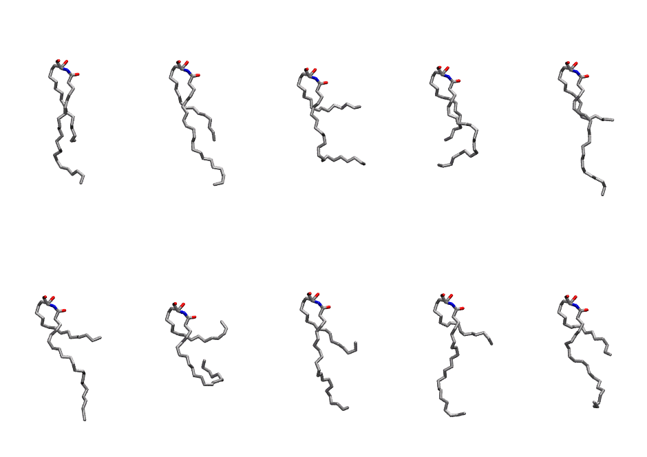
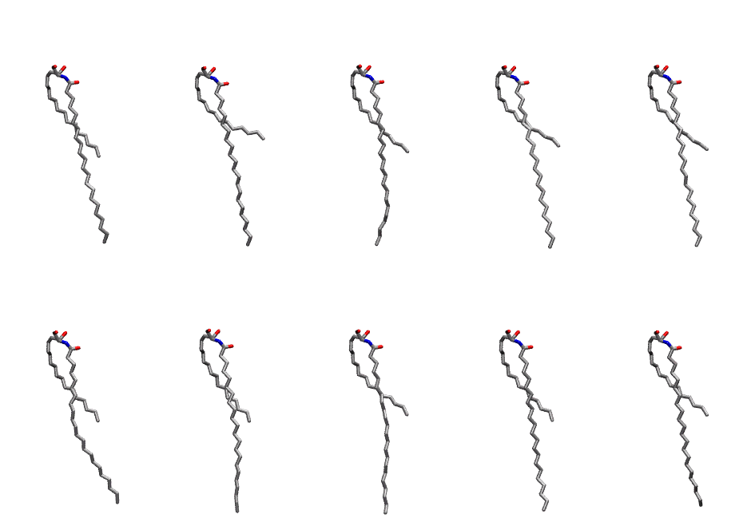

.. _lipid_gallery cer220:

CER220
======

**CERAMIDE d18:1/22:0**

==============  ============================================
CHARMM resname  ``CER220``
Net charge      0.00
Atoms           123
Topology file   ``toppar_all36_lipid_sphingo.str``
Conformers      10 fluid, 10 liquid-ordered (``CER220__Lo``)
==============  ============================================

Structure
---------

Conformers
----------

The grid packer draws a conformer per lipid from an ensemble, so what the ensemble contains is what a built bilayer is made of. CER220 ships two: a fluid one, used by default, and a liquid-ordered one, used for a leaflet declared ``phase: Lo``. All conformers on this page are rendered at one shared scale.

Fluid (``CER220``)
~~~~~~~~~~~~~~~~~~

=============  =============  ================
Conformer      Head-tail (Å)  Max internal (Å)
=============  =============  ================
``CER220-00``  12.35          24.90
``CER220-01``  12.08          25.75
``CER220-02``  4.48           23.34
``CER220-03``  11.04          20.74
``CER220-04``  8.18           27.10
``CER220-05``  5.07           25.38
``CER220-06``  0.89           18.47
``CER220-07``  6.65           24.71
``CER220-08``  6.61           24.62
``CER220-09``  8.37           23.31
=============  =============  ================

Liquid-ordered (``CER220__Lo``)
~~~~~~~~~~~~~~~~~~~~~~~~~~~~~~~

=============  =============  ================
Conformer      Head-tail (Å)  Max internal (Å)
=============  =============  ================
``CER220-00``  11.88          31.33
``CER220-01``  8.86           31.41
``CER220-02``  11.21          30.84
``CER220-03``  10.15          31.57
``CER220-04``  10.81          31.31
``CER220-05``  11.71          30.64
``CER220-06``  12.04          31.08
``CER220-07``  10.92          31.29
``CER220-08``  11.78          31.18
``CER220-09``  10.80          31.23
=============  =============  ================

Provenance
----------

How each ensemble was generated, read from the entry's own ``info.yaml``:

===================  ============  ==============
Setting              ``CER220``    ``CER220__Lo``
===================  ============  ==============
Sampler              ``mc``        ``mc``
Phase                none (fluid)  Lo
Trans bias           0.0           40.0
Chain order          0.108         0.311
MC seed              0             0
Chains               2             2
Cylinder APL         60.0 Ų       60.0 Ų
Cylinder inflation   1.9           1.9
Equilibration steps  20000         20000
Decorrelation steps  3000          3000
Max MC angle         30°           30°
Radius scale         0.8           0.8
Axial bias           1.0           1.0
===================  ============  ==============
