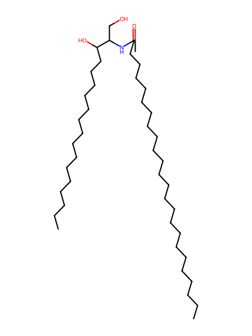
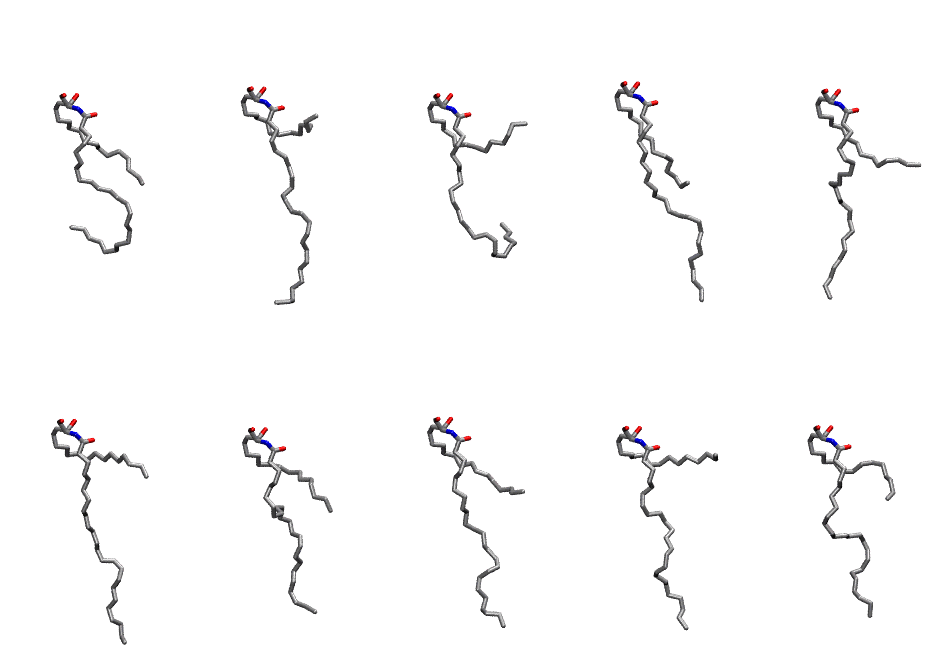

.. _lipid_gallery cer241:

CER241
======

**CERAMIDE d18:1/24:1 (w/nervonic acid)**

==============  ==================================
CHARMM resname  ``CER241``
Net charge      0.00
Atoms           127
Topology file   ``toppar_all36_lipid_sphingo.str``
Conformers      10 fluid
==============  ==================================

Structure
---------

Conformers
----------

The grid packer draws a conformer per lipid from this ensemble, so what the ensemble contains is what a built bilayer is made of. A leaflet declared ``phase: Lo`` generates an ordered ensemble when a build first needs it. All conformers are rendered at one shared scale.

=============  =============  ================
Conformer      Head-tail (Å)  Max internal (Å)
=============  =============  ================
``CER241-00``  8.33           21.86
``CER241-01``  0.98           28.06
``CER241-02``  1.10           22.87
``CER241-03``  9.70           29.61
``CER241-04``  6.65           26.86
``CER241-05``  4.38           30.33
``CER241-06``  7.48           25.86
``CER241-07``  6.46           27.70
``CER241-08``  0.94           26.96
``CER241-09``  6.27           25.40
=============  =============  ================

Provenance
----------

How the ensemble was generated, read from the entry's own ``info.yaml``:

===================  ============
Setting              ``CER241``
===================  ============
Sampler              ``mc``
Phase                none (fluid)
Trans bias           0.0
Chain order          0.080
MC seed              0
Chains               2
Cylinder APL         60.0 Ų
Cylinder inflation   1.9
Equilibration steps  20000
Decorrelation steps  3000
Max MC angle         30°
Radius scale         0.8
Axial bias           1.0
===================  ============
