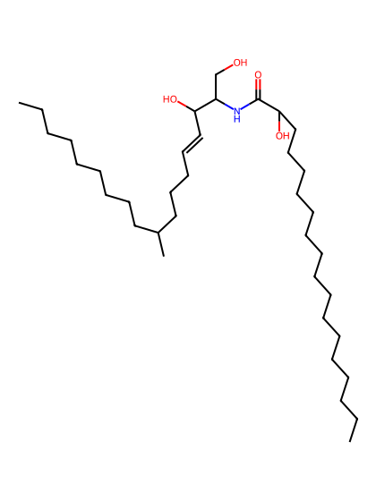
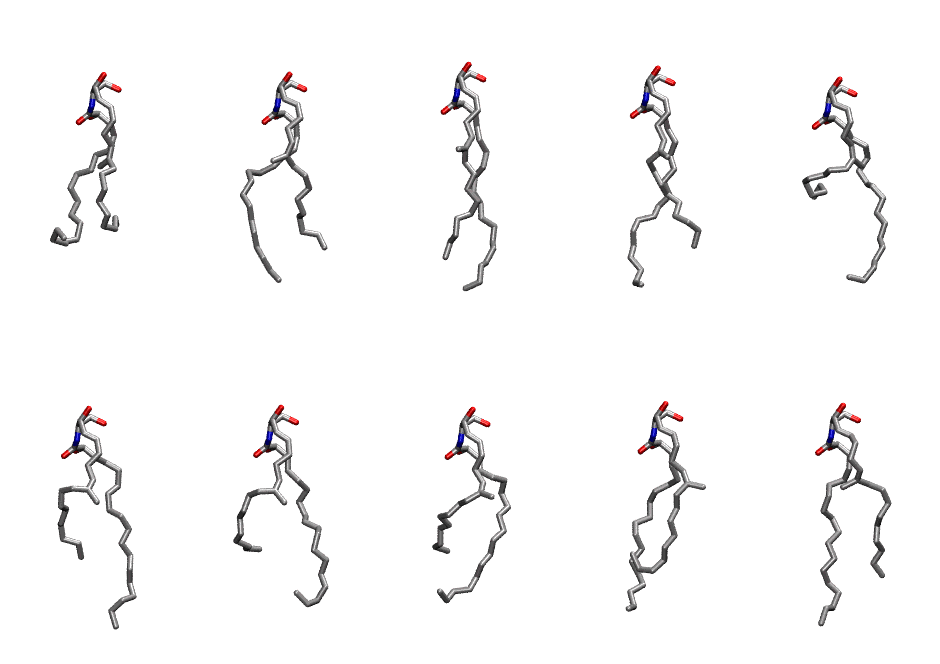
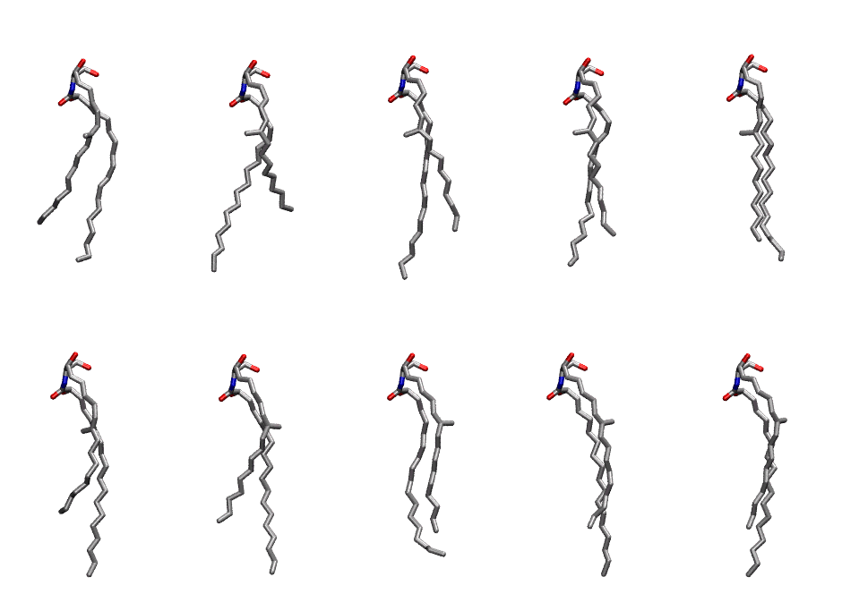

.. _lipid_gallery cer3e:

CER3E
=====

**CERAMIDE t16:2/18:1**

==============  ===========================================
CHARMM resname  ``CER3E``
Net charge      0.00
Atoms           111
Topology file   ``toppar_all36_lipid_sphingo.str``
Conformers      10 fluid, 10 liquid-ordered (``CER3E__Lo``)
==============  ===========================================

Structure
---------

Conformers
----------

The grid packer draws a conformer per lipid from an ensemble, so what the ensemble contains is what a built bilayer is made of. CER3E ships two: a fluid one, used by default, and a liquid-ordered one, used for a leaflet declared ``phase: Lo``. All conformers on this page are rendered at one shared scale.

Fluid (``CER3E``)
~~~~~~~~~~~~~~~~~

============  =============  ================
Conformer     Head-tail (Å)  Max internal (Å)
============  =============  ================
``CER3E-00``  4.65           17.79
``CER3E-01``  4.15           20.76
``CER3E-02``  4.00           22.55
``CER3E-03``  4.36           21.83
``CER3E-04``  4.17           20.41
``CER3E-05``  4.81           21.66
``CER3E-06``  4.96           19.96
``CER3E-07``  4.24           19.28
``CER3E-08``  3.85           20.91
``CER3E-09``  3.71           21.65
============  =============  ================

Liquid-ordered (``CER3E__Lo``)
~~~~~~~~~~~~~~~~~~~~~~~~~~~~~~

============  =============  ================
Conformer     Head-tail (Å)  Max internal (Å)
============  =============  ================
``CER3E-00``  12.99          22.20
``CER3E-01``  11.50          23.18
``CER3E-02``  14.08          24.41
``CER3E-03``  14.33          23.05
``CER3E-04``  15.25          22.74
``CER3E-05``  12.56          24.89
``CER3E-06``  13.32          24.29
``CER3E-07``  14.46          22.47
``CER3E-08``  14.06          24.40
``CER3E-09``  14.03          24.62
============  =============  ================

Provenance
----------

How each ensemble was generated, read from the entry's own ``info.yaml``:

===================  ============  =============
Setting              ``CER3E``     ``CER3E__Lo``
===================  ============  =============
Sampler              ``mc``        ``mc``
Phase                none (fluid)  Lo
Trans bias           0.0           7.5
Chain order          0.174         0.294
MC seed              0             0
Chains               2             2
Cylinder APL         60.0 Ų       60.0 Ų
Cylinder inflation   1.9           1.9
Equilibration steps  20000         20000
Decorrelation steps  3000          3000
Max MC angle         30°           30°
Radius scale         0.8           0.8
Axial bias           1.0           1.0
===================  ============  =============
