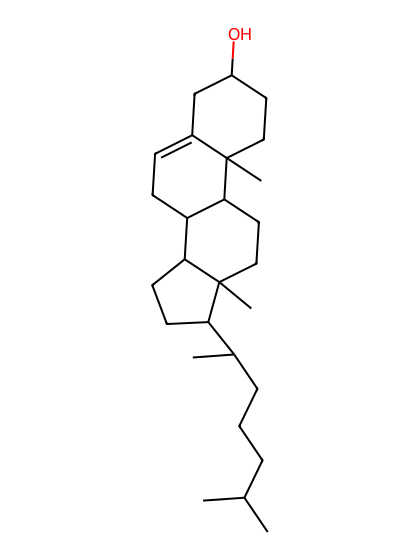
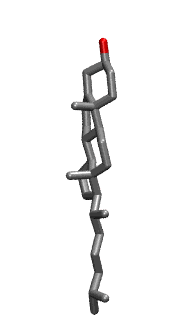

.. _lipid_gallery chl1:

CHL1
====

**cholesterol (name to avoid conflict with choline)**

==============  ========================================
CHARMM resname  ``CHL1``
Net charge      0.00
Atoms           74
Topology file   ``toppar_all36_lipid_cholesterol.str``
Conformers      1 fluid, 1 liquid-ordered (``CHL1__Lo``)
==============  ========================================

Structure
---------

Conformers
----------

A sterol is dominated by its rigid fused rings, so the collection carries one minimized structure for it rather than a sampled ensemble.

Fluid (``CHL1``)
~~~~~~~~~~~~~~~~

==========  =============  ================  ================
Conformer   Head-tail (Å)  Max internal (Å)  Min chain extent
==========  =============  ================  ================
``CHL1-0``  15.53          18.84             -0.01
==========  =============  ================  ================

Liquid-ordered (``CHL1__Lo``)
~~~~~~~~~~~~~~~~~~~~~~~~~~~~~

==========  =============  ================  ================
Conformer   Head-tail (Å)  Max internal (Å)  Min chain extent
==========  =============  ================  ================
``CHL1-0``  15.53          18.84             -0.01
==========  =============  ================  ================

*Min chain extent* is how far the least-extended acyl chain descends below its own attachment carbon, as a fraction of that chain's all-trans contour; an all-trans chain scores 1.0, and a conformer under 0.25 is rejected at generation as folded.

Provenance
----------

How each ensemble was generated, read from the entry's own ``info.yaml``:

=======  ==========  ============
Setting  ``CHL1``    ``CHL1__Lo``
=======  ==========  ============
Sampler  ``single``  ``single``
=======  ==========  ============
