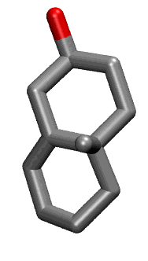

.. _lipid_gallery chm1:

CHM1
====

**cholesterol analog with only rings 1 and 2**

==============  ======================================
CHARMM resname  ``CHM1``
Net charge      0.00
Atoms           30
Topology file   ``toppar_all36_lipid_cholesterol.str``
Conformers      1 fluid
==============  ======================================

Conformers
----------

A sterol is dominated by its rigid fused rings, so the collection carries one minimized structure for it rather than a sampled ensemble.

==========  =============  ================
Conformer   Head-tail (Å)  Max internal (Å)
==========  =============  ================
``CHM1-0``  5.20           7.85
==========  =============  ================

Provenance
----------

How the ensemble was generated, read from the entry's own ``info.yaml``:

=======  ==========
Setting  ``CHM1``
=======  ==========
Sampler  ``single``
=======  ==========
