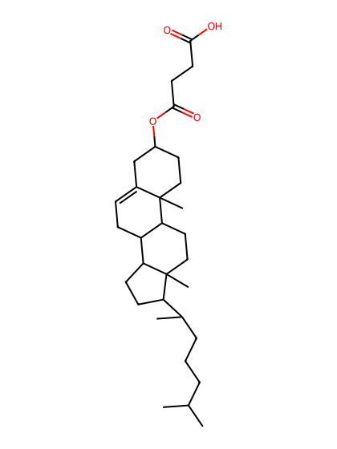
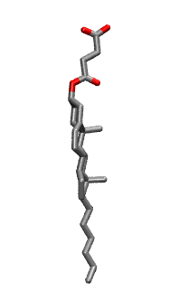

.. _lipid_gallery chsd:

CHSD
====

**Cholesteryl HemiSuccinate (deprotonated) Y01**

==============  ======================================
CHARMM resname  ``CHSD``
Net charge      -1.00
Atoms           84
Topology file   ``toppar_all36_lipid_cholesterol.str``
Conformers      1 fluid
==============  ======================================

Structure
---------

Conformers
----------

A sterol is dominated by its rigid fused rings, so the collection carries one minimized structure for it rather than a sampled ensemble.

==========  =============  ================  ================
Conformer   Head-tail (Å)  Max internal (Å)  Min chain extent
==========  =============  ================  ================
``CHSD-0``  21.16          23.74             -0.02
==========  =============  ================  ================

*Min chain extent* is how far the least-extended acyl chain descends below its own attachment carbon, as a fraction of that chain's all-trans contour; an all-trans chain scores 1.0, and a conformer under 0.25 is rejected at generation as folded.

Provenance
----------

How the ensemble was generated, read from the entry's own ``info.yaml``:

=======  ==========
Setting  ``CHSD``
=======  ==========
Sampler  ``single``
=======  ==========
