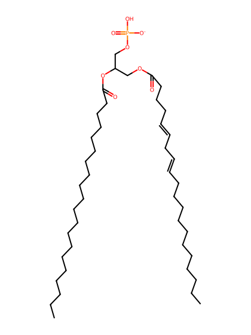
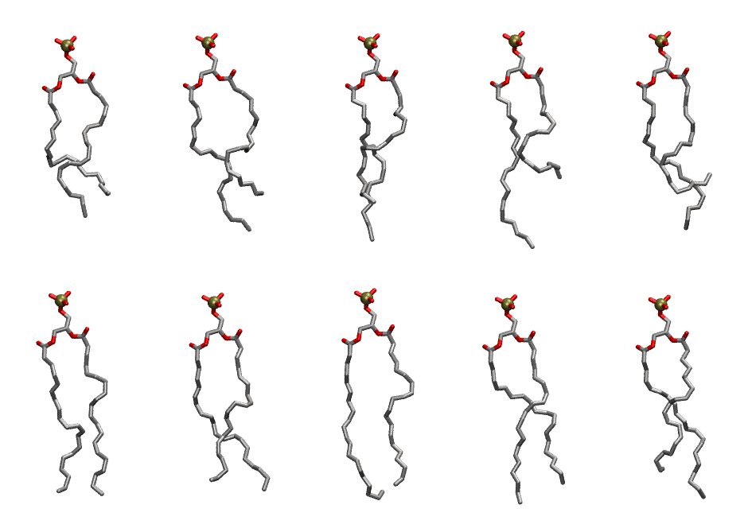

.. _lipid_gallery dapa:

DAPA
====

**1,2-Diarachidonyl-Phosphatidic acid**

==============  ========================================
CHARMM resname  ``DAPA``
Net charge      -1.00
Atoms           120
Topology file   ``toppar_all36_lipid_miscellaneous.str``
Conformers      10 fluid
==============  ========================================

Structure
---------

Conformers
----------

The grid packer draws a conformer per lipid from this ensemble, so what the ensemble contains is what a built bilayer is made of. A leaflet declared ``phase: Lo`` generates an ordered ensemble when a build first needs it. All conformers are rendered at one shared scale.

===========  =============  ================  ================
Conformer    Head-tail (Å)  Max internal (Å)  Min chain extent
===========  =============  ================  ================
``DAPA-00``  13.42          24.77             0.54
``DAPA-01``  13.76          26.89             0.61
``DAPA-02``  14.82          27.63             0.65
``DAPA-03``  11.97          29.21             0.53
``DAPA-04``  11.66          26.67             0.52
``DAPA-05``  18.91          27.82             0.76
``DAPA-06``  17.24          26.95             0.74
``DAPA-07``  18.36          28.52             0.78
``DAPA-08``  17.36          28.25             0.70
``DAPA-09``  15.55          27.84             0.68
===========  =============  ================  ================

*Min chain extent* is how far the least-extended acyl chain descends below its own attachment carbon, as a fraction of that chain's all-trans contour; an all-trans chain scores 1.0, and a conformer under 0.25 is rejected at generation as folded.

Provenance
----------

How the ensemble was generated, read from the entry's own ``info.yaml``:

===================  ============
Setting              ``DAPA``
===================  ============
Sampler              ``mc``
Phase                none (fluid)
Trans bias           0.0
Chain order          0.197
MC seed              0
Chains               2
Cylinder APL         60.0 Ų
Cylinder inflation   1.9
Equilibration steps  20000
Decorrelation steps  3000
Max MC angle         30°
Radius scale         0.8
Axial bias           1.0
===================  ============
