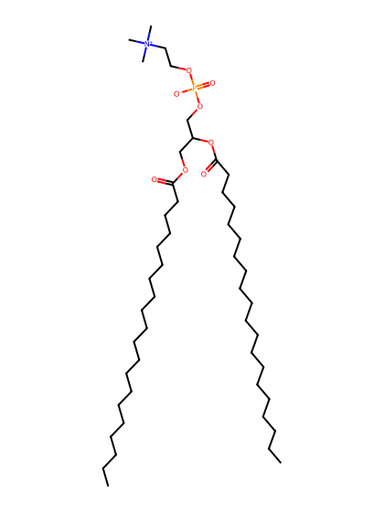
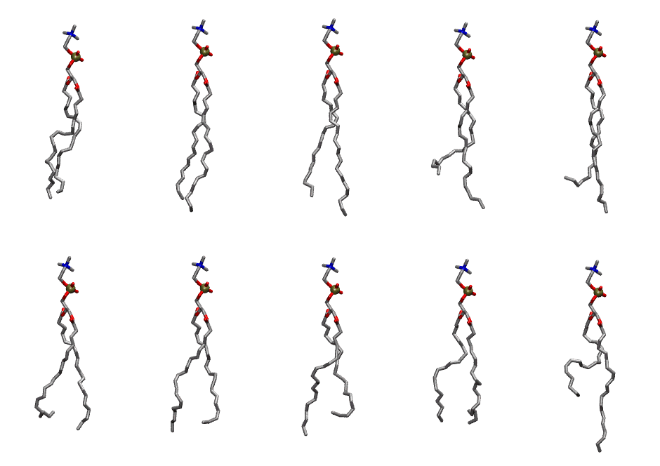

.. _lipid_gallery dapc:

DAPC
====

**2,3-diarachidonyl-D-glycero-1-phosphatidylcholine (20:4 20:4 PC)**

==============  =======================
CHARMM resname  ``DAPC``
Net charge      0.00
Atoms           138
Topology file   ``top_all36_lipid.rtf``
Conformers      10 fluid
==============  =======================

Structure
---------

Conformers
----------

The grid packer draws a conformer per lipid from this ensemble, so what the ensemble contains is what a built bilayer is made of. A leaflet declared ``phase: Lo`` generates an ordered ensemble when a build first needs it. All conformers are rendered at one shared scale.

===========  =============  ================  ================
Conformer    Head-tail (Å)  Max internal (Å)  Min chain extent
===========  =============  ================  ================
``DAPC-00``  17.62          30.88             0.75
``DAPC-01``  19.67          33.92             0.85
``DAPC-02``  19.33          34.75             0.84
``DAPC-03``  14.97          32.84             0.66
``DAPC-04``  15.98          33.48             0.70
``DAPC-05``  15.76          30.72             0.63
``DAPC-06``  17.50          31.29             0.76
``DAPC-07``  15.62          31.74             0.68
``DAPC-08``  16.71          29.88             0.69
``DAPC-09``  12.20          33.50             0.54
===========  =============  ================  ================

*Min chain extent* is how far the least-extended acyl chain descends below its own attachment carbon, as a fraction of that chain's all-trans contour; an all-trans chain scores 1.0, and a conformer under 0.25 is rejected at generation as folded.

Provenance
----------

How the ensemble was generated, read from the entry's own ``info.yaml``:

===================  ============
Setting              ``DAPC``
===================  ============
Sampler              ``mc``
Phase                none (fluid)
Trans bias           0.0
Chain order          0.228
MC seed              0
Chains               2
Cylinder APL         60.0 Ų
Cylinder inflation   1.9
Equilibration steps  20000
Decorrelation steps  3000
Max MC angle         30°
Radius scale         0.8
Axial bias           1.0
===================  ============
