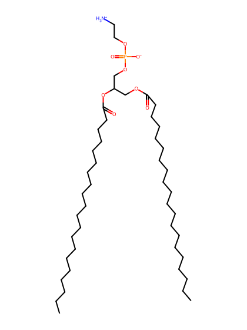
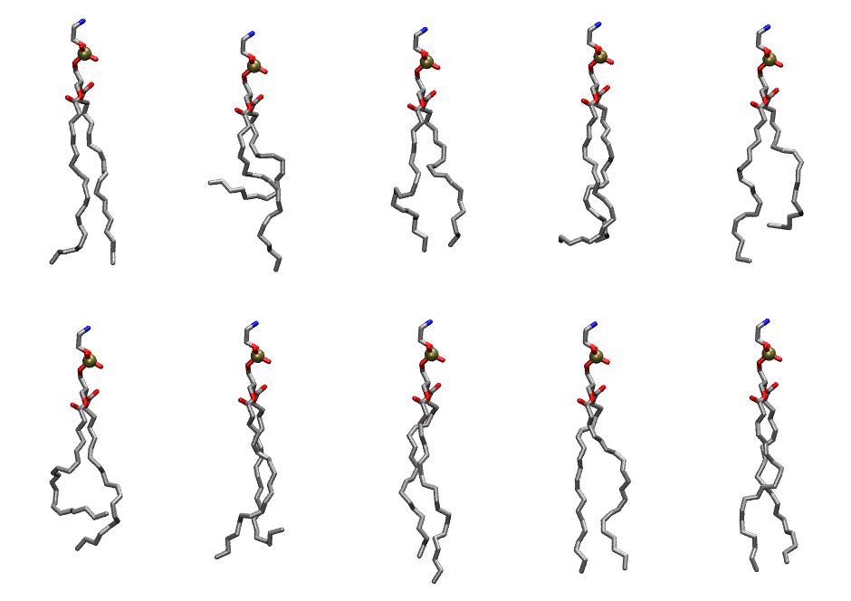

.. _lipid_gallery dape:

DAPE
====

**1,2-Diarachidonyl-Phosphatidylethanolamine**

==============  ========================================
CHARMM resname  ``DAPE``
Net charge      0.00
Atoms           129
Topology file   ``toppar_all36_lipid_miscellaneous.str``
Conformers      10 fluid
==============  ========================================

Structure
---------

Conformers
----------

The grid packer draws a conformer per lipid from this ensemble, so what the ensemble contains is what a built bilayer is made of. A leaflet declared ``phase: Lo`` generates an ordered ensemble when a build first needs it. All conformers are rendered at one shared scale.

===========  =============  ================  ================
Conformer    Head-tail (Å)  Max internal (Å)  Min chain extent
===========  =============  ================  ================
``DAPE-00``  19.31          30.54             0.78
``DAPE-01``  8.54           29.71             0.39
``DAPE-02``  16.29          27.71             0.68
``DAPE-03``  16.38          28.03             0.66
``DAPE-04``  14.26          29.45             0.62
``DAPE-05``  12.77          28.04             0.51
``DAPE-06``  15.21          29.87             0.66
``DAPE-07``  18.49          32.54             0.80
``DAPE-08``  19.66          30.84             0.79
``DAPE-09``  19.24          31.20             0.82
===========  =============  ================  ================

*Min chain extent* is how far the least-extended acyl chain descends below its own attachment carbon, as a fraction of that chain's all-trans contour; an all-trans chain scores 1.0, and a conformer under 0.25 is rejected at generation as folded.

Provenance
----------

How the ensemble was generated, read from the entry's own ``info.yaml``:

===================  ============
Setting              ``DAPE``
===================  ============
Sampler              ``mc``
Phase                none (fluid)
Trans bias           0.0
Chain order          0.197
MC seed              0
Chains               2
Cylinder APL         60.0 Ų
Cylinder inflation   1.9
Equilibration steps  20000
Decorrelation steps  3000
Max MC angle         30°
Radius scale         0.8
Axial bias           1.0
===================  ============
