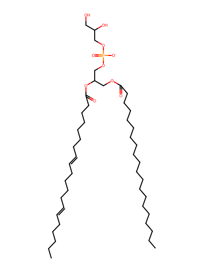
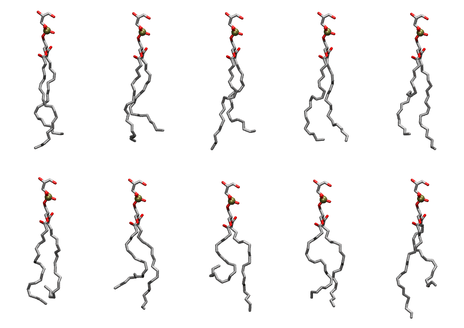

.. _lipid_gallery dapg:

DAPG
====

**1,2-Diarachidonyl-Phosphatidylglycerol**

==============  ========================================
CHARMM resname  ``DAPG``
Net charge      -1.00
Atoms           131
Topology file   ``toppar_all36_lipid_miscellaneous.str``
Conformers      10 fluid
==============  ========================================

Structure
---------

Conformers
----------

The grid packer draws a conformer per lipid from this ensemble, so what the ensemble contains is what a built bilayer is made of. A leaflet declared ``phase: Lo`` generates an ordered ensemble when a build first needs it. All conformers are rendered at one shared scale.

===========  =============  ================  ================
Conformer    Head-tail (Å)  Max internal (Å)  Min chain extent
===========  =============  ================  ================
``DAPG-00``  17.13          31.29             0.74
``DAPG-01``  16.05          29.90             0.70
``DAPG-02``  16.17          31.43             0.70
``DAPG-03``  18.11          29.52             0.73
``DAPG-04``  16.71          31.26             0.67
``DAPG-05``  14.16          28.88             0.62
``DAPG-06``  14.19          29.68             0.57
``DAPG-07``  8.78           29.60             0.34
``DAPG-08``  15.99          28.94             0.64
``DAPG-09``  13.51          31.79             0.59
===========  =============  ================  ================

*Min chain extent* is how far the least-extended acyl chain descends below its own attachment carbon, as a fraction of that chain's all-trans contour; an all-trans chain scores 1.0, and a conformer under 0.25 is rejected at generation as folded.

Provenance
----------

How the ensemble was generated, read from the entry's own ``info.yaml``:

===================  ============
Setting              ``DAPG``
===================  ============
Sampler              ``mc``
Phase                none (fluid)
Trans bias           0.0
Chain order          0.185
MC seed              0
Chains               2
Cylinder APL         60.0 Ų
Cylinder inflation   1.9
Equilibration steps  20000
Decorrelation steps  3000
Max MC angle         30°
Radius scale         0.8
Axial bias           1.0
===================  ============
