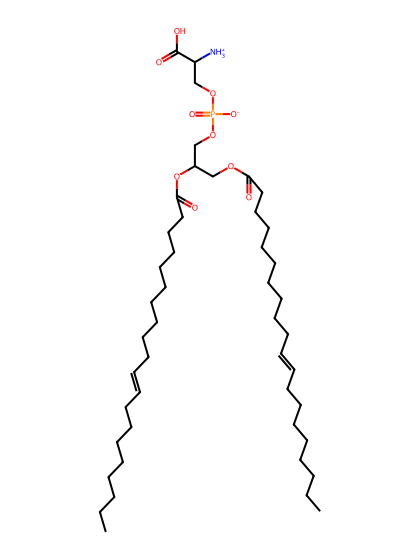
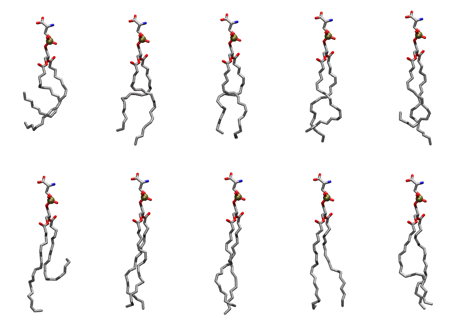

.. _lipid_gallery daps:

DAPS
====

**1,2-Diarachidonyl-Phosphatidylserine**

==============  ========================================
CHARMM resname  ``DAPS``
Net charge      -1.00
Atoms           131
Topology file   ``toppar_all36_lipid_miscellaneous.str``
Conformers      10 fluid
==============  ========================================

Structure
---------

Conformers
----------

The grid packer draws a conformer per lipid from this ensemble, so what the ensemble contains is what a built bilayer is made of. A leaflet declared ``phase: Lo`` generates an ordered ensemble when a build first needs it. All conformers are rendered at one shared scale.

===========  =============  ================  ================
Conformer    Head-tail (Å)  Max internal (Å)  Min chain extent
===========  =============  ================  ================
``DAPS-00``  6.37           25.85             0.29
``DAPS-01``  15.21          29.58             0.66
``DAPS-02``  16.07          28.38             0.68
``DAPS-03``  16.08          29.66             0.64
``DAPS-04``  12.14          30.59             0.48
``DAPS-05``  7.99           31.18             0.36
``DAPS-06``  19.24          30.77             0.77
``DAPS-07``  19.13          32.34             0.77
``DAPS-08``  18.94          30.73             0.76
``DAPS-09``  18.36          31.04             0.74
===========  =============  ================  ================

*Min chain extent* is how far the least-extended acyl chain descends below its own attachment carbon, as a fraction of that chain's all-trans contour; an all-trans chain scores 1.0, and a conformer under 0.25 is rejected at generation as folded.

Provenance
----------

How the ensemble was generated, read from the entry's own ``info.yaml``:

===================  ============
Setting              ``DAPS``
===================  ============
Sampler              ``mc``
Phase                none (fluid)
Trans bias           0.0
Chain order          0.198
MC seed              0
Chains               2
Cylinder APL         60.0 Ų
Cylinder inflation   1.9
Equilibration steps  20000
Decorrelation steps  3000
Max MC angle         30°
Radius scale         0.8
Axial bias           1.0
===================  ============
