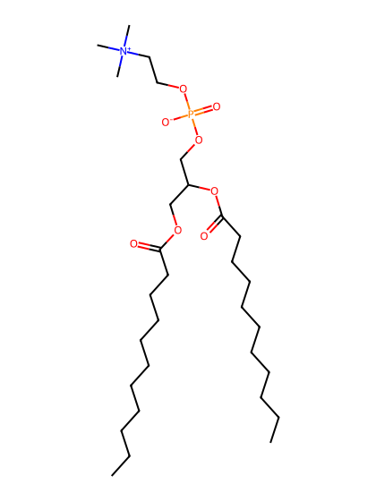
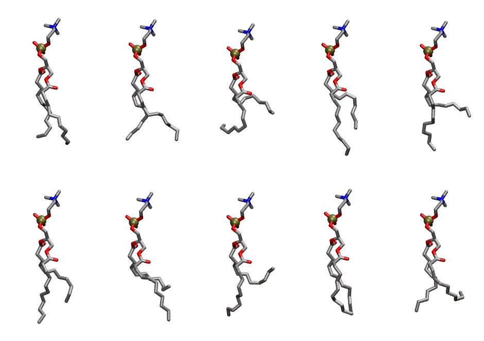
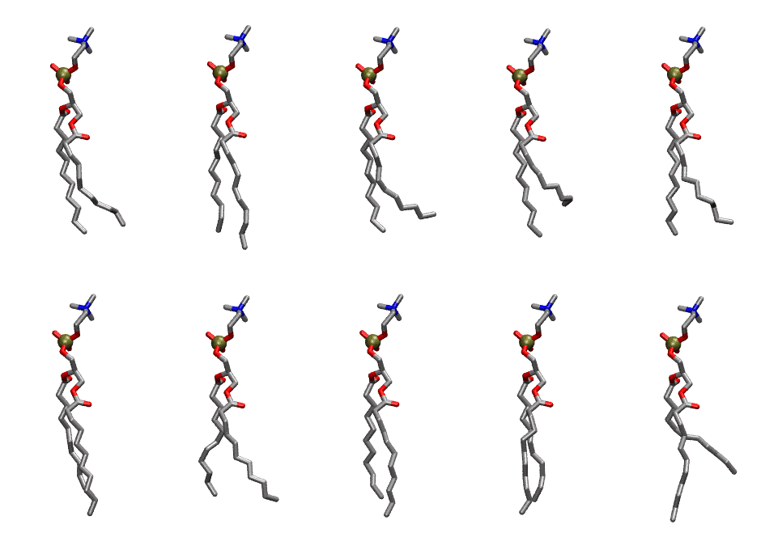

.. _lipid_gallery dcpc:

DCPC
====

**1,2 diundecanoyl-D-glycero-3-Phosphatidylcholine**

==============  ==========================================
CHARMM resname  ``DCPC``
Net charge      0.00
Atoms           100
Topology file   ``toppar_all36_lipid_miscellaneous.str``
Conformers      10 fluid, 10 liquid-ordered (``DCPC__Lo``)
==============  ==========================================

Structure
---------

Conformers
----------

The grid packer draws a conformer per lipid from an ensemble, so what the ensemble contains is what a built bilayer is made of. DCPC ships two: a fluid one, used by default, and a liquid-ordered one, used for a leaflet declared ``phase: Lo``. All conformers on this page are rendered at one shared scale.

Fluid (``DCPC``)
~~~~~~~~~~~~~~~~

===========  =============  ================  ================
Conformer    Head-tail (Å)  Max internal (Å)  Min chain extent
===========  =============  ================  ================
``DCPC-00``  8.09           22.26             0.74
``DCPC-01``  8.22           21.66             0.68
``DCPC-02``  3.23           19.74             0.44
``DCPC-03``  6.32           23.89             0.68
``DCPC-04``  4.12           23.05             0.51
``DCPC-05``  6.87           23.39             0.73
``DCPC-06``  4.05           22.86             0.50
``DCPC-07``  1.07           22.28             0.27
``DCPC-08``  8.81           21.99             0.74
``DCPC-09``  5.37           21.58             0.44
===========  =============  ================  ================

Liquid-ordered (``DCPC__Lo``)
~~~~~~~~~~~~~~~~~~~~~~~~~~~~~

===========  =============  ================  ================
Conformer    Head-tail (Å)  Max internal (Å)  Min chain extent
===========  =============  ================  ================
``DCPC-00``  9.17           23.31             0.74
``DCPC-01``  9.99           24.77             0.95
``DCPC-02``  8.10           23.18             0.66
``DCPC-03``  6.41           23.43             0.53
``DCPC-04``  8.98           23.57             0.73
``DCPC-05``  9.71           24.48             0.93
``DCPC-06``  9.33           23.48             0.80
``DCPC-07``  9.74           24.89             0.94
``DCPC-08``  10.01          24.67             0.92
``DCPC-09``  6.89           25.23             0.73
===========  =============  ================  ================

*Min chain extent* is how far the least-extended acyl chain descends below its own attachment carbon, as a fraction of that chain's all-trans contour; an all-trans chain scores 1.0, and a conformer under 0.25 is rejected at generation as folded.

Provenance
----------

How each ensemble was generated, read from the entry's own ``info.yaml``:

===================  ============  ============
Setting              ``DCPC``      ``DCPC__Lo``
===================  ============  ============
Sampler              ``mc``        ``mc``
Phase                none (fluid)  Lo
Trans bias           0.0           5.0
Chain order          0.141         0.290
MC seed              0             0
Chains               2             2
Cylinder APL         60.0 Ų       60.0 Ų
Cylinder inflation   1.9           1.9
Equilibration steps  20000         20000
Decorrelation steps  3000          3000
Max MC angle         30°           30°
Radius scale         0.8           0.8
Axial bias           1.0           1.0
===================  ============  ============
