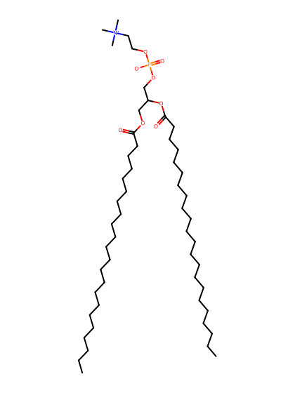
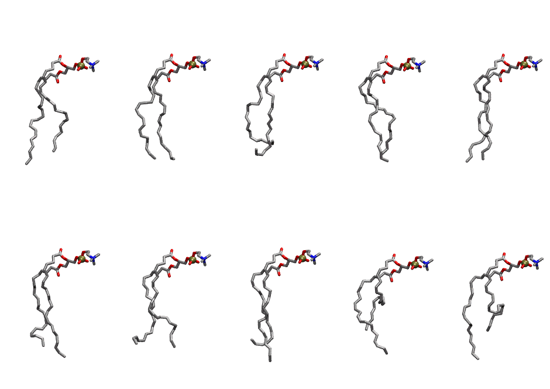

.. _lipid_gallery ddopc:

DDOPC
=====

**1-Docosahexaenoyl-2-Docosahexaenoyl-Phosphatidylcholine**

==============  ========================================
CHARMM resname  ``DDOPC``
Net charge      0.00
Atoms           142
Topology file   ``toppar_all36_lipid_miscellaneous.str``
Conformers      10 fluid
==============  ========================================

Structure
---------

Conformers
----------

The grid packer draws a conformer per lipid from this ensemble, so what the ensemble contains is what a built bilayer is made of. A leaflet declared ``phase: Lo`` generates an ordered ensemble when a build first needs it. All conformers are rendered at one shared scale.

============  =============  ================  ================
Conformer     Head-tail (Å)  Max internal (Å)  Min chain extent
============  =============  ================  ================
``DDOPC-00``  14.61          30.07             0.69
``DDOPC-01``  16.41          29.04             0.66
``DDOPC-02``  12.81          27.57             0.52
``DDOPC-03``  15.09          26.47             0.61
``DDOPC-04``  16.53          29.64             0.68
``DDOPC-05``  14.90          27.12             0.60
``DDOPC-06``  14.24          27.78             0.58
``DDOPC-07``  13.79          27.98             0.56
``DDOPC-08``  10.27          25.35             0.55
``DDOPC-09``  10.74          29.21             0.57
============  =============  ================  ================

*Min chain extent* is how far the least-extended acyl chain descends below its own attachment carbon, as a fraction of that chain's all-trans contour; an all-trans chain scores 1.0, and a conformer under 0.25 is rejected at generation as folded.

Provenance
----------

How the ensemble was generated, read from the entry's own ``info.yaml``:

===================  ============
Setting              ``DDOPC``
===================  ============
Sampler              ``mc``
Phase                none (fluid)
Trans bias           0.0
Chain order          0.156
MC seed              0
Chains               2
Cylinder APL         60.0 Ų
Cylinder inflation   1.9
Equilibration steps  20000
Decorrelation steps  3000
Max MC angle         30°
Radius scale         0.8
Axial bias           1.0
===================  ============
