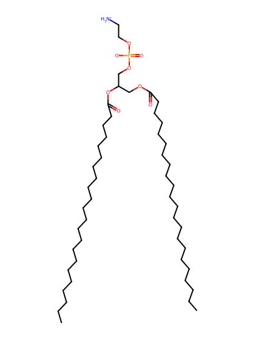
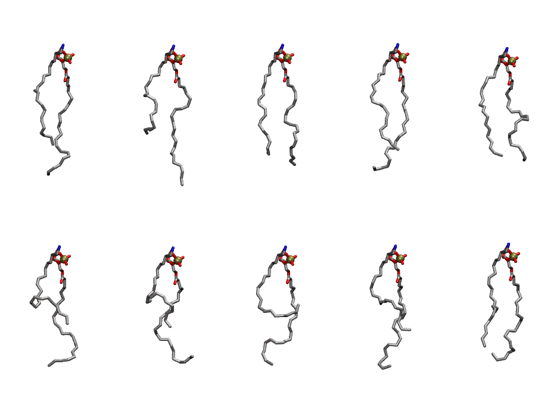

.. _lipid_gallery ddope:

DDOPE
=====

**1-Docosahexaenoyl-2-Docosahexaenoyl-Phosphatidylethanolamine**

==============  ========================================
CHARMM resname  ``DDOPE``
Net charge      0.00
Atoms           133
Topology file   ``toppar_all36_lipid_miscellaneous.str``
Conformers      10 fluid
==============  ========================================

Structure
---------

Conformers
----------

The grid packer draws a conformer per lipid from this ensemble, so what the ensemble contains is what a built bilayer is made of. A leaflet declared ``phase: Lo`` generates an ordered ensemble when a build first needs it. All conformers are rendered at one shared scale.

============  =============  ================  ================
Conformer     Head-tail (Å)  Max internal (Å)  Min chain extent
============  =============  ================  ================
``DDOPE-00``  12.30          29.32             0.67
``DDOPE-01``  9.98           29.94             0.58
``DDOPE-02``  13.99          27.26             0.64
``DDOPE-03``  13.42          27.22             0.67
``DDOPE-04``  13.84          26.08             0.59
``DDOPE-05``  7.96           25.59             0.50
``DDOPE-06``  8.31           26.70             0.52
``DDOPE-07``  4.36           25.73             0.37
``DDOPE-08``  9.32           27.61             0.56
``DDOPE-09``  12.86          27.29             0.57
============  =============  ================  ================

*Min chain extent* is how far the least-extended acyl chain descends below its own attachment carbon, as a fraction of that chain's all-trans contour; an all-trans chain scores 1.0, and a conformer under 0.25 is rejected at generation as folded.

Provenance
----------

How the ensemble was generated, read from the entry's own ``info.yaml``:

===================  ============
Setting              ``DDOPE``
===================  ============
Sampler              ``mc``
Phase                none (fluid)
Trans bias           0.0
Chain order          0.143
MC seed              0
Chains               2
Cylinder APL         60.0 Ų
Cylinder inflation   1.9
Equilibration steps  20000
Decorrelation steps  3000
Max MC angle         30°
Radius scale         0.8
Axial bias           1.0
===================  ============
