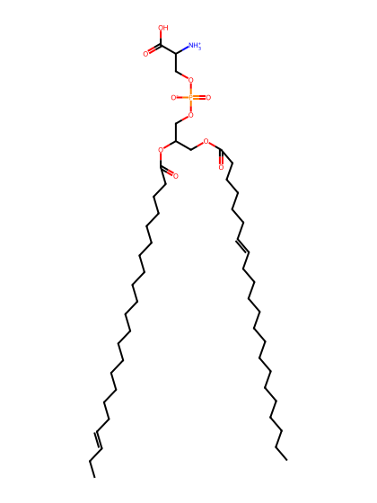
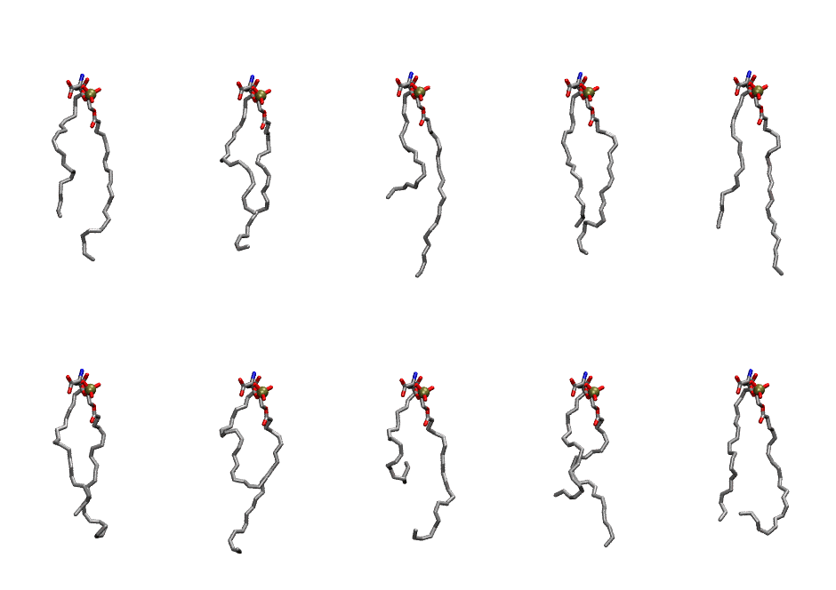

.. _lipid_gallery ddops:

DDOPS
=====

**1-Docosahexaenoyl-2-Docosahexaenoyl-Phosphatidylserine**

==============  ========================================
CHARMM resname  ``DDOPS``
Net charge      -1.00
Atoms           135
Topology file   ``toppar_all36_lipid_miscellaneous.str``
Conformers      10 fluid
==============  ========================================

Structure
---------

Conformers
----------

The grid packer draws a conformer per lipid from this ensemble, so what the ensemble contains is what a built bilayer is made of. A leaflet declared ``phase: Lo`` generates an ordered ensemble when a build first needs it. All conformers are rendered at one shared scale.

============  =============  ================  ================
Conformer     Head-tail (Å)  Max internal (Å)  Min chain extent
============  =============  ================  ================
``DDOPS-00``  12.67          28.35             0.69
``DDOPS-01``  12.02          27.42             0.66
``DDOPS-02``  10.31          32.06             0.60
``DDOPS-03``  14.30          28.68             0.71
``DDOPS-04``  14.65          31.52             0.76
``DDOPS-05``  13.13          27.21             0.59
``DDOPS-06``  7.66           27.70             0.50
``DDOPS-07``  5.46           25.39             0.42
``DDOPS-08``  10.02          26.87             0.59
``DDOPS-09``  12.99          25.38             0.52
============  =============  ================  ================

*Min chain extent* is how far the least-extended acyl chain descends below its own attachment carbon, as a fraction of that chain's all-trans contour; an all-trans chain scores 1.0, and a conformer under 0.25 is rejected at generation as folded.

Provenance
----------

How the ensemble was generated, read from the entry's own ``info.yaml``:

===================  ============
Setting              ``DDOPS``
===================  ============
Sampler              ``mc``
Phase                none (fluid)
Trans bias           0.0
Chain order          0.153
MC seed              0
Chains               2
Cylinder APL         60.0 Ų
Cylinder inflation   1.9
Equilibration steps  20000
Decorrelation steps  3000
Max MC angle         30°
Radius scale         0.8
Axial bias           1.0
===================  ============
