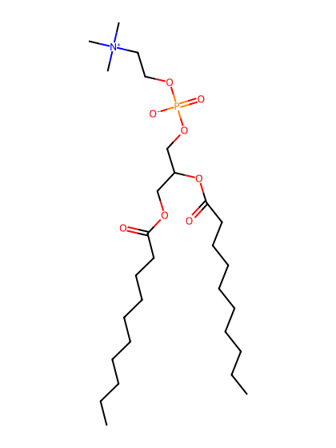
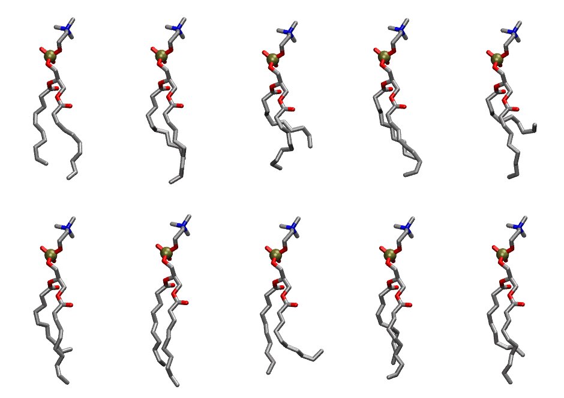
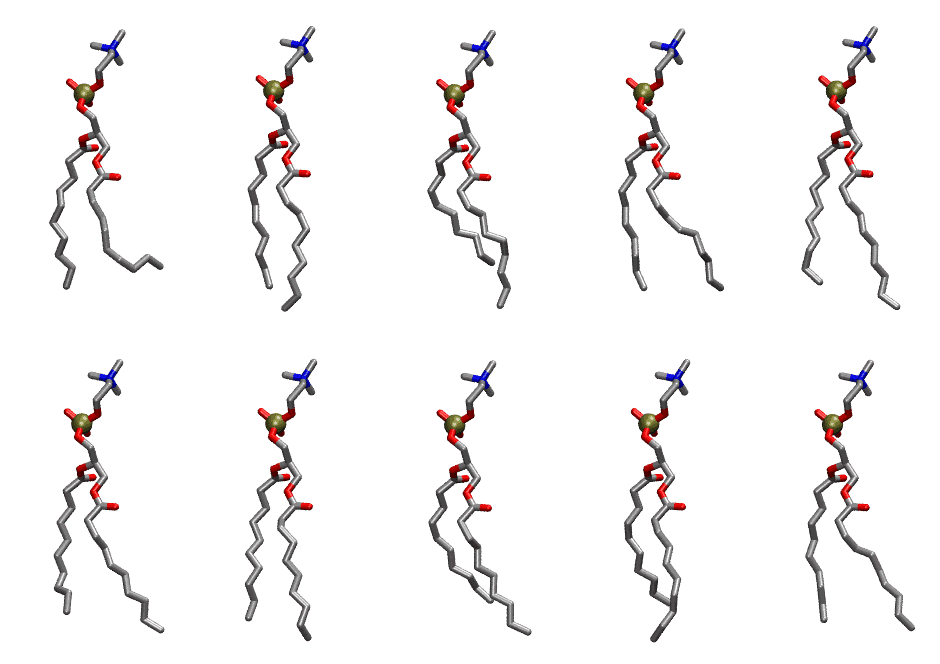

.. _lipid_gallery ddpc:

DDPC
====

**1,2 didecanoyl-D-glycero-3-Phosphatidylcholine**

==============  ==========================================
CHARMM resname  ``DDPC``
Net charge      0.00
Atoms           94
Topology file   ``toppar_all36_lipid_miscellaneous.str``
Conformers      10 fluid, 10 liquid-ordered (``DDPC__Lo``)
==============  ==========================================

Structure
---------

Conformers
----------

The grid packer draws a conformer per lipid from an ensemble, so what the ensemble contains is what a built bilayer is made of. DDPC ships two: a fluid one, used by default, and a liquid-ordered one, used for a leaflet declared ``phase: Lo``. All conformers on this page are rendered at one shared scale.

Fluid (``DDPC``)
~~~~~~~~~~~~~~~~

===========  =============  ================  ================
Conformer    Head-tail (Å)  Max internal (Å)  Min chain extent
===========  =============  ================  ================
``DDPC-00``  7.50           22.89             0.83
``DDPC-01``  6.79           22.81             0.79
``DDPC-02``  4.80           20.79             0.61
``DDPC-03``  6.66           22.40             0.78
``DDPC-04``  2.04           21.95             0.37
``DDPC-05``  5.75           23.23             0.70
``DDPC-06``  8.02           23.61             0.90
``DDPC-07``  6.00           21.88             0.53
``DDPC-08``  7.52           22.88             0.83
``DDPC-09``  6.58           22.99             0.77
===========  =============  ================  ================

Liquid-ordered (``DDPC__Lo``)
~~~~~~~~~~~~~~~~~~~~~~~~~~~~~

===========  =============  ================  ================
Conformer    Head-tail (Å)  Max internal (Å)  Min chain extent
===========  =============  ================  ================
``DDPC-00``  6.96           21.55             0.62
``DDPC-01``  8.74           23.60             0.92
``DDPC-02``  6.62           22.82             0.77
``DDPC-03``  8.69           22.12             0.77
``DDPC-04``  8.41           23.62             0.91
``DDPC-05``  8.16           22.91             0.85
``DDPC-06``  8.67           23.46             0.90
``DDPC-07``  7.19           22.99             0.82
``DDPC-08``  7.49           23.52             0.85
``DDPC-09``  8.73           22.94             0.83
===========  =============  ================  ================

*Min chain extent* is how far the least-extended acyl chain descends below its own attachment carbon, as a fraction of that chain's all-trans contour; an all-trans chain scores 1.0, and a conformer under 0.25 is rejected at generation as folded.

Provenance
----------

How each ensemble was generated, read from the entry's own ``info.yaml``:

===================  ============  ============
Setting              ``DDPC``      ``DDPC__Lo``
===================  ============  ============
Sampler              ``mc``        ``mc``
Phase                none (fluid)  Lo
Trans bias           0.0           3.75
Chain order          0.209         0.282
MC seed              0             0
Chains               2             2
Cylinder APL         60.0 Ų       60.0 Ų
Cylinder inflation   1.9           1.9
Equilibration steps  20000         20000
Decorrelation steps  3000          3000
Max MC angle         30°           30°
Radius scale         0.8           0.8
Axial bias           1.0           1.0
===================  ============  ============
