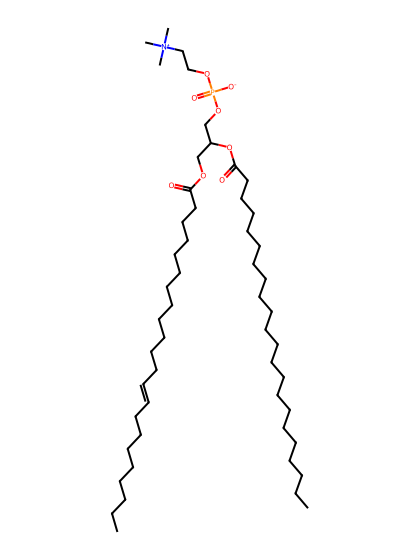
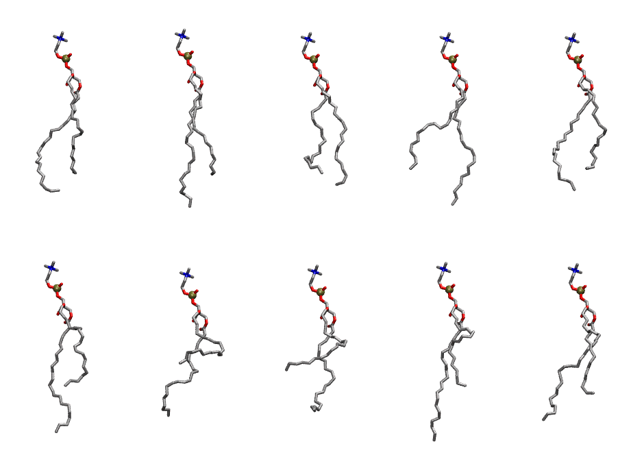

.. _lipid_gallery depc:

DEPC
====

**di-erucic-phosphatidylcholine (diC22:1)**

==============  ========================================
CHARMM resname  ``DEPC``
Net charge      0.00
Atoms           162
Topology file   ``toppar_all36_lipid_miscellaneous.str``
Conformers      10 fluid
==============  ========================================

Structure
---------

Conformers
----------

The grid packer draws a conformer per lipid from this ensemble, so what the ensemble contains is what a built bilayer is made of. A leaflet declared ``phase: Lo`` generates an ordered ensemble when a build first needs it. All conformers are rendered at one shared scale.

===========  =============  ================  ================
Conformer    Head-tail (Å)  Max internal (Å)  Min chain extent
===========  =============  ================  ================
``DEPC-00``  15.49          34.12             0.68
``DEPC-01``  16.43          36.16             0.72
``DEPC-02``  15.52          33.69             0.59
``DEPC-03``  14.64          36.08             0.65
``DEPC-04``  14.48          34.19             0.64
``DEPC-05``  12.31          35.57             0.56
``DEPC-06``  6.59           31.39             0.35
``DEPC-07``  8.51           32.68             0.42
``DEPC-08``  12.10          36.61             0.55
``DEPC-09``  13.39          33.75             0.60
===========  =============  ================  ================

*Min chain extent* is how far the least-extended acyl chain descends below its own attachment carbon, as a fraction of that chain's all-trans contour; an all-trans chain scores 1.0, and a conformer under 0.25 is rejected at generation as folded.

Provenance
----------

How the ensemble was generated, read from the entry's own ``info.yaml``:

===================  ============
Setting              ``DEPC``
===================  ============
Sampler              ``mc``
Phase                none (fluid)
Trans bias           0.0
Chain order          0.128
MC seed              0
Chains               2
Cylinder APL         60.0 Ų
Cylinder inflation   1.9
Equilibration steps  20000
Decorrelation steps  3000
Max MC angle         30°
Radius scale         0.8
Axial bias           1.0
===================  ============
