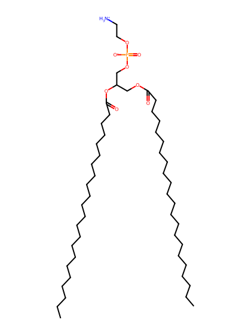
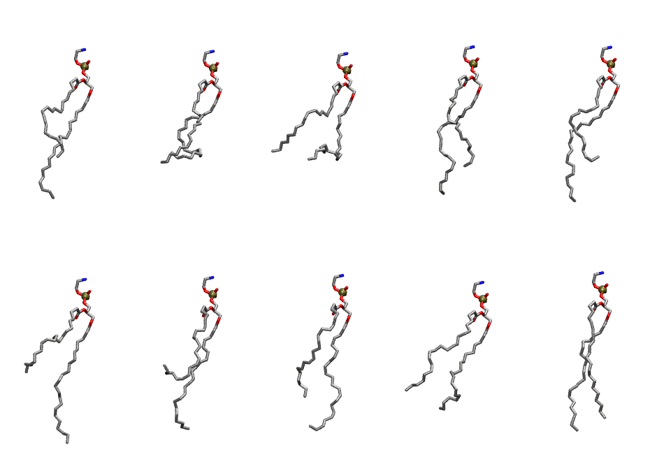

.. _lipid_gallery depe:

DEPE
====

**di-erucic-phosphatidylethanolamine (diC22:1)**

==============  ========================================
CHARMM resname  ``DEPE``
Net charge      0.00
Atoms           153
Topology file   ``toppar_all36_lipid_miscellaneous.str``
Conformers      10 fluid
==============  ========================================

Structure
---------

Conformers
----------

The grid packer draws a conformer per lipid from this ensemble, so what the ensemble contains is what a built bilayer is made of. A leaflet declared ``phase: Lo`` generates an ordered ensemble when a build first needs it. All conformers are rendered at one shared scale.

===========  =============  ================  ================
Conformer    Head-tail (Å)  Max internal (Å)  Min chain extent
===========  =============  ================  ================
``DEPE-00``  10.91          33.93             0.54
``DEPE-01``  9.82           30.57             0.38
``DEPE-02``  9.12           30.00             0.41
``DEPE-03``  13.25          31.39             0.62
``DEPE-04``  11.43          33.57             0.56
``DEPE-05``  8.11           34.12             0.43
``DEPE-06``  7.24           32.51             0.40
``DEPE-07``  13.61          33.55             0.64
``DEPE-08``  11.06          29.45             0.54
``DEPE-09``  18.24          34.44             0.79
===========  =============  ================  ================

*Min chain extent* is how far the least-extended acyl chain descends below its own attachment carbon, as a fraction of that chain's all-trans contour; an all-trans chain scores 1.0, and a conformer under 0.25 is rejected at generation as folded.

Provenance
----------

How the ensemble was generated, read from the entry's own ``info.yaml``:

===================  ============
Setting              ``DEPE``
===================  ============
Sampler              ``mc``
Phase                none (fluid)
Trans bias           0.0
Chain order          0.111
MC seed              0
Chains               2
Cylinder APL         60.0 Ų
Cylinder inflation   1.9
Equilibration steps  20000
Decorrelation steps  3000
Max MC angle         30°
Radius scale         0.8
Axial bias           1.0
===================  ============
