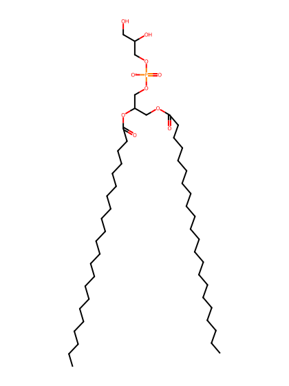
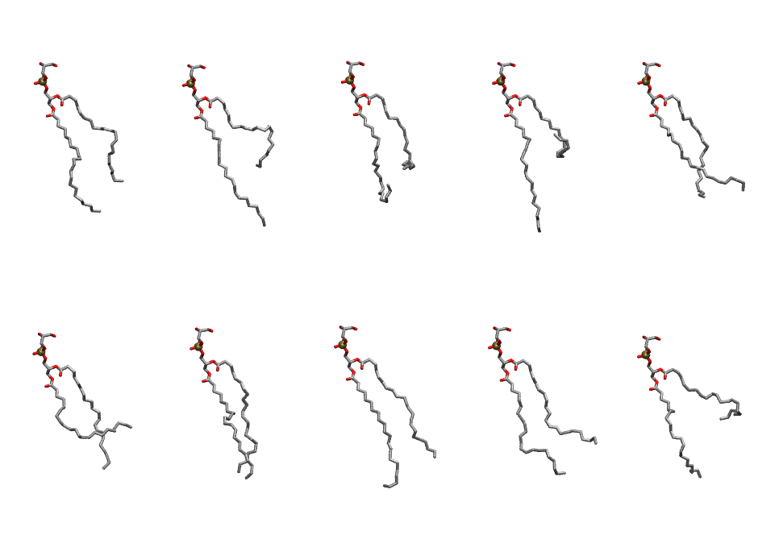

.. _lipid_gallery depg:

DEPG
====

**di-erucic-phosphatidylglycerol (diC22:1)**

==============  ========================================
CHARMM resname  ``DEPG``
Net charge      -1.00
Atoms           155
Topology file   ``toppar_all36_lipid_miscellaneous.str``
Conformers      10 fluid
==============  ========================================

Structure
---------

Conformers
----------

The grid packer draws a conformer per lipid from this ensemble, so what the ensemble contains is what a built bilayer is made of. A leaflet declared ``phase: Lo`` generates an ordered ensemble when a build first needs it. All conformers are rendered at one shared scale.

===========  =============  ================  ================
Conformer    Head-tail (Å)  Max internal (Å)  Min chain extent
===========  =============  ================  ================
``DEPG-00``  12.44          31.42             0.58
``DEPG-01``  9.09           34.87             0.46
``DEPG-02``  10.32          29.23             0.50
``DEPG-03``  3.60           34.68             0.25
``DEPG-04``  14.26          31.73             0.54
``DEPG-05``  7.82           29.83             0.30
``DEPG-06``  17.35          31.81             0.70
``DEPG-07``  14.85          33.51             0.67
``DEPG-08``  12.04          31.87             0.57
``DEPG-09``  5.67           30.51             0.33
===========  =============  ================  ================

*Min chain extent* is how far the least-extended acyl chain descends below its own attachment carbon, as a fraction of that chain's all-trans contour; an all-trans chain scores 1.0, and a conformer under 0.25 is rejected at generation as folded.

Provenance
----------

How the ensemble was generated, read from the entry's own ``info.yaml``:

===================  ============
Setting              ``DEPG``
===================  ============
Sampler              ``mc``
Phase                none (fluid)
Trans bias           0.0
Chain order          0.122
MC seed              0
Chains               2
Cylinder APL         60.0 Ų
Cylinder inflation   1.9
Equilibration steps  20000
Decorrelation steps  3000
Max MC angle         30°
Radius scale         0.8
Axial bias           1.0
===================  ============
