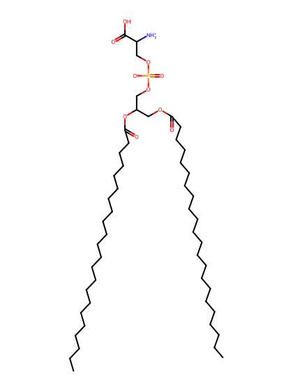
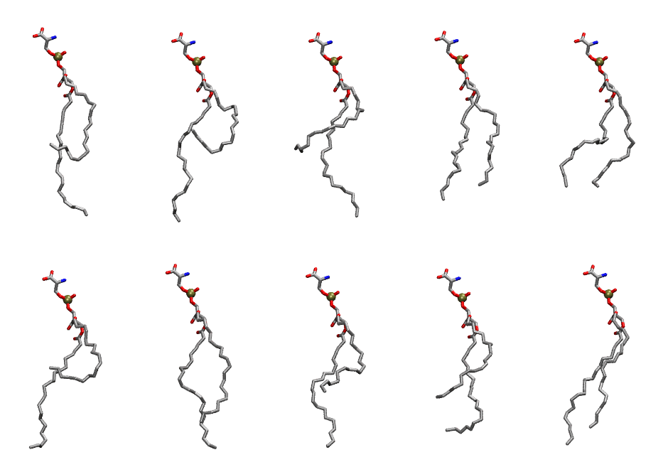

.. _lipid_gallery deps:

DEPS
====

**di-erucic-phosphatidylserine (diC22:1)**

==============  ========================================
CHARMM resname  ``DEPS``
Net charge      -1.00
Atoms           155
Topology file   ``toppar_all36_lipid_miscellaneous.str``
Conformers      10 fluid
==============  ========================================

Structure
---------

Conformers
----------

The grid packer draws a conformer per lipid from this ensemble, so what the ensemble contains is what a built bilayer is made of. A leaflet declared ``phase: Lo`` generates an ordered ensemble when a build first needs it. All conformers are rendered at one shared scale.

===========  =============  ================  ================
Conformer    Head-tail (Å)  Max internal (Å)  Min chain extent
===========  =============  ================  ================
``DEPS-00``  8.52           35.90             0.42
``DEPS-01``  5.17           33.68             0.30
``DEPS-02``  8.41           34.59             0.42
``DEPS-03``  14.97          33.87             0.66
``DEPS-04``  14.86          30.56             0.56
``DEPS-05``  5.08           33.62             0.30
``DEPS-06``  15.61          33.89             0.69
``DEPS-07``  9.70           34.07             0.47
``DEPS-08``  10.52          30.89             0.50
``DEPS-09``  16.38          34.04             0.72
===========  =============  ================  ================

*Min chain extent* is how far the least-extended acyl chain descends below its own attachment carbon, as a fraction of that chain's all-trans contour; an all-trans chain scores 1.0, and a conformer under 0.25 is rejected at generation as folded.

Provenance
----------

How the ensemble was generated, read from the entry's own ``info.yaml``:

===================  ============
Setting              ``DEPS``
===================  ============
Sampler              ``mc``
Phase                none (fluid)
Trans bias           0.0
Chain order          0.111
MC seed              0
Chains               2
Cylinder APL         60.0 Ų
Cylinder inflation   1.9
Equilibration steps  20000
Decorrelation steps  3000
Max MC angle         30°
Radius scale         0.8
Axial bias           1.0
===================  ============
