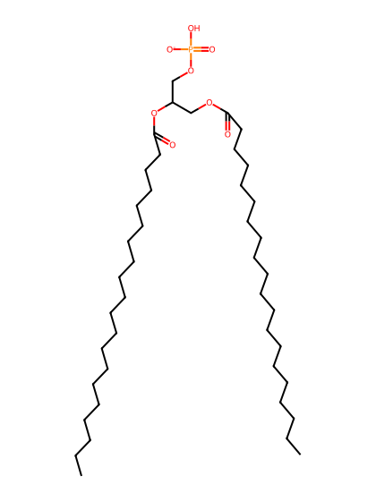
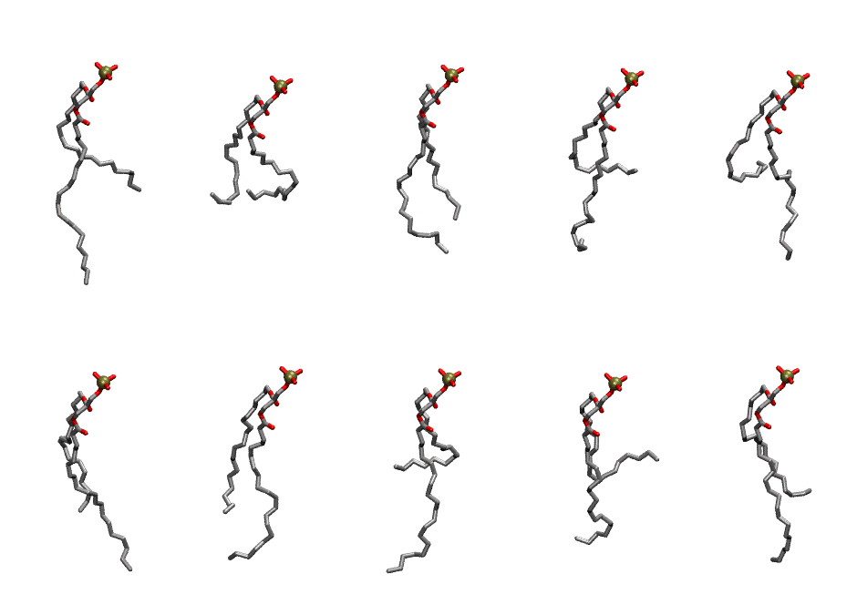

.. _lipid_gallery dgpa:

DGPA
====

**di-gadoleic-phosphatidic acid (diC20:1)**

==============  ========================================
CHARMM resname  ``DGPA``
Net charge      -1.00
Atoms           132
Topology file   ``toppar_all36_lipid_miscellaneous.str``
Conformers      10 fluid
==============  ========================================

Structure
---------

Conformers
----------

The grid packer draws a conformer per lipid from this ensemble, so what the ensemble contains is what a built bilayer is made of. A leaflet declared ``phase: Lo`` generates an ordered ensemble when a build first needs it. All conformers are rendered at one shared scale.

===========  =============  ================  ================
Conformer    Head-tail (Å)  Max internal (Å)  Min chain extent
===========  =============  ================  ================
``DGPA-00``  8.07           28.36             0.49
``DGPA-01``  6.59           24.18             0.29
``DGPA-02``  11.21          26.18             0.62
``DGPA-03``  5.00           29.57             0.37
``DGPA-04``  3.76           27.16             0.32
``DGPA-05``  9.39           28.04             0.55
``DGPA-06``  10.24          27.84             0.58
``DGPA-07``  4.48           28.50             0.35
``DGPA-08``  3.04           27.23             0.29
``DGPA-09``  7.73           28.26             0.48
===========  =============  ================  ================

*Min chain extent* is how far the least-extended acyl chain descends below its own attachment carbon, as a fraction of that chain's all-trans contour; an all-trans chain scores 1.0, and a conformer under 0.25 is rejected at generation as folded.

Provenance
----------

How the ensemble was generated, read from the entry's own ``info.yaml``:

===================  ============
Setting              ``DGPA``
===================  ============
Sampler              ``mc``
Phase                none (fluid)
Trans bias           0.0
Chain order          0.056
MC seed              0
Chains               2
Cylinder APL         60.0 Ų
Cylinder inflation   1.9
Equilibration steps  20000
Decorrelation steps  3000
Max MC angle         30°
Radius scale         0.8
Axial bias           1.0
===================  ============
