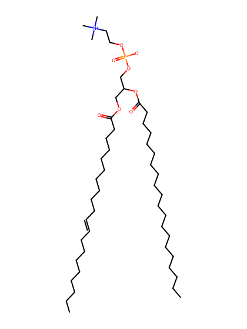
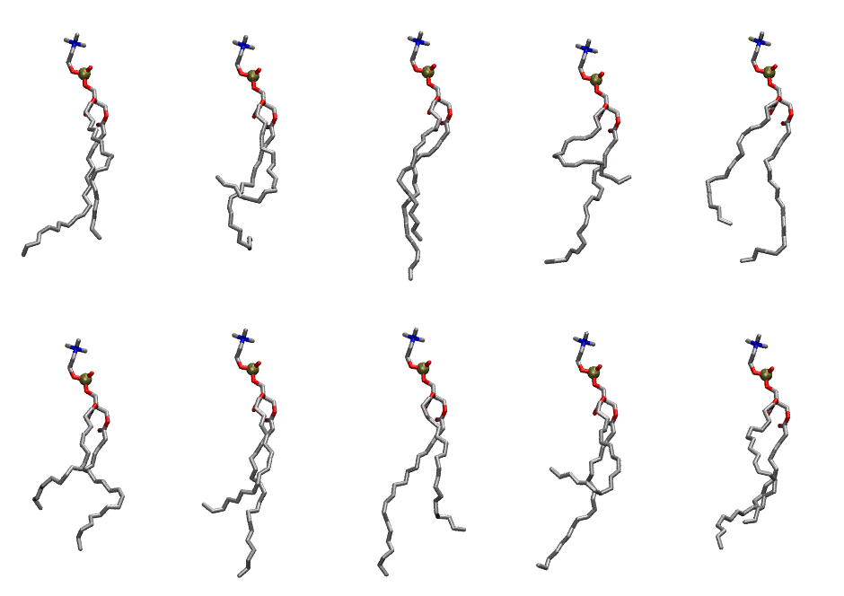

.. _lipid_gallery dgpc:

DGPC
====

**di-gadoleic-phosphatidylcholine (diC20:1)**

==============  ========================================
CHARMM resname  ``DGPC``
Net charge      0.00
Atoms           150
Topology file   ``toppar_all36_lipid_miscellaneous.str``
Conformers      10 fluid
==============  ========================================

Structure
---------

Conformers
----------

The grid packer draws a conformer per lipid from this ensemble, so what the ensemble contains is what a built bilayer is made of. A leaflet declared ``phase: Lo`` generates an ordered ensemble when a build first needs it. All conformers are rendered at one shared scale.

===========  =============  ================  ================
Conformer    Head-tail (Å)  Max internal (Å)  Min chain extent
===========  =============  ================  ================
``DGPC-00``  14.70          32.14             0.70
``DGPC-01``  6.54           29.85             0.37
``DGPC-02``  15.11          34.13             0.72
``DGPC-03``  6.01           31.18             0.35
``DGPC-04``  13.03          31.58             0.64
``DGPC-05``  10.10          30.14             0.52
``DGPC-06``  10.98          33.82             0.55
``DGPC-07``  14.33          33.84             0.69
``DGPC-08``  5.92           33.05             0.34
``DGPC-09``  12.53          31.57             0.62
===========  =============  ================  ================

*Min chain extent* is how far the least-extended acyl chain descends below its own attachment carbon, as a fraction of that chain's all-trans contour; an all-trans chain scores 1.0, and a conformer under 0.25 is rejected at generation as folded.

Provenance
----------

How the ensemble was generated, read from the entry's own ``info.yaml``:

===================  ============
Setting              ``DGPC``
===================  ============
Sampler              ``mc``
Phase                none (fluid)
Trans bias           0.0
Chain order          0.136
MC seed              0
Chains               2
Cylinder APL         60.0 Ų
Cylinder inflation   1.9
Equilibration steps  20000
Decorrelation steps  3000
Max MC angle         30°
Radius scale         0.8
Axial bias           1.0
===================  ============
