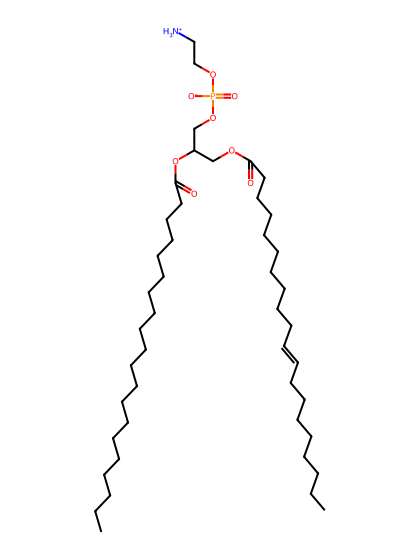
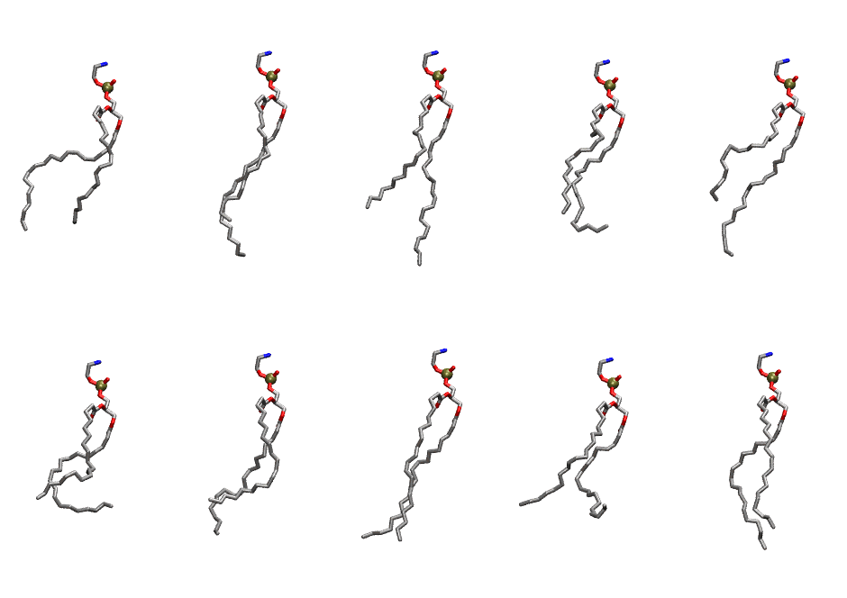

.. _lipid_gallery dgpe:

DGPE
====

**di-gadoleic-phosphatidylethanolamine (diC20:1)**

==============  ========================================
CHARMM resname  ``DGPE``
Net charge      0.00
Atoms           141
Topology file   ``toppar_all36_lipid_miscellaneous.str``
Conformers      10 fluid
==============  ========================================

Structure
---------

Conformers
----------

The grid packer draws a conformer per lipid from this ensemble, so what the ensemble contains is what a built bilayer is made of. A leaflet declared ``phase: Lo`` generates an ordered ensemble when a build first needs it. All conformers are rendered at one shared scale.

===========  =============  ================  ================
Conformer    Head-tail (Å)  Max internal (Å)  Min chain extent
===========  =============  ================  ================
``DGPE-00``  12.18          28.64             0.56
``DGPE-01``  13.43          31.19             0.69
``DGPE-02``  11.66          33.26             0.61
``DGPE-03``  11.14          29.15             0.55
``DGPE-04``  9.48           31.16             0.52
``DGPE-05``  9.06           27.59             0.43
``DGPE-06``  10.27          29.76             0.56
``DGPE-07``  16.13          31.36             0.68
``DGPE-08``  10.31          27.59             0.45
``DGPE-09``  14.25          29.63             0.72
===========  =============  ================  ================

*Min chain extent* is how far the least-extended acyl chain descends below its own attachment carbon, as a fraction of that chain's all-trans contour; an all-trans chain scores 1.0, and a conformer under 0.25 is rejected at generation as folded.

Provenance
----------

How the ensemble was generated, read from the entry's own ``info.yaml``:

===================  ============
Setting              ``DGPE``
===================  ============
Sampler              ``mc``
Phase                none (fluid)
Trans bias           0.0
Chain order          0.104
MC seed              0
Chains               2
Cylinder APL         60.0 Ų
Cylinder inflation   1.9
Equilibration steps  20000
Decorrelation steps  3000
Max MC angle         30°
Radius scale         0.8
Axial bias           1.0
===================  ============
