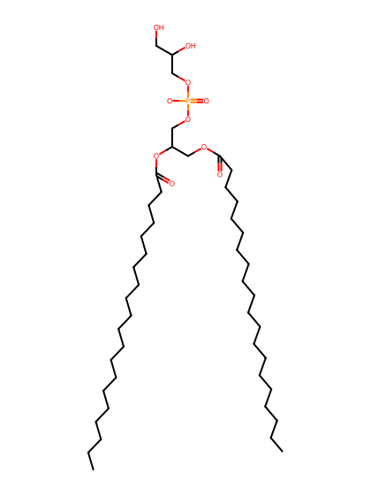
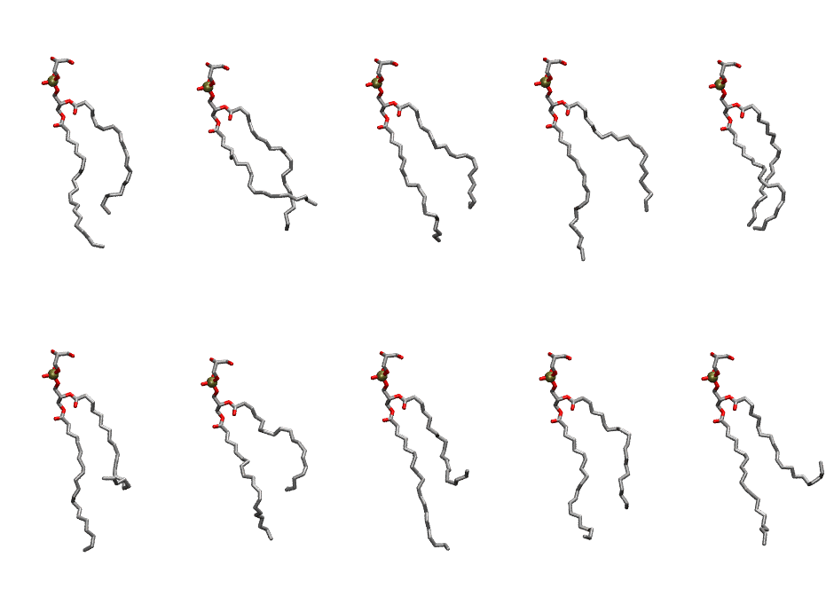

.. _lipid_gallery dgpg:

DGPG
====

**di-gadoleic-phosphatidylglycerol (diC20:1)**

==============  ========================================
CHARMM resname  ``DGPG``
Net charge      -1.00
Atoms           143
Topology file   ``toppar_all36_lipid_miscellaneous.str``
Conformers      10 fluid
==============  ========================================

Structure
---------

Conformers
----------

The grid packer draws a conformer per lipid from this ensemble, so what the ensemble contains is what a built bilayer is made of. A leaflet declared ``phase: Lo`` generates an ordered ensemble when a build first needs it. All conformers are rendered at one shared scale.

===========  =============  ================  ================
Conformer    Head-tail (Å)  Max internal (Å)  Min chain extent
===========  =============  ================  ================
``DGPG-00``  13.03          30.32             0.66
``DGPG-01``  10.88          29.31             0.46
``DGPG-02``  11.32          30.00             0.59
``DGPG-03``  12.51          31.38             0.64
``DGPG-04``  14.34          27.27             0.62
``DGPG-05``  8.90           31.64             0.49
``DGPG-06``  9.22           29.07             0.50
``DGPG-07``  7.57           31.95             0.43
``DGPG-08``  12.88          29.55             0.65
``DGPG-09``  6.17           30.91             0.38
===========  =============  ================  ================

*Min chain extent* is how far the least-extended acyl chain descends below its own attachment carbon, as a fraction of that chain's all-trans contour; an all-trans chain scores 1.0, and a conformer under 0.25 is rejected at generation as folded.

Provenance
----------

How the ensemble was generated, read from the entry's own ``info.yaml``:

===================  ============
Setting              ``DGPG``
===================  ============
Sampler              ``mc``
Phase                none (fluid)
Trans bias           0.0
Chain order          0.131
MC seed              0
Chains               2
Cylinder APL         60.0 Ų
Cylinder inflation   1.9
Equilibration steps  20000
Decorrelation steps  3000
Max MC angle         30°
Radius scale         0.8
Axial bias           1.0
===================  ============
