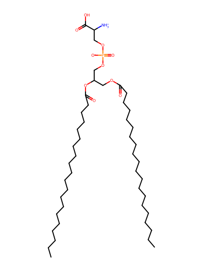
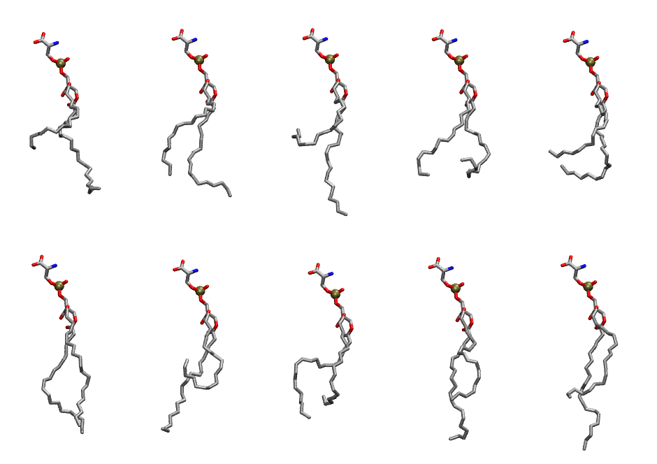

.. _lipid_gallery dgps:

DGPS
====

**di-gadoleic-phosphatidylserine (diC20:1)**

==============  ========================================
CHARMM resname  ``DGPS``
Net charge      -1.00
Atoms           143
Topology file   ``toppar_all36_lipid_miscellaneous.str``
Conformers      10 fluid
==============  ========================================

Structure
---------

Conformers
----------

The grid packer draws a conformer per lipid from this ensemble, so what the ensemble contains is what a built bilayer is made of. A leaflet declared ``phase: Lo`` generates an ordered ensemble when a build first needs it. All conformers are rendered at one shared scale.

===========  =============  ================  ================
Conformer    Head-tail (Å)  Max internal (Å)  Min chain extent
===========  =============  ================  ================
``DGPS-00``  7.12           30.30             0.40
``DGPS-01``  11.99          30.56             0.60
``DGPS-02``  4.76           33.37             0.30
``DGPS-03``  9.59           27.84             0.40
``DGPS-04``  7.91           25.62             0.43
``DGPS-05``  16.12          31.43             0.72
``DGPS-06``  4.59           30.99             0.30
``DGPS-07``  10.07          27.60             0.52
``DGPS-08``  11.45          31.00             0.58
``DGPS-09``  11.36          32.83             0.58
===========  =============  ================  ================

*Min chain extent* is how far the least-extended acyl chain descends below its own attachment carbon, as a fraction of that chain's all-trans contour; an all-trans chain scores 1.0, and a conformer under 0.25 is rejected at generation as folded.

Provenance
----------

How the ensemble was generated, read from the entry's own ``info.yaml``:

===================  ============
Setting              ``DGPS``
===================  ============
Sampler              ``mc``
Phase                none (fluid)
Trans bias           0.0
Chain order          0.104
MC seed              0
Chains               2
Cylinder APL         60.0 Ų
Cylinder inflation   1.9
Equilibration steps  20000
Decorrelation steps  3000
Max MC angle         30°
Radius scale         0.8
Axial bias           1.0
===================  ============
