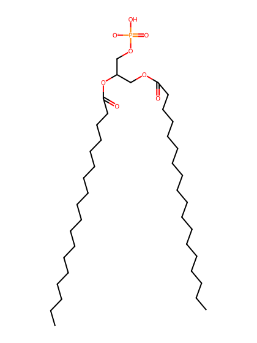
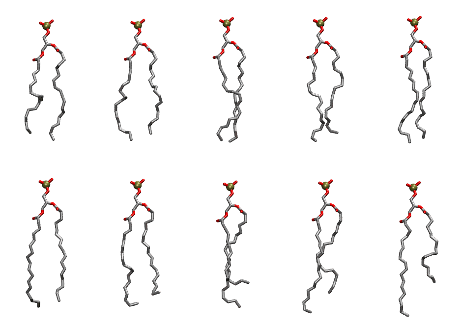

.. _lipid_gallery dipa:

DIPA
====

==============  ========================================
CHARMM resname  ``DIPA``
Net charge      -1.00
Atoms           112
Topology file   ``toppar_all36_lipid_miscellaneous.str``
Conformers      10 fluid
==============  ========================================

Structure
---------

Conformers
----------

The grid packer draws a conformer per lipid from this ensemble, so what the ensemble contains is what a built bilayer is made of. A leaflet declared ``phase: Lo`` generates an ordered ensemble when a build first needs it. All conformers are rendered at one shared scale.

===========  =============  ================  ================
Conformer    Head-tail (Å)  Max internal (Å)  Min chain extent
===========  =============  ================  ================
``DIPA-00``  14.63          25.73             0.69
``DIPA-01``  14.91          26.04             0.76
``DIPA-02``  16.58          26.68             0.78
``DIPA-03``  15.15          27.47             0.79
``DIPA-04``  16.32          27.25             0.81
``DIPA-05``  16.53          27.79             0.83
``DIPA-06``  14.69          27.23             0.78
``DIPA-07``  12.43          27.16             0.67
``DIPA-08``  14.62          28.86             0.77
``DIPA-09``  11.13          28.99             0.61
===========  =============  ================  ================

*Min chain extent* is how far the least-extended acyl chain descends below its own attachment carbon, as a fraction of that chain's all-trans contour; an all-trans chain scores 1.0, and a conformer under 0.25 is rejected at generation as folded.

Provenance
----------

How the ensemble was generated, read from the entry's own ``info.yaml``:

===================  ============
Setting              ``DIPA``
===================  ============
Sampler              ``mc``
Phase                none (fluid)
Trans bias           0.0
Chain order          0.252
MC seed              0
Chains               2
Cylinder APL         60.0 Ų
Cylinder inflation   1.9
Equilibration steps  20000
Decorrelation steps  3000
Max MC angle         30°
Radius scale         0.8
Axial bias           1.0
===================  ============
