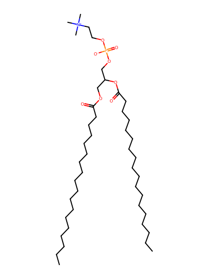
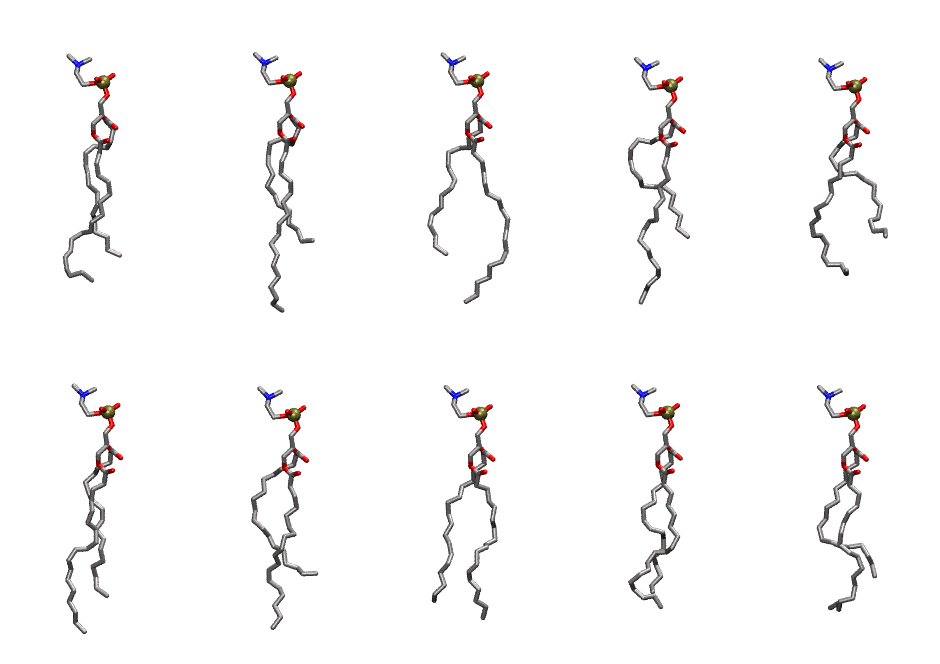

.. _lipid_gallery dlipc:

DLiPC
=====

**1,2-dilinoleoyl-sn-glycero-3-Phosphatidylcholine**

==============  ========================================
CHARMM resname  ``DLiPC``
Net charge      0.00
Atoms           134
Topology file   ``toppar_all36_lipid_miscellaneous.str``
Conformers      10 fluid
==============  ========================================

Structure
---------

Conformers
----------

The grid packer draws a conformer per lipid from this ensemble, so what the ensemble contains is what a built bilayer is made of. A leaflet declared ``phase: Lo`` generates an ordered ensemble when a build first needs it. All conformers are rendered at one shared scale.

============  =============  ================  ================
Conformer     Head-tail (Å)  Max internal (Å)  Min chain extent
============  =============  ================  ================
``DLiPC-00``  13.40          28.48             0.72
``DLiPC-01``  11.85          31.66             0.65
``DLiPC-02``  13.37          30.73             0.72
``DLiPC-03``  10.80          29.77             0.60
``DLiPC-04``  10.67          26.66             0.60
``DLiPC-05``  14.63          30.24             0.78
``DLiPC-06``  11.71          29.90             0.64
``DLiPC-07``  15.03          28.72             0.78
``DLiPC-08``  14.13          27.37             0.73
``DLiPC-09``  12.18          27.71             0.67
============  =============  ================  ================

*Min chain extent* is how far the least-extended acyl chain descends below its own attachment carbon, as a fraction of that chain's all-trans contour; an all-trans chain scores 1.0, and a conformer under 0.25 is rejected at generation as folded.

Provenance
----------

How the ensemble was generated, read from the entry's own ``info.yaml``:

===================  ============
Setting              ``DLiPC``
===================  ============
Sampler              ``mc``
Phase                none (fluid)
Trans bias           0.0
Chain order          0.196
MC seed              0
Chains               2
Cylinder APL         60.0 Ų
Cylinder inflation   1.9
Equilibration steps  20000
Decorrelation steps  3000
Max MC angle         30°
Radius scale         0.8
Axial bias           1.0
===================  ============
