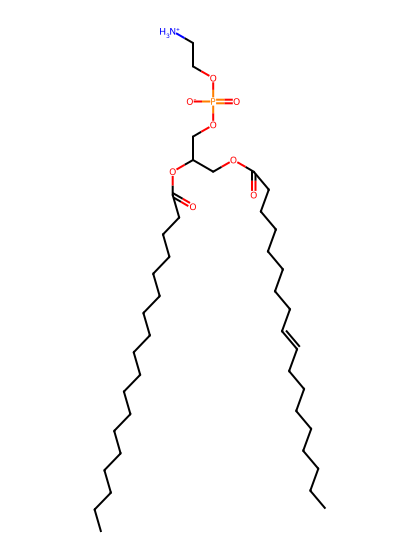
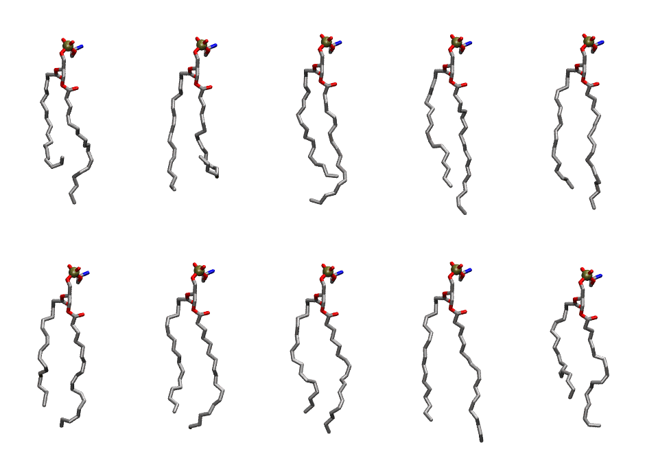

.. _lipid_gallery dlipe:

DLiPE
=====

**1,2-dilinoleoyl-sn-glycero-3-phosphoethanolamine**

==============  ========================================
CHARMM resname  ``DLiPE``
Net charge      0.00
Atoms           125
Topology file   ``toppar_all36_lipid_miscellaneous.str``
Conformers      10 fluid
==============  ========================================

Structure
---------

Conformers
----------

The grid packer draws a conformer per lipid from this ensemble, so what the ensemble contains is what a built bilayer is made of. A leaflet declared ``phase: Lo`` generates an ordered ensemble when a build first needs it. All conformers are rendered at one shared scale.

============  =============  ================  ================
Conformer     Head-tail (Å)  Max internal (Å)  Min chain extent
============  =============  ================  ================
``DLiPE-00``  10.49          25.77             0.58
``DLiPE-01``  10.56          24.74             0.48
``DLiPE-02``  13.90          26.59             0.74
``DLiPE-03``  15.31          27.70             0.80
``DLiPE-04``  15.62          26.76             0.82
``DLiPE-05``  13.70          25.91             0.73
``DLiPE-06``  14.92          26.15             0.79
``DLiPE-07``  14.78          25.83             0.78
``DLiPE-08``  16.32          28.23             0.85
``DLiPE-09``  12.08          24.59             0.65
============  =============  ================  ================

*Min chain extent* is how far the least-extended acyl chain descends below its own attachment carbon, as a fraction of that chain's all-trans contour; an all-trans chain scores 1.0, and a conformer under 0.25 is rejected at generation as folded.

Provenance
----------

How the ensemble was generated, read from the entry's own ``info.yaml``:

===================  ============
Setting              ``DLiPE``
===================  ============
Sampler              ``mc``
Phase                none (fluid)
Trans bias           0.0
Chain order          0.221
MC seed              0
Chains               2
Cylinder APL         60.0 Ų
Cylinder inflation   1.9
Equilibration steps  20000
Decorrelation steps  3000
Max MC angle         30°
Radius scale         0.8
Axial bias           1.0
===================  ============
