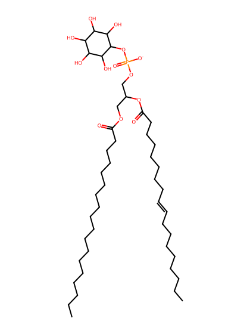
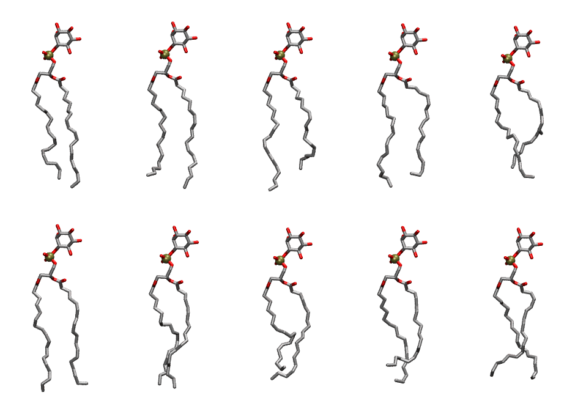

.. _lipid_gallery dlipi:

DLiPI
=====

**1,2-dilinoleoyl-sn-glycero-3-phosphoinositol**

==============  ===================================
CHARMM resname  ``DLiPI``
Net charge      -1.00
Atoms           137
Topology file   ``toppar_all36_lipid_inositol.str``
Conformers      10 fluid
==============  ===================================

Structure
---------

Conformers
----------

The grid packer draws a conformer per lipid from this ensemble, so what the ensemble contains is what a built bilayer is made of. A leaflet declared ``phase: Lo`` generates an ordered ensemble when a build first needs it. All conformers are rendered at one shared scale.

============  =============  ================  ================
Conformer     Head-tail (Å)  Max internal (Å)  Min chain extent
============  =============  ================  ================
``DLiPI-00``  17.30          29.97             0.77
``DLiPI-01``  16.98          29.93             0.75
``DLiPI-02``  15.67          30.39             0.71
``DLiPI-03``  16.37          29.55             0.75
``DLiPI-04``  14.85          27.66             0.68
``DLiPI-05``  17.97          29.98             0.82
``DLiPI-06``  17.74          28.87             0.79
``DLiPI-07``  14.53          27.73             0.64
``DLiPI-08``  14.46          28.52             0.66
``DLiPI-09``  15.93          27.55             0.72
============  =============  ================  ================

*Min chain extent* is how far the least-extended acyl chain descends below its own attachment carbon, as a fraction of that chain's all-trans contour; an all-trans chain scores 1.0, and a conformer under 0.25 is rejected at generation as folded.

Provenance
----------

How the ensemble was generated, read from the entry's own ``info.yaml``:

===================  ============
Setting              ``DLiPI``
===================  ============
Sampler              ``mc``
Phase                none (fluid)
Trans bias           0.0
Chain order          0.205
MC seed              0
Chains               2
Cylinder APL         60.0 Ų
Cylinder inflation   1.9
Equilibration steps  20000
Decorrelation steps  3000
Max MC angle         30°
Radius scale         0.8
Axial bias           1.0
===================  ============
