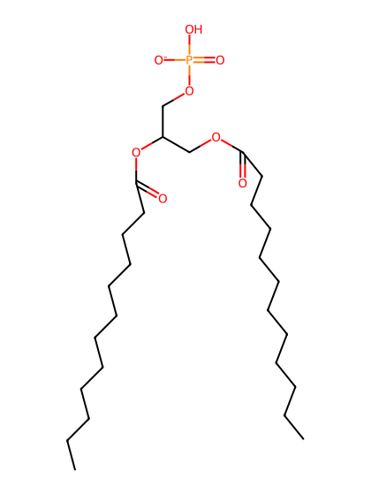
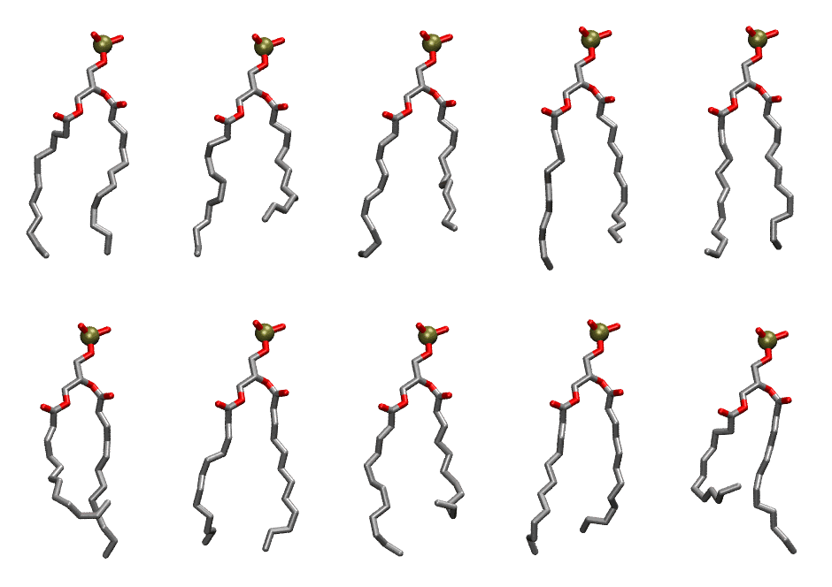
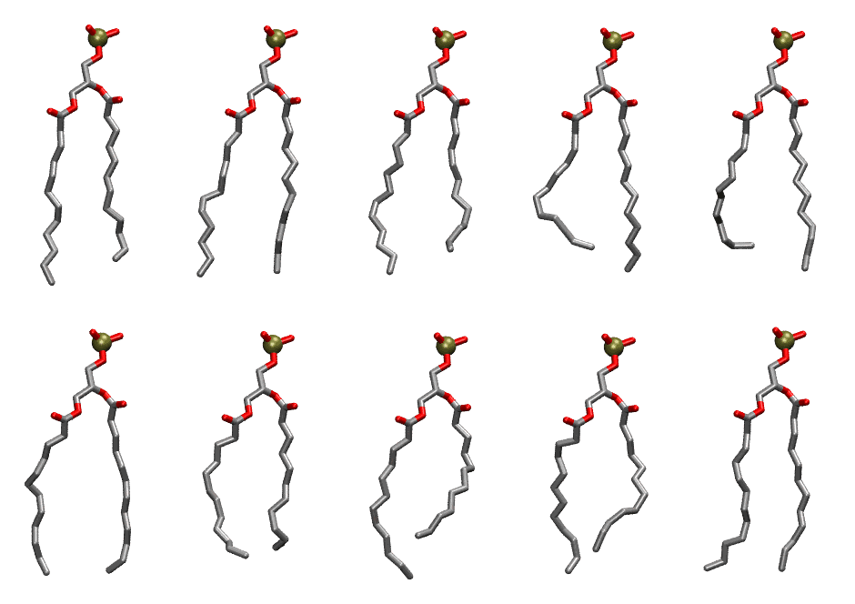

.. _lipid_gallery dlpa:

DLPA
====

**2,3 dilauroyl-D-glycero-1-Phosphatidic acid**

==============  ==========================================
CHARMM resname  ``DLPA``
Net charge      -1.00
Atoms           88
Topology file   ``top_all36_lipid.rtf``
Conformers      10 fluid, 10 liquid-ordered (``DLPA__Lo``)
==============  ==========================================

Structure
---------

Conformers
----------

The grid packer draws a conformer per lipid from an ensemble, so what the ensemble contains is what a built bilayer is made of. DLPA ships two: a fluid one, used by default, and a liquid-ordered one, used for a leaflet declared ``phase: Lo``. All conformers on this page are rendered at one shared scale.

Fluid (``DLPA``)
~~~~~~~~~~~~~~~~

===========  =============  ================  ================
Conformer    Head-tail (Å)  Max internal (Å)  Min chain extent
===========  =============  ================  ================
``DLPA-00``  11.53          21.07             0.82
``DLPA-01``  8.56           21.28             0.67
``DLPA-02``  9.62           21.73             0.75
``DLPA-03``  10.94          22.39             0.84
``DLPA-04``  11.54          22.12             0.83
``DLPA-05``  8.11           20.72             0.55
``DLPA-06``  11.69          21.23             0.81
``DLPA-07``  8.15           21.37             0.64
``DLPA-08``  10.67          22.26             0.82
``DLPA-09``  6.33           19.94             0.43
===========  =============  ================  ================

Liquid-ordered (``DLPA__Lo``)
~~~~~~~~~~~~~~~~~~~~~~~~~~~~~

===========  =============  ================  ================
Conformer    Head-tail (Å)  Max internal (Å)  Min chain extent
===========  =============  ================  ================
``DLPA-00``  12.10          23.33             0.93
``DLPA-01``  13.04          23.00             0.93
``DLPA-02``  11.14          22.44             0.86
``DLPA-03``  10.90          20.92             0.75
``DLPA-04``  10.80          21.21             0.75
``DLPA-05``  12.70          21.98             0.90
``DLPA-06``  10.31          20.84             0.78
``DLPA-07``  9.57           21.68             0.75
``DLPA-08``  10.60          21.47             0.82
``DLPA-09``  12.69          22.66             0.88
===========  =============  ================  ================

*Min chain extent* is how far the least-extended acyl chain descends below its own attachment carbon, as a fraction of that chain's all-trans contour; an all-trans chain scores 1.0, and a conformer under 0.25 is rejected at generation as folded.

Provenance
----------

How each ensemble was generated, read from the entry's own ``info.yaml``:

===================  ============  ============
Setting              ``DLPA``      ``DLPA__Lo``
===================  ============  ============
Sampler              ``mc``        ``mc``
Phase                none (fluid)  Lo
Trans bias           0.0           2.5
Chain order          0.239         0.290
MC seed              0             0
Chains               2             2
Cylinder APL         60.0 Ų       60.0 Ų
Cylinder inflation   1.9           1.9
Equilibration steps  20000         20000
Decorrelation steps  3000          3000
Max MC angle         30°           30°
Radius scale         0.8           0.8
Axial bias           1.0           1.0
===================  ============  ============
