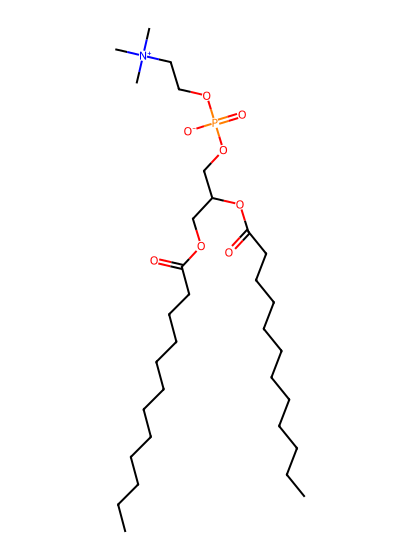
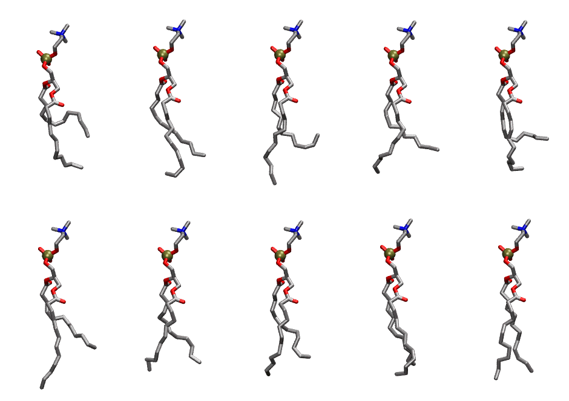
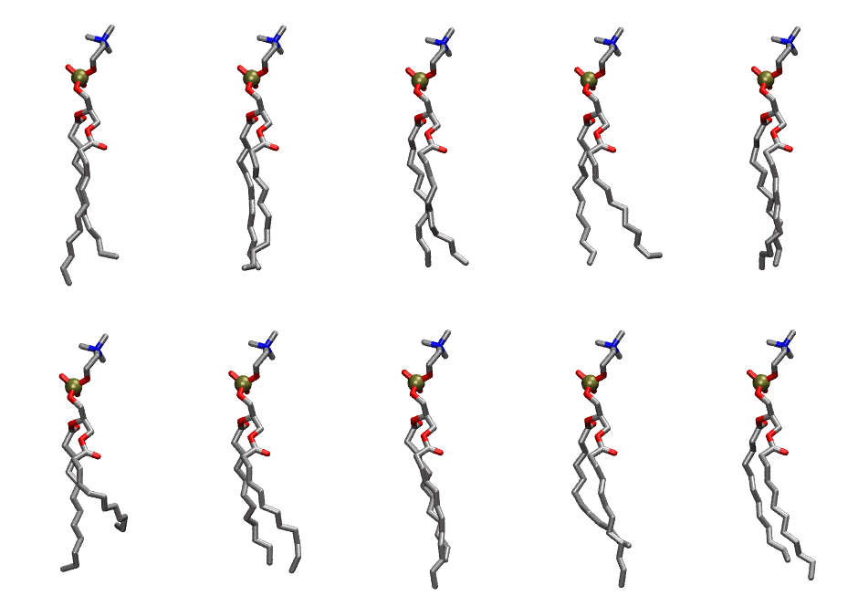

.. _lipid_gallery dlpc:

DLPC
====

**2,3 dilauroyl-D-glycero-1-Phosphatidylcholine**

==============  ==========================================
CHARMM resname  ``DLPC``
Net charge      0.00
Atoms           106
Topology file   ``top_all36_lipid.rtf``
Conformers      10 fluid, 10 liquid-ordered (``DLPC__Lo``)
==============  ==========================================

Structure
---------

Conformers
----------

The grid packer draws a conformer per lipid from an ensemble, so what the ensemble contains is what a built bilayer is made of. DLPC ships two: a fluid one, used by default, and a liquid-ordered one, used for a leaflet declared ``phase: Lo``. All conformers on this page are rendered at one shared scale.

Fluid (``DLPC``)
~~~~~~~~~~~~~~~~

===========  =============  ================  ================
Conformer    Head-tail (Å)  Max internal (Å)  Min chain extent
===========  =============  ================  ================
``DLPC-00``  4.42           22.38             0.49
``DLPC-01``  7.78           23.92             0.73
``DLPC-02``  4.90           24.92             0.52
``DLPC-03``  6.86           23.62             0.66
``DLPC-04``  5.33           22.87             0.55
``DLPC-05``  6.54           25.71             0.64
``DLPC-06``  8.62           23.22             0.72
``DLPC-07``  7.88           23.77             0.74
``DLPC-08``  9.18           23.87             0.79
``DLPC-09``  10.16          24.55             0.83
===========  =============  ================  ================

Liquid-ordered (``DLPC__Lo``)
~~~~~~~~~~~~~~~~~~~~~~~~~~~~~

===========  =============  ================  ================
Conformer    Head-tail (Å)  Max internal (Å)  Min chain extent
===========  =============  ================  ================
``DLPC-00``  10.35          26.30             0.91
``DLPC-01``  11.32          25.12             0.84
``DLPC-02``  10.65          24.07             0.79
``DLPC-03``  9.97           23.66             0.74
``DLPC-04``  10.89          24.36             0.83
``DLPC-05``  6.54           24.09             0.50
``DLPC-06``  10.33          24.25             0.82
``DLPC-07``  10.16          25.92             0.90
``DLPC-08``  8.76           25.97             0.80
``DLPC-09``  10.17          25.03             0.88
===========  =============  ================  ================

*Min chain extent* is how far the least-extended acyl chain descends below its own attachment carbon, as a fraction of that chain's all-trans contour; an all-trans chain scores 1.0, and a conformer under 0.25 is rejected at generation as folded.

Provenance
----------

How each ensemble was generated, read from the entry's own ``info.yaml``:

===================  ============  ============
Setting              ``DLPC``      ``DLPC__Lo``
===================  ============  ============
Sampler              ``mc``        ``mc``
Phase                none (fluid)  Lo
Trans bias           0.0           5.0
Chain order          0.176         0.287
MC seed              0             0
Chains               2             2
Cylinder APL         60.0 Ų       60.0 Ų
Cylinder inflation   1.9           1.9
Equilibration steps  20000         20000
Decorrelation steps  3000          3000
Max MC angle         30°           30°
Radius scale         0.8           0.8
Axial bias           1.0           1.0
===================  ============  ============
