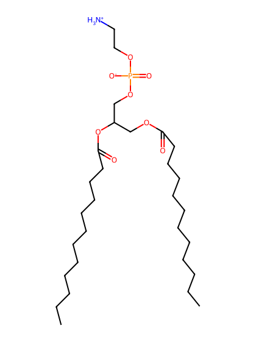
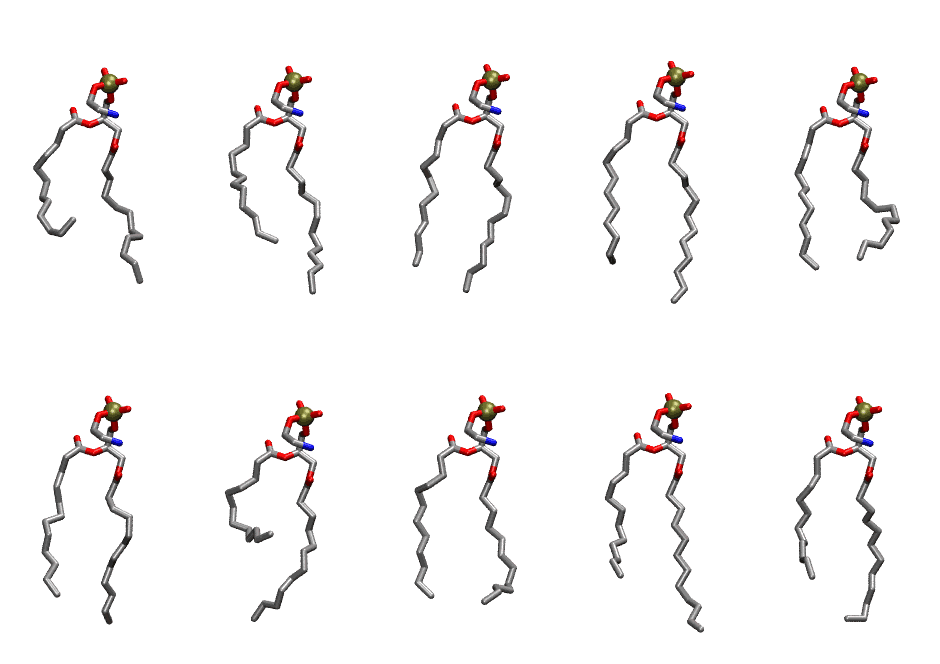
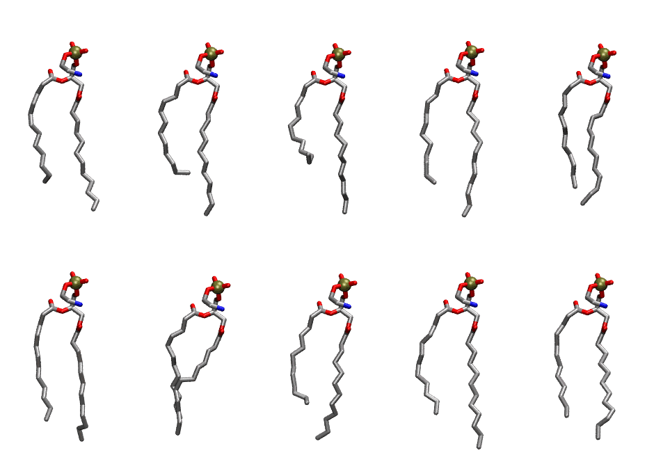

.. _lipid_gallery dlpe:

DLPE
====

**2,3 dilauroyl-D-glycero-1-Phosphatidylethanolamine**

==============  ==========================================
CHARMM resname  ``DLPE``
Net charge      0.00
Atoms           97
Topology file   ``top_all36_lipid.rtf``
Conformers      10 fluid, 10 liquid-ordered (``DLPE__Lo``)
==============  ==========================================

Structure
---------

Conformers
----------

The grid packer draws a conformer per lipid from an ensemble, so what the ensemble contains is what a built bilayer is made of. DLPE ships two: a fluid one, used by default, and a liquid-ordered one, used for a leaflet declared ``phase: Lo``. All conformers on this page are rendered at one shared scale.

Fluid (``DLPE``)
~~~~~~~~~~~~~~~~

===========  =============  ================  ================
Conformer    Head-tail (Å)  Max internal (Å)  Min chain extent
===========  =============  ================  ================
``DLPE-00``  6.07           18.49             0.59
``DLPE-01``  7.90           19.24             0.72
``DLPE-02``  10.00          19.19             0.83
``DLPE-03``  10.06          20.65             0.88
``DLPE-04``  9.24           17.83             0.62
``DLPE-05``  9.90           19.86             0.83
``DLPE-06``  4.51           19.01             0.48
``DLPE-07``  10.03          18.27             0.72
``DLPE-08``  8.53           20.55             0.77
``DLPE-09``  8.38           19.46             0.76
===========  =============  ================  ================

Liquid-ordered (``DLPE__Lo``)
~~~~~~~~~~~~~~~~~~~~~~~~~~~~~

===========  =============  ================  ================
Conformer    Head-tail (Å)  Max internal (Å)  Min chain extent
===========  =============  ================  ================
``DLPE-00``  10.09          21.05             0.88
``DLPE-01``  8.94           21.17             0.80
``DLPE-02``  6.68           20.83             0.64
``DLPE-03``  10.28          21.47             0.89
``DLPE-04``  10.47          20.14             0.86
``DLPE-05``  11.04          20.65             0.92
``DLPE-06``  10.28          19.97             0.83
``DLPE-07``  8.80           20.66             0.79
``DLPE-08``  10.19          21.48             0.89
``DLPE-09``  10.41          20.36             0.90
===========  =============  ================  ================

*Min chain extent* is how far the least-extended acyl chain descends below its own attachment carbon, as a fraction of that chain's all-trans contour; an all-trans chain scores 1.0, and a conformer under 0.25 is rejected at generation as folded.

Provenance
----------

How each ensemble was generated, read from the entry's own ``info.yaml``:

===================  ============  ============
Setting              ``DLPE``      ``DLPE__Lo``
===================  ============  ============
Sampler              ``mc``        ``mc``
Phase                none (fluid)  Lo
Trans bias           0.0           5.0
Chain order          0.218         0.312
MC seed              0             0
Chains               2             2
Cylinder APL         60.0 Ų       60.0 Ų
Cylinder inflation   1.9           1.9
Equilibration steps  20000         20000
Decorrelation steps  3000          3000
Max MC angle         30°           30°
Radius scale         0.8           0.8
Axial bias           1.0           1.0
===================  ============  ============
