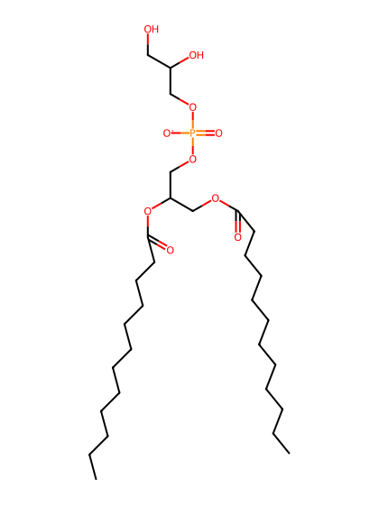
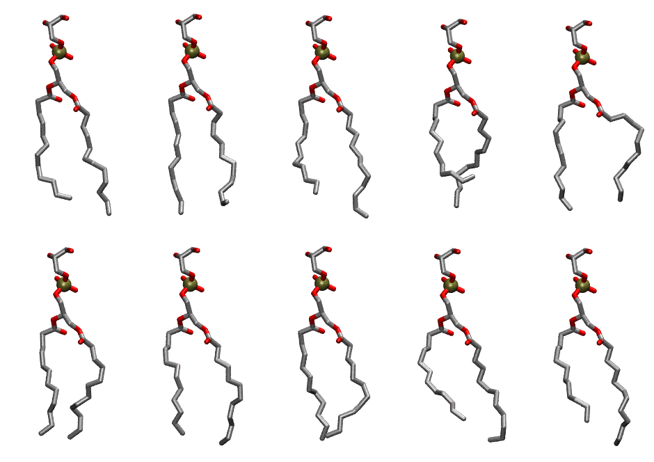

.. _lipid_gallery dlpg:

DLPG
====

**2,3 dilauroyl-D-glycero-1-Phosphatidylglycerol**

==============  ==========================================
CHARMM resname  ``DLPG``
Net charge      -1.00
Atoms           99
Topology file   ``top_all36_lipid.rtf``
Conformers      10 fluid, 10 liquid-ordered (``DLPG__Lo``)
==============  ==========================================

Structure
---------

Conformers
----------

The grid packer draws a conformer per lipid from an ensemble, so what the ensemble contains is what a built bilayer is made of. DLPG ships two: a fluid one, used by default, and a liquid-ordered one, used for a leaflet declared ``phase: Lo``. All conformers on this page are rendered at one shared scale.

Fluid (``DLPG``)
~~~~~~~~~~~~~~~~

===========  =============  ================  ================
Conformer    Head-tail (Å)  Max internal (Å)  Min chain extent
===========  =============  ================  ================
``DLPG-00``  9.82           24.33             0.81
``DLPG-01``  10.34          23.80             0.76
``DLPG-02``  9.14           24.69             0.76
``DLPG-03``  6.99           22.25             0.61
``DLPG-04``  9.38           22.47             0.69
``DLPG-05``  10.13          23.22             0.77
``DLPG-06``  10.12          24.16             0.82
``DLPG-07``  10.52          23.14             0.77
``DLPG-08``  8.39           23.54             0.71
``DLPG-09``  8.59           23.96             0.72
===========  =============  ================  ================

Liquid-ordered (``DLPG__Lo``)
~~~~~~~~~~~~~~~~~~~~~~~~~~~~~

===========  =============  ================  ================
Conformer    Head-tail (Å)  Max internal (Å)  Min chain extent
===========  =============  ================  ================
``DLPG-00``  9.82           24.33             0.81
``DLPG-01``  10.34          23.80             0.76
``DLPG-02``  9.14           24.69             0.76
``DLPG-03``  6.99           22.25             0.61
``DLPG-04``  9.38           22.47             0.69
``DLPG-05``  10.13          23.22             0.77
``DLPG-06``  10.12          24.16             0.82
``DLPG-07``  10.52          23.14             0.77
``DLPG-08``  8.39           23.54             0.71
``DLPG-09``  8.59           23.96             0.72
===========  =============  ================  ================

*Min chain extent* is how far the least-extended acyl chain descends below its own attachment carbon, as a fraction of that chain's all-trans contour; an all-trans chain scores 1.0, and a conformer under 0.25 is rejected at generation as folded.

Provenance
----------

How each ensemble was generated, read from the entry's own ``info.yaml``:

===================  ============  ============
Setting              ``DLPG``      ``DLPG__Lo``
===================  ============  ============
Sampler              ``mc``        ``mc``
Phase                none (fluid)  Lo
Trans bias           0.0           0.0
Chain order          0.232         0.232
MC seed              0             0
Chains               2             2
Cylinder APL         60.0 Ų       60.0 Ų
Cylinder inflation   1.9           1.9
Equilibration steps  20000         20000
Decorrelation steps  3000          3000
Max MC angle         30°           30°
Radius scale         0.8           0.8
Axial bias           1.0           1.0
===================  ============  ============
