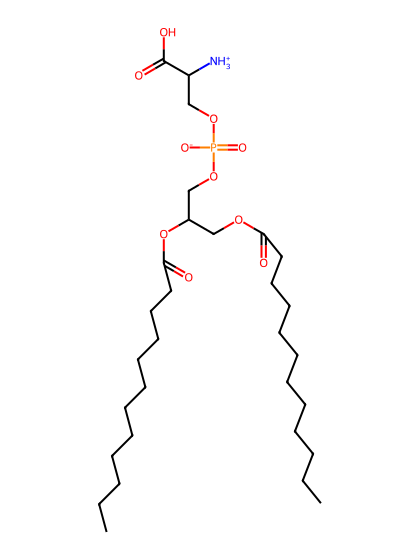
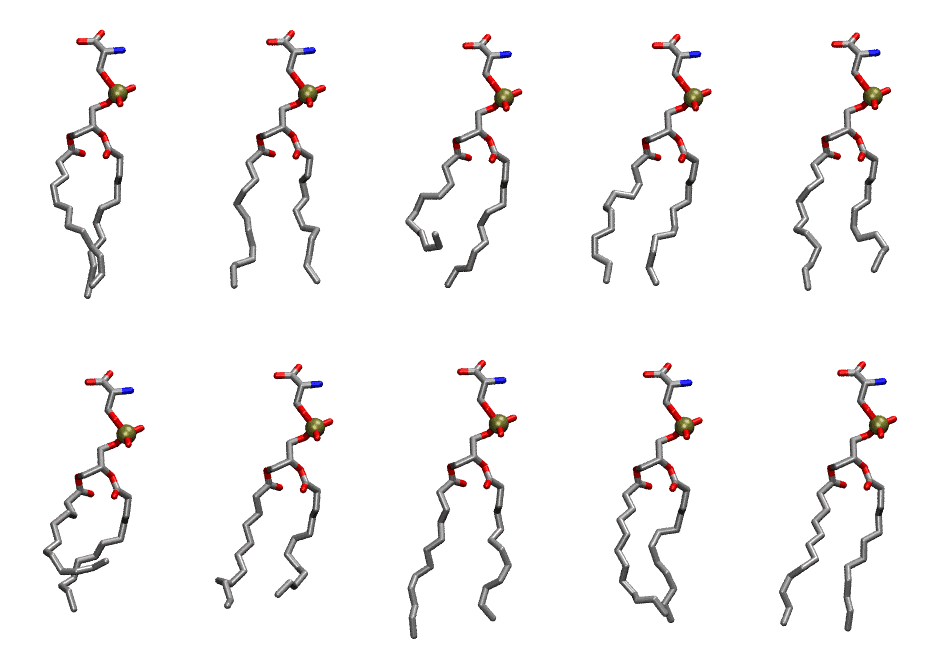
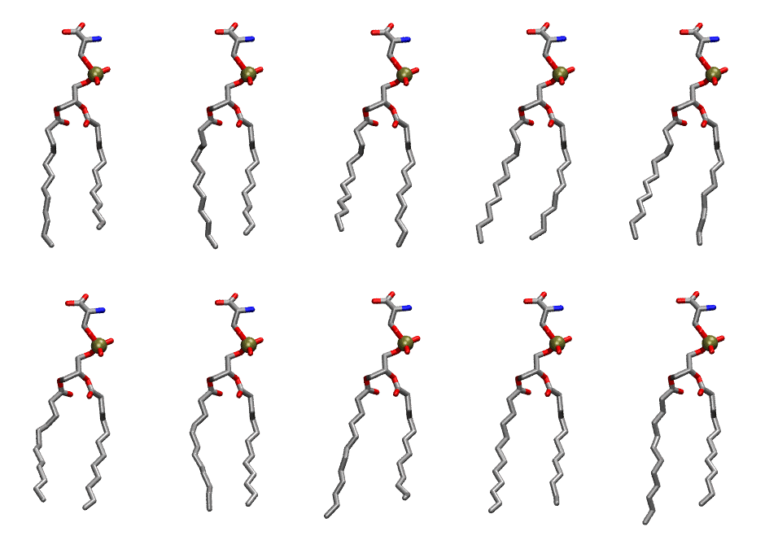

.. _lipid_gallery dlps:

DLPS
====

**2,3 dilauroyl-D-glycero-1-Phosphatidylserine**

==============  ==========================================
CHARMM resname  ``DLPS``
Net charge      -1.00
Atoms           99
Topology file   ``top_all36_lipid.rtf``
Conformers      10 fluid, 10 liquid-ordered (``DLPS__Lo``)
==============  ==========================================

Structure
---------

Conformers
----------

The grid packer draws a conformer per lipid from an ensemble, so what the ensemble contains is what a built bilayer is made of. DLPS ships two: a fluid one, used by default, and a liquid-ordered one, used for a leaflet declared ``phase: Lo``. All conformers on this page are rendered at one shared scale.

Fluid (``DLPS``)
~~~~~~~~~~~~~~~~

===========  =============  ================  ================
Conformer    Head-tail (Å)  Max internal (Å)  Min chain extent
===========  =============  ================  ================
``DLPS-00``  10.79          22.90             0.80
``DLPS-01``  10.38          22.70             0.78
``DLPS-02``  6.19           21.79             0.47
``DLPS-03``  10.06          22.30             0.75
``DLPS-04``  9.25           22.62             0.70
``DLPS-05``  5.40           20.73             0.42
``DLPS-06``  8.72           22.37             0.66
``DLPS-07``  10.99          24.24             0.82
``DLPS-08``  10.40          22.06             0.78
``DLPS-09``  11.29          23.65             0.84
===========  =============  ================  ================

Liquid-ordered (``DLPS__Lo``)
~~~~~~~~~~~~~~~~~~~~~~~~~~~~~

===========  =============  ================  ================
Conformer    Head-tail (Å)  Max internal (Å)  Min chain extent
===========  =============  ================  ================
``DLPS-00``  10.49          24.01             0.79
``DLPS-01``  11.07          23.72             0.83
``DLPS-02``  10.61          23.42             0.79
``DLPS-03``  11.55          24.36             0.86
``DLPS-04``  11.48          24.01             0.85
``DLPS-05``  10.57          23.38             0.79
``DLPS-06``  11.11          23.49             0.83
``DLPS-07``  10.62          24.73             0.80
``DLPS-08``  11.15          24.11             0.83
``DLPS-09``  11.28          24.91             0.84
===========  =============  ================  ================

*Min chain extent* is how far the least-extended acyl chain descends below its own attachment carbon, as a fraction of that chain's all-trans contour; an all-trans chain scores 1.0, and a conformer under 0.25 is rejected at generation as folded.

Provenance
----------

How each ensemble was generated, read from the entry's own ``info.yaml``:

===================  ============  ============
Setting              ``DLPS``      ``DLPS__Lo``
===================  ============  ============
Sampler              ``mc``        ``mc``
Phase                none (fluid)  Lo
Trans bias           0.0           20.0
Chain order          0.209         0.281
MC seed              0             0
Chains               2             2
Cylinder APL         60.0 Ų       60.0 Ų
Cylinder inflation   1.9           1.9
Equilibration steps  20000         20000
Decorrelation steps  3000          3000
Max MC angle         30°           30°
Radius scale         0.8           0.8
Axial bias           1.0           1.0
===================  ============  ============
