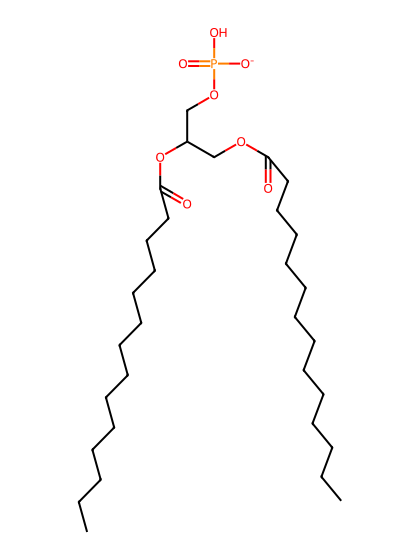
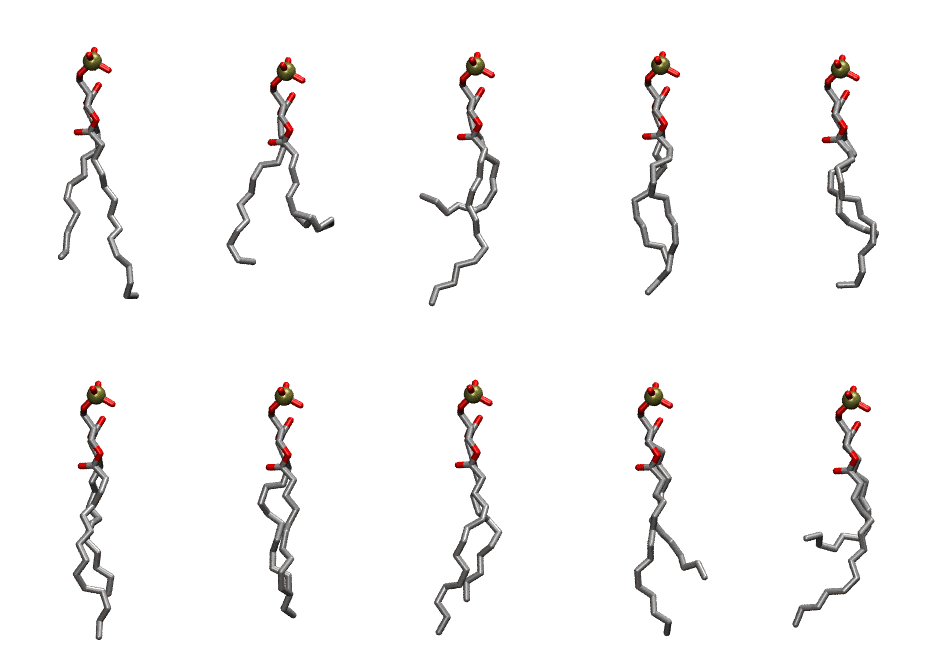
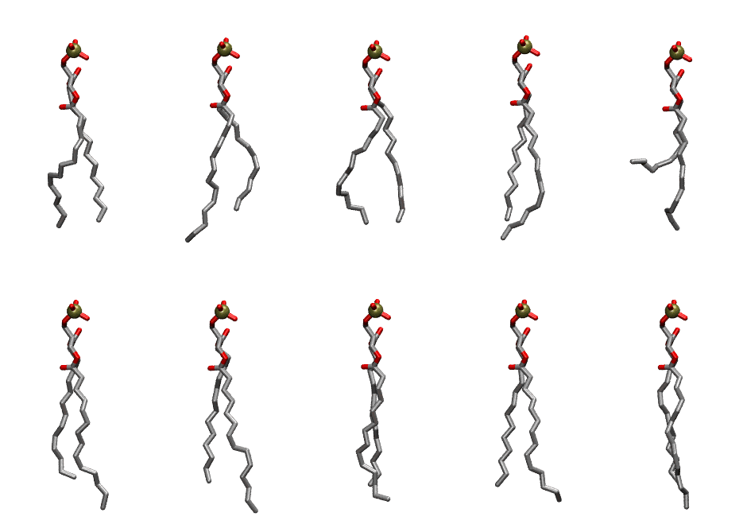

.. _lipid_gallery dmpa:

DMPA
====

**2,3 dimyristoyl-D-glycero-1-Phosphatidic acid**

==============  ==========================================
CHARMM resname  ``DMPA``
Net charge      -1.00
Atoms           100
Topology file   ``top_all36_lipid.rtf``
Conformers      10 fluid, 10 liquid-ordered (``DMPA__Lo``)
==============  ==========================================

Structure
---------

Conformers
----------

The grid packer draws a conformer per lipid from an ensemble, so what the ensemble contains is what a built bilayer is made of. DMPA ships two: a fluid one, used by default, and a liquid-ordered one, used for a leaflet declared ``phase: Lo``. All conformers on this page are rendered at one shared scale.

Fluid (``DMPA``)
~~~~~~~~~~~~~~~~

===========  =============  ================  ================
Conformer    Head-tail (Å)  Max internal (Å)  Min chain extent
===========  =============  ================  ================
``DMPA-00``  10.81          22.68             0.84
``DMPA-01``  6.28           19.42             0.38
``DMPA-02``  5.12           22.66             0.49
``DMPA-03``  11.01          21.45             0.82
``DMPA-04``  9.03           20.71             0.73
``DMPA-05``  11.06          22.63             0.85
``DMPA-06``  10.89          21.10             0.75
``DMPA-07``  11.62          22.61             0.88
``DMPA-08``  9.50           22.33             0.76
``DMPA-09``  5.83           21.60             0.54
===========  =============  ================  ================

Liquid-ordered (``DMPA__Lo``)
~~~~~~~~~~~~~~~~~~~~~~~~~~~~~

===========  =============  ================  ================
Conformer    Head-tail (Å)  Max internal (Å)  Min chain extent
===========  =============  ================  ================
``DMPA-00``  12.31          21.96             0.79
``DMPA-01``  11.24          23.02             0.87
``DMPA-02``  12.26          21.95             0.76
``DMPA-03``  12.61          22.82             0.89
``DMPA-04``  5.74           22.14             0.53
``DMPA-05``  11.91          23.36             0.91
``DMPA-06``  12.29          23.85             0.93
``DMPA-07``  12.80          22.45             0.88
``DMPA-08``  12.79          22.78             0.88
``DMPA-09``  12.54          22.90             0.92
===========  =============  ================  ================

*Min chain extent* is how far the least-extended acyl chain descends below its own attachment carbon, as a fraction of that chain's all-trans contour; an all-trans chain scores 1.0, and a conformer under 0.25 is rejected at generation as folded.

Provenance
----------

How each ensemble was generated, read from the entry's own ``info.yaml``:

===================  ============  ============
Setting              ``DMPA``      ``DMPA__Lo``
===================  ============  ============
Sampler              ``mc``        ``mc``
Phase                none (fluid)  Lo
Trans bias           0.0           5.0
Chain order          0.227         0.306
MC seed              0             0
Chains               2             2
Cylinder APL         60.0 Ų       60.0 Ų
Cylinder inflation   1.9           1.9
Equilibration steps  20000         20000
Decorrelation steps  3000          3000
Max MC angle         30°           30°
Radius scale         0.8           0.8
Axial bias           1.0           1.0
===================  ============  ============
