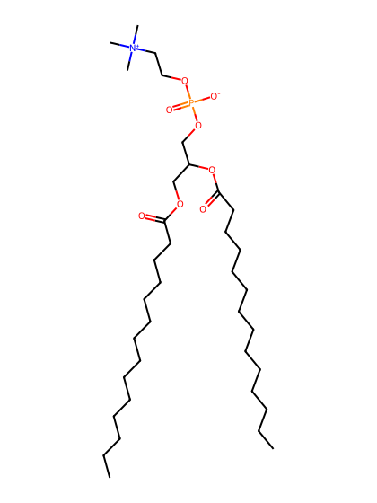
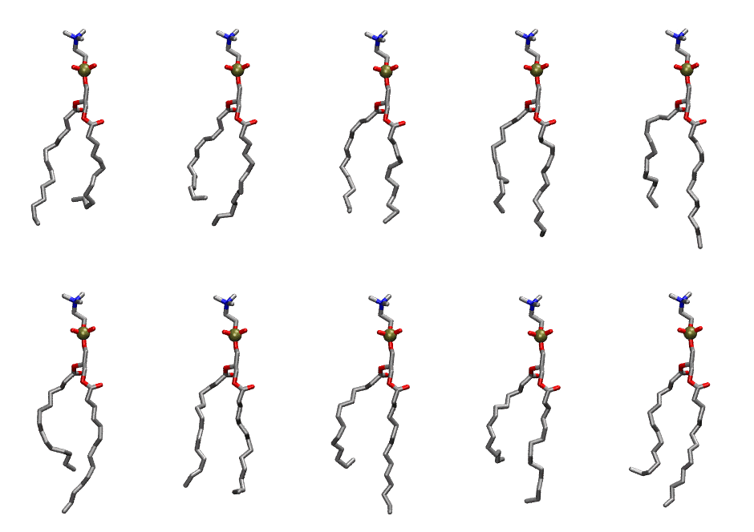
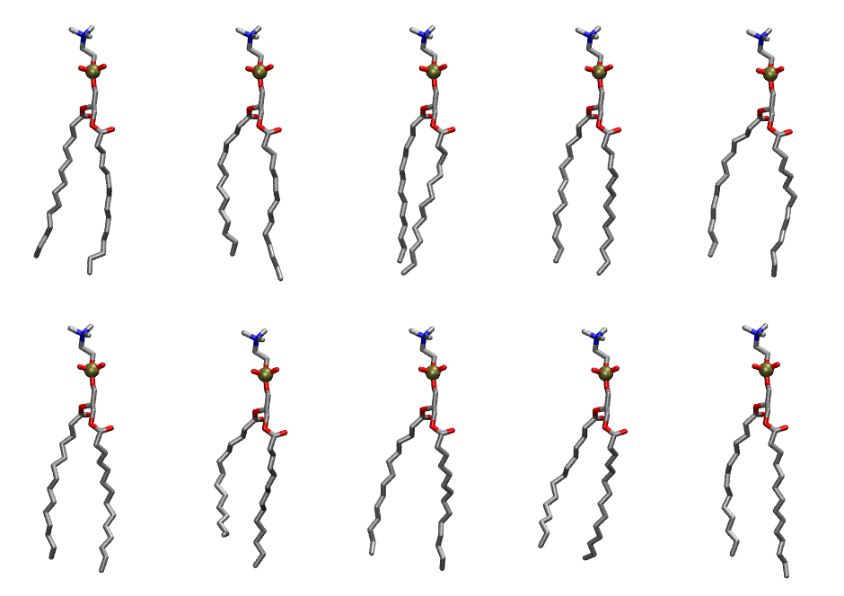

.. _lipid_gallery dmpc:

DMPC
====

**2,3 dimyristoyl-D-glycero-1-Phosphatidylcholine**

==============  ==========================================
CHARMM resname  ``DMPC``
Net charge      0.00
Atoms           118
Topology file   ``top_all36_lipid.rtf``
Conformers      10 fluid, 10 liquid-ordered (``DMPC__Lo``)
==============  ==========================================

Structure
---------

Conformers
----------

The grid packer draws a conformer per lipid from an ensemble, so what the ensemble contains is what a built bilayer is made of. DMPC ships two: a fluid one, used by default, and a liquid-ordered one, used for a leaflet declared ``phase: Lo``. All conformers on this page are rendered at one shared scale.

Fluid (``DMPC``)
~~~~~~~~~~~~~~~~

===========  =============  ================  ================
Conformer    Head-tail (Å)  Max internal (Å)  Min chain extent
===========  =============  ================  ================
``DMPC-00``  9.48           26.13             0.55
``DMPC-01``  9.24           25.84             0.65
``DMPC-02``  10.71          24.98             0.70
``DMPC-03``  10.89          26.95             0.75
``DMPC-04``  10.28          28.04             0.71
``DMPC-05``  10.26          28.36             0.71
``DMPC-06``  12.01          25.85             0.75
``DMPC-07``  8.90           28.20             0.62
``DMPC-08``  8.68           26.73             0.61
``DMPC-09``  10.28          28.10             0.71
===========  =============  ================  ================

Liquid-ordered (``DMPC__Lo``)
~~~~~~~~~~~~~~~~~~~~~~~~~~~~~

===========  =============  ================  ================
Conformer    Head-tail (Å)  Max internal (Å)  Min chain extent
===========  =============  ================  ================
``DMPC-00``  13.73          28.08             0.92
``DMPC-01``  13.47          29.20             0.90
``DMPC-02``  14.27          28.86             0.92
``DMPC-03``  14.23          28.60             0.92
``DMPC-04``  13.35          28.52             0.89
``DMPC-05``  14.02          28.25             0.91
``DMPC-06``  11.10          27.73             0.76
``DMPC-07``  13.31          28.22             0.88
``DMPC-08``  12.40          27.18             0.81
``DMPC-09``  13.75          29.03             0.92
===========  =============  ================  ================

*Min chain extent* is how far the least-extended acyl chain descends below its own attachment carbon, as a fraction of that chain's all-trans contour; an all-trans chain scores 1.0, and a conformer under 0.25 is rejected at generation as folded.

Provenance
----------

How each ensemble was generated, read from the entry's own ``info.yaml``:

===================  ============  ============
Setting              ``DMPC``      ``DMPC__Lo``
===================  ============  ============
Sampler              ``mc``        ``mc``
Phase                none (fluid)  Lo
Trans bias           0.0           10.0
Chain order          0.176         0.309
MC seed              0             0
Chains               2             2
Cylinder APL         60.0 Ų       60.0 Ų
Cylinder inflation   1.9           1.9
Equilibration steps  20000         20000
Decorrelation steps  3000          3000
Max MC angle         30°           30°
Radius scale         0.8           0.8
Axial bias           1.0           1.0
===================  ============  ============
