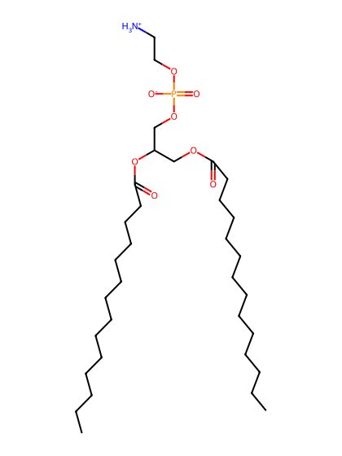
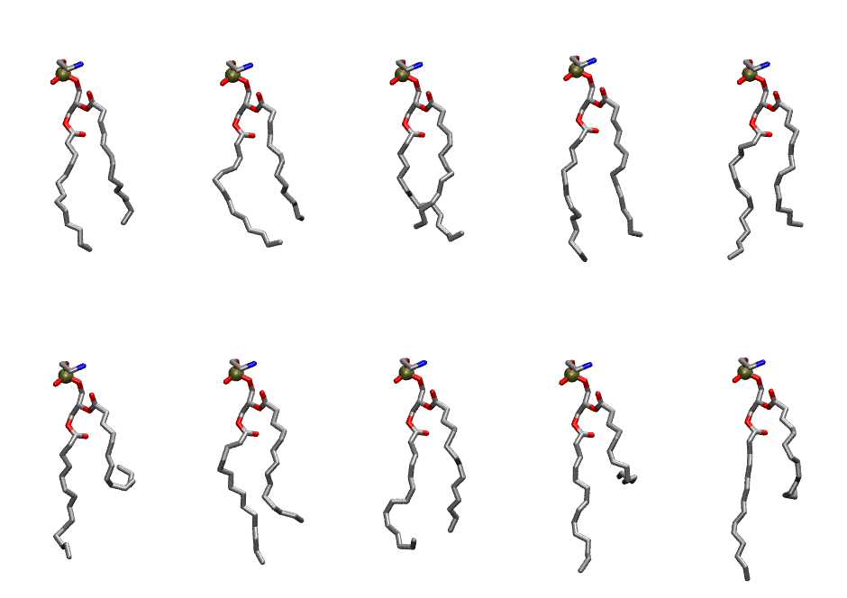
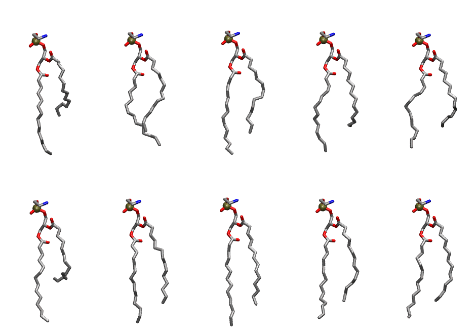

.. _lipid_gallery dmpe:

DMPE
====

**2,3 dimyristoyl-D-glycero-1-Phosphatidylethanolamine**

==============  ==========================================
CHARMM resname  ``DMPE``
Net charge      0.00
Atoms           109
Topology file   ``top_all36_lipid.rtf``
Conformers      10 fluid, 10 liquid-ordered (``DMPE__Lo``)
==============  ==========================================

Structure
---------

Conformers
----------

The grid packer draws a conformer per lipid from an ensemble, so what the ensemble contains is what a built bilayer is made of. DMPE ships two: a fluid one, used by default, and a liquid-ordered one, used for a leaflet declared ``phase: Lo``. All conformers on this page are rendered at one shared scale.

Fluid (``DMPE``)
~~~~~~~~~~~~~~~~

===========  =============  ================  ================
Conformer    Head-tail (Å)  Max internal (Å)  Min chain extent
===========  =============  ================  ================
``DMPE-00``  9.38           22.40             0.73
``DMPE-01``  8.80           21.94             0.69
``DMPE-02``  9.76           21.76             0.64
``DMPE-03``  11.07          23.84             0.84
``DMPE-04``  9.61           23.02             0.79
``DMPE-05``  3.29           22.25             0.40
``DMPE-06``  9.19           24.04             0.76
``DMPE-07``  10.34          22.05             0.70
``DMPE-08``  4.42           24.13             0.47
``DMPE-09``  5.88           25.08             0.56
===========  =============  ================  ================

Liquid-ordered (``DMPE__Lo``)
~~~~~~~~~~~~~~~~~~~~~~~~~~~~~

===========  =============  ================  ================
Conformer    Head-tail (Å)  Max internal (Å)  Min chain extent
===========  =============  ================  ================
``DMPE-00``  7.55           25.07             0.66
``DMPE-01``  10.62          23.54             0.81
``DMPE-02``  11.26          24.76             0.88
``DMPE-03``  9.82           24.00             0.80
``DMPE-04``  9.72           23.19             0.79
``DMPE-05``  6.88           24.56             0.62
``DMPE-06``  11.68          25.23             0.91
``DMPE-07``  12.15          25.64             0.94
``DMPE-08``  11.31          24.54             0.89
``DMPE-09``  11.32          24.32             0.88
===========  =============  ================  ================

*Min chain extent* is how far the least-extended acyl chain descends below its own attachment carbon, as a fraction of that chain's all-trans contour; an all-trans chain scores 1.0, and a conformer under 0.25 is rejected at generation as folded.

Provenance
----------

How each ensemble was generated, read from the entry's own ``info.yaml``:

===================  ============  ============
Setting              ``DMPE``      ``DMPE__Lo``
===================  ============  ============
Sampler              ``mc``        ``mc``
Phase                none (fluid)  Lo
Trans bias           0.0           2.5
Chain order          0.183         0.283
MC seed              0             0
Chains               2             2
Cylinder APL         60.0 Ų       60.0 Ų
Cylinder inflation   1.9           1.9
Equilibration steps  20000         20000
Decorrelation steps  3000          3000
Max MC angle         30°           30°
Radius scale         0.8           0.8
Axial bias           1.0           1.0
===================  ============  ============
