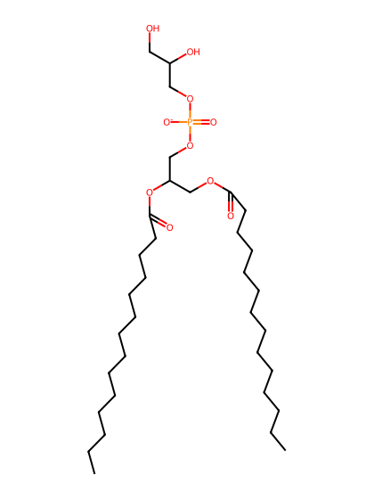
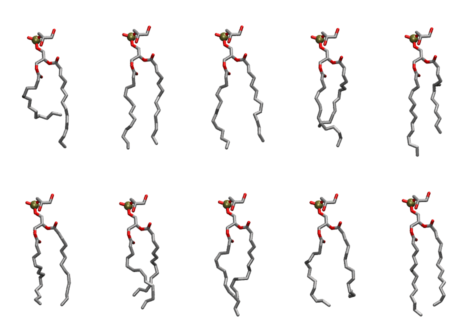

.. _lipid_gallery dmpg:

DMPG
====

**2,3 dimyristoyl-D-glycero-1-Phosphatidylglycerol**

==============  ==========================================
CHARMM resname  ``DMPG``
Net charge      -1.00
Atoms           111
Topology file   ``top_all36_lipid.rtf``
Conformers      10 fluid, 10 liquid-ordered (``DMPG__Lo``)
==============  ==========================================

Structure
---------

Conformers
----------

The grid packer draws a conformer per lipid from an ensemble, so what the ensemble contains is what a built bilayer is made of. DMPG ships two: a fluid one, used by default, and a liquid-ordered one, used for a leaflet declared ``phase: Lo``. All conformers on this page are rendered at one shared scale.

Fluid (``DMPG``)
~~~~~~~~~~~~~~~~

===========  =============  ================  ================
Conformer    Head-tail (Å)  Max internal (Å)  Min chain extent
===========  =============  ================  ================
``DMPG-00``  7.02           23.42             0.44
``DMPG-01``  12.89          23.93             0.85
``DMPG-02``  12.43          23.87             0.85
``DMPG-03``  9.24           22.86             0.72
``DMPG-04``  10.51          24.64             0.80
``DMPG-05``  11.45          22.02             0.71
``DMPG-06``  9.71           22.30             0.75
``DMPG-07``  10.60          23.73             0.80
``DMPG-08``  9.14           22.32             0.71
``DMPG-09``  12.07          24.10             0.86
===========  =============  ================  ================

Liquid-ordered (``DMPG__Lo``)
~~~~~~~~~~~~~~~~~~~~~~~~~~~~~

===========  =============  ================  ================
Conformer    Head-tail (Å)  Max internal (Å)  Min chain extent
===========  =============  ================  ================
``DMPG-00``  7.02           23.42             0.44
``DMPG-01``  12.89          23.93             0.85
``DMPG-02``  12.43          23.87             0.85
``DMPG-03``  9.24           22.86             0.72
``DMPG-04``  10.51          24.64             0.80
``DMPG-05``  11.45          22.02             0.71
``DMPG-06``  9.71           22.30             0.75
``DMPG-07``  10.60          23.73             0.80
``DMPG-08``  9.14           22.32             0.71
``DMPG-09``  12.07          24.10             0.86
===========  =============  ================  ================

*Min chain extent* is how far the least-extended acyl chain descends below its own attachment carbon, as a fraction of that chain's all-trans contour; an all-trans chain scores 1.0, and a conformer under 0.25 is rejected at generation as folded.

Provenance
----------

How each ensemble was generated, read from the entry's own ``info.yaml``:

===================  ============  ============
Setting              ``DMPG``      ``DMPG__Lo``
===================  ============  ============
Sampler              ``mc``        ``mc``
Phase                none (fluid)  Lo
Trans bias           0.0           0.0
Chain order          0.233         0.233
MC seed              0             0
Chains               2             2
Cylinder APL         60.0 Ų       60.0 Ų
Cylinder inflation   1.9           1.9
Equilibration steps  20000         20000
Decorrelation steps  3000          3000
Max MC angle         30°           30°
Radius scale         0.8           0.8
Axial bias           1.0           1.0
===================  ============  ============
