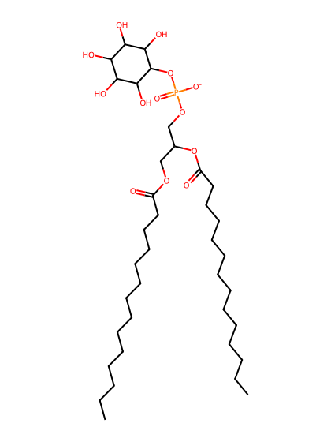
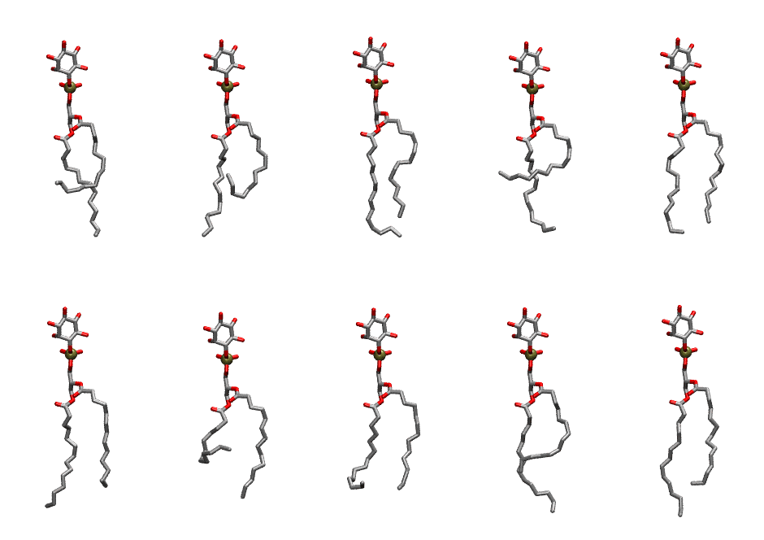
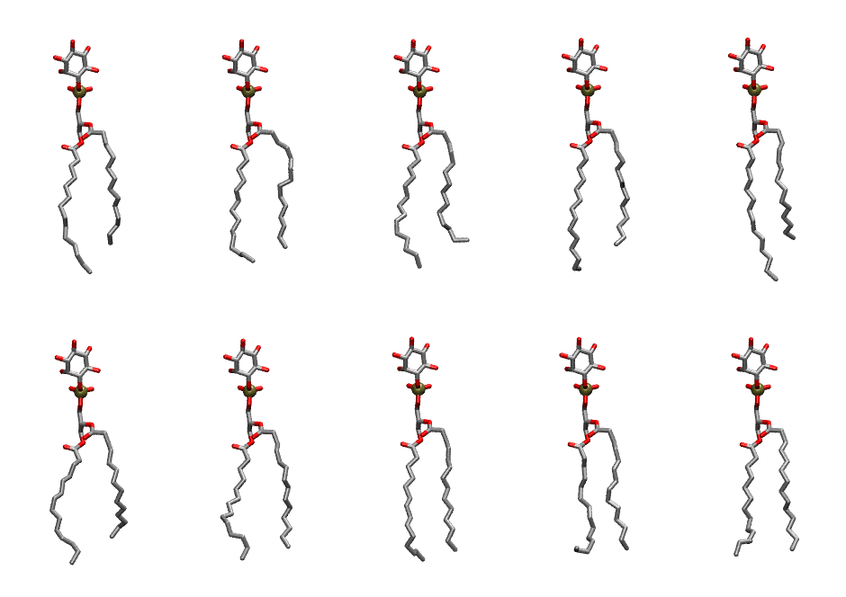

.. _lipid_gallery dmpi:

DMPI
====

**Di-myristoyl-inositol**

==============  ==========================================
CHARMM resname  ``DMPI``
Net charge      -1.00
Atoms           121
Topology file   ``toppar_all36_lipid_inositol.str``
Conformers      10 fluid, 10 liquid-ordered (``DMPI__Lo``)
==============  ==========================================

Structure
---------

Conformers
----------

The grid packer draws a conformer per lipid from an ensemble, so what the ensemble contains is what a built bilayer is made of. DMPI ships two: a fluid one, used by default, and a liquid-ordered one, used for a leaflet declared ``phase: Lo``. All conformers on this page are rendered at one shared scale.

Fluid (``DMPI``)
~~~~~~~~~~~~~~~~

===========  =============  ================  ================
Conformer    Head-tail (Å)  Max internal (Å)  Min chain extent
===========  =============  ================  ================
``DMPI-00``  6.11           27.98             0.48
``DMPI-01``  5.20           27.56             0.42
``DMPI-02``  11.00          28.50             0.77
``DMPI-03``  4.60           27.06             0.39
``DMPI-04``  11.58          27.33             0.77
``DMPI-05``  10.26          28.59             0.73
``DMPI-06``  5.40           26.05             0.31
``DMPI-07``  10.45          25.93             0.61
``DMPI-08``  8.90           29.09             0.65
``DMPI-09``  10.87          29.60             0.77
===========  =============  ================  ================

Liquid-ordered (``DMPI__Lo``)
~~~~~~~~~~~~~~~~~~~~~~~~~~~~~

===========  =============  ================  ================
Conformer    Head-tail (Å)  Max internal (Å)  Min chain extent
===========  =============  ================  ================
``DMPI-00``  11.63          29.47             0.81
``DMPI-01``  12.12          28.34             0.82
``DMPI-02``  11.31          28.63             0.79
``DMPI-03``  11.94          29.62             0.83
``DMPI-04``  11.22          31.08             0.79
``DMPI-05``  10.82          28.20             0.76
``DMPI-06``  12.13          27.94             0.80
``DMPI-07``  12.74          28.53             0.83
``DMPI-08``  12.53          27.54             0.74
``DMPI-09``  12.62          27.45             0.79
===========  =============  ================  ================

*Min chain extent* is how far the least-extended acyl chain descends below its own attachment carbon, as a fraction of that chain's all-trans contour; an all-trans chain scores 1.0, and a conformer under 0.25 is rejected at generation as folded.

Provenance
----------

How each ensemble was generated, read from the entry's own ``info.yaml``:

===================  ============  ============
Setting              ``DMPI``      ``DMPI__Lo``
===================  ============  ============
Sampler              ``mc``        ``mc``
Phase                none (fluid)  Lo
Trans bias           0.0           2.5
Chain order          0.191         0.275
MC seed              0             0
Chains               2             2
Cylinder APL         60.0 Ų       60.0 Ų
Cylinder inflation   1.9           1.9
Equilibration steps  20000         20000
Decorrelation steps  3000          3000
Max MC angle         30°           30°
Radius scale         0.8           0.8
Axial bias           1.0           1.0
===================  ============  ============
