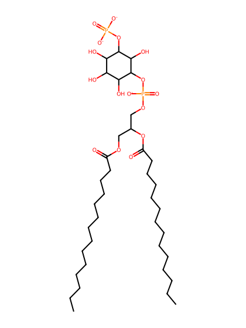
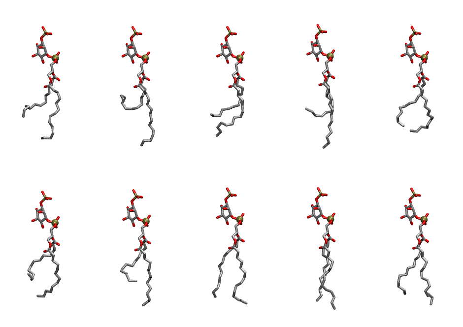
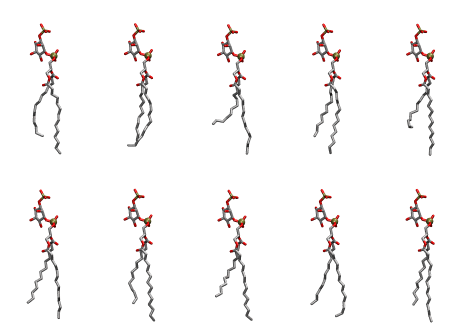

.. _lipid_gallery dmpi13:

DMPI13
======

**Di-myristoyl-inositol-(3)-phosphate (PIP1)**

==============  ============================================
CHARMM resname  ``DMPI13``
Net charge      -3.00
Atoms           124
Topology file   ``toppar_all36_lipid_inositol.str``
Conformers      10 fluid, 10 liquid-ordered (``DMPI13__Lo``)
==============  ============================================

Structure
---------

Conformers
----------

The grid packer draws a conformer per lipid from an ensemble, so what the ensemble contains is what a built bilayer is made of. DMPI13 ships two: a fluid one, used by default, and a liquid-ordered one, used for a leaflet declared ``phase: Lo``. All conformers on this page are rendered at one shared scale.

Fluid (``DMPI13``)
~~~~~~~~~~~~~~~~~~

=============  =============  ================  ================
Conformer      Head-tail (Å)  Max internal (Å)  Min chain extent
=============  =============  ================  ================
``DMPI13-00``  6.76           26.67             0.54
``DMPI13-01``  2.80           28.11             0.30
``DMPI13-02``  6.32           25.59             0.51
``DMPI13-03``  5.50           29.01             0.47
``DMPI13-04``  8.98           25.01             0.63
``DMPI13-05``  5.16           25.02             0.44
``DMPI13-06``  7.07           27.26             0.56
``DMPI13-07``  11.05          27.57             0.78
``DMPI13-08``  12.02          28.86             0.85
``DMPI13-09``  10.35          27.41             0.76
=============  =============  ================  ================

Liquid-ordered (``DMPI13__Lo``)
~~~~~~~~~~~~~~~~~~~~~~~~~~~~~~~

=============  =============  ================  ================
Conformer      Head-tail (Å)  Max internal (Å)  Min chain extent
=============  =============  ================  ================
``DMPI13-00``  11.39          30.07             0.82
``DMPI13-01``  12.38          28.36             0.84
``DMPI13-02``  8.53           29.66             0.65
``DMPI13-03``  11.41          29.72             0.82
``DMPI13-04``  9.35           29.95             0.70
``DMPI13-05``  11.53          29.44             0.83
``DMPI13-06``  11.81          30.57             0.85
``DMPI13-07``  10.07          30.16             0.74
``DMPI13-08``  11.94          29.32             0.86
``DMPI13-09``  12.09          30.62             0.86
=============  =============  ================  ================

*Min chain extent* is how far the least-extended acyl chain descends below its own attachment carbon, as a fraction of that chain's all-trans contour; an all-trans chain scores 1.0, and a conformer under 0.25 is rejected at generation as folded.

Provenance
----------

How each ensemble was generated, read from the entry's own ``info.yaml``:

===================  ============  ==============
Setting              ``DMPI13``    ``DMPI13__Lo``
===================  ============  ==============
Sampler              ``mc``        ``mc``
Phase                none (fluid)  Lo
Trans bias           0.0           7.5
Chain order          0.150         0.306
MC seed              0             0
Chains               2             2
Cylinder APL         60.0 Ų       60.0 Ų
Cylinder inflation   1.9           1.9
Equilibration steps  20000         20000
Decorrelation steps  3000          3000
Max MC angle         30°           30°
Radius scale         0.8           0.8
Axial bias           1.0           1.0
===================  ============  ==============
