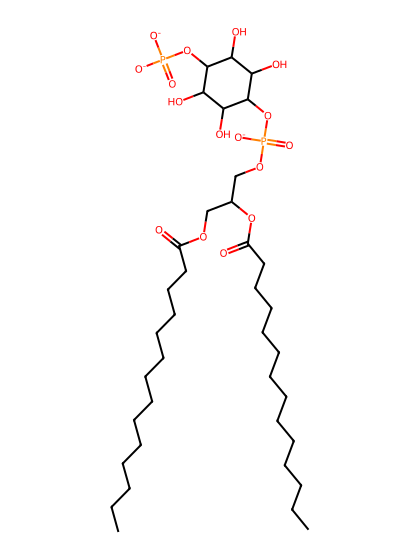
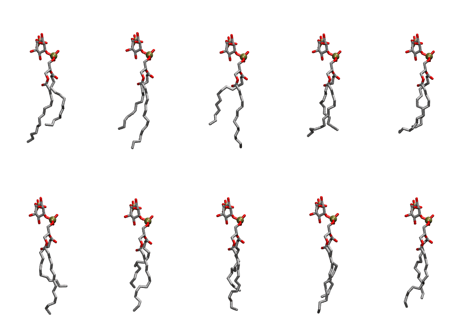
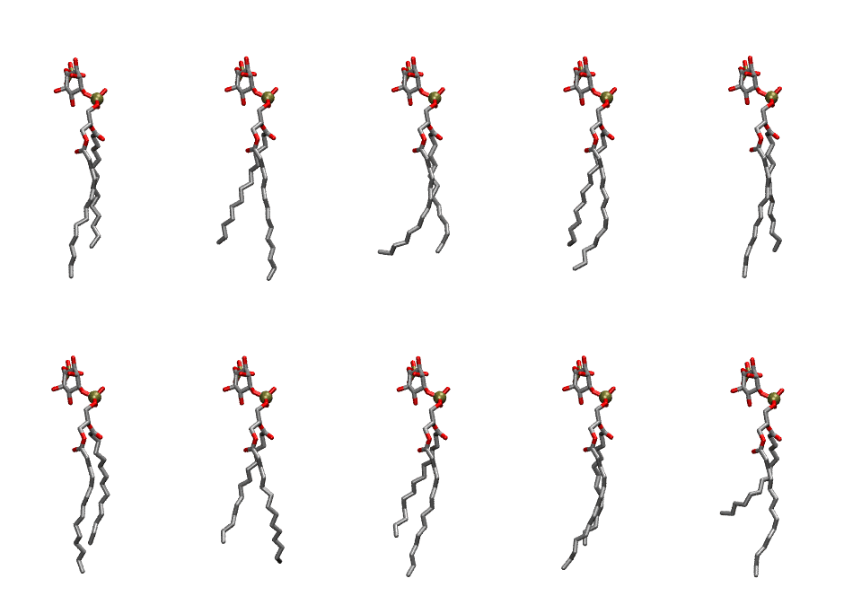

.. _lipid_gallery dmpi14:

DMPI14
======

**Di-myristoyl-inositol-(4)-phosphate (PIP1)**

==============  ============================================
CHARMM resname  ``DMPI14``
Net charge      -3.00
Atoms           124
Topology file   ``toppar_all36_lipid_inositol.str``
Conformers      10 fluid, 10 liquid-ordered (``DMPI14__Lo``)
==============  ============================================

Structure
---------

Conformers
----------

The grid packer draws a conformer per lipid from an ensemble, so what the ensemble contains is what a built bilayer is made of. DMPI14 ships two: a fluid one, used by default, and a liquid-ordered one, used for a leaflet declared ``phase: Lo``. All conformers on this page are rendered at one shared scale.

Fluid (``DMPI14``)
~~~~~~~~~~~~~~~~~~

=============  =============  ================  ================
Conformer      Head-tail (Å)  Max internal (Å)  Min chain extent
=============  =============  ================  ================
``DMPI14-00``  8.97           25.35             0.68
``DMPI14-01``  10.11          27.58             0.75
``DMPI14-02``  8.62           26.52             0.66
``DMPI14-03``  10.04          24.09             0.70
``DMPI14-04``  9.27           23.52             0.64
``DMPI14-05``  8.40           27.47             0.64
``DMPI14-06``  8.35           27.23             0.64
``DMPI14-07``  9.31           26.64             0.70
``DMPI14-08``  11.03          27.61             0.80
``DMPI14-09``  11.03          25.68             0.80
=============  =============  ================  ================

Liquid-ordered (``DMPI14__Lo``)
~~~~~~~~~~~~~~~~~~~~~~~~~~~~~~~

=============  =============  ================  ================
Conformer      Head-tail (Å)  Max internal (Å)  Min chain extent
=============  =============  ================  ================
``DMPI14-00``  11.83          28.50             0.85
``DMPI14-01``  11.49          28.86             0.83
``DMPI14-02``  12.59          25.94             0.78
``DMPI14-03``  11.75          28.11             0.85
``DMPI14-04``  12.53          28.78             0.89
``DMPI14-05``  11.65          27.61             0.84
``DMPI14-06``  11.45          27.05             0.83
``DMPI14-07``  10.66          28.79             0.78
``DMPI14-08``  11.77          27.76             0.85
``DMPI14-09``  7.69           28.88             0.60
=============  =============  ================  ================

*Min chain extent* is how far the least-extended acyl chain descends below its own attachment carbon, as a fraction of that chain's all-trans contour; an all-trans chain scores 1.0, and a conformer under 0.25 is rejected at generation as folded.

Provenance
----------

How each ensemble was generated, read from the entry's own ``info.yaml``:

===================  ============  ==============
Setting              ``DMPI14``    ``DMPI14__Lo``
===================  ============  ==============
Sampler              ``mc``        ``mc``
Phase                none (fluid)  Lo
Trans bias           0.0           7.5
Chain order          0.200         0.307
MC seed              0             0
Chains               2             2
Cylinder APL         60.0 Ų       60.0 Ų
Cylinder inflation   1.9           1.9
Equilibration steps  20000         20000
Decorrelation steps  3000          3000
Max MC angle         30°           30°
Radius scale         0.8           0.8
Axial bias           1.0           1.0
===================  ============  ==============
